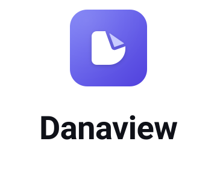
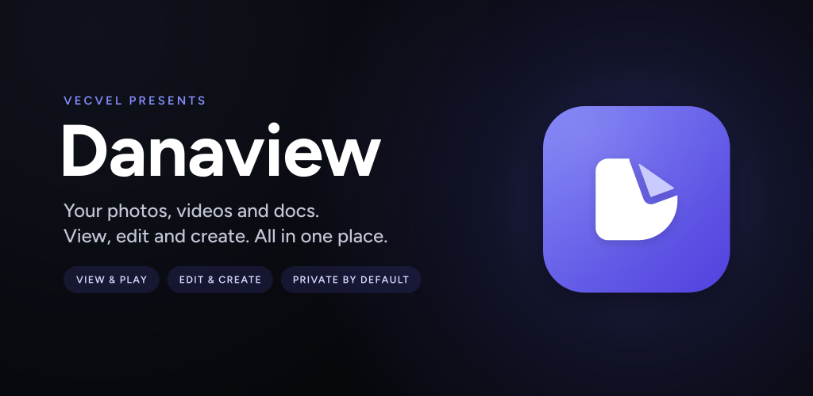

<div align="center">

<picture>
  <source media="(prefers-color-scheme: dark)" srcset="assets/branding/wordmark/danaview_lockup_stacked.svg">
  
</picture>

**Play anything. Edit photos and videos. Capture with your own camera. All on your device.**

*A private, all-in-one media app for iPhone, iPad, Android, macOS, Windows and Linux, built with Flutter, native GPU engines and on-device AI.*

[](https://flutter.dev)
[](https://mpv.io)
[](https://github.com/ggml-org/whisper.cpp)
[](#-platforms)
[](LICENSE)
[](#-sponsor--support)

[Features](#-at-a-glance) · [Roadmap](#%EF%B8%8F-roadmap) · [Player](#-player-available-now) · [Editor](#%EF%B8%8F-video-editor-v11-in-development) · [Platforms](#-platforms) · [Privacy](#-privacy) · [Build](#-getting-started)



</div>

---

## ✨ At a glance

| | What it does | Status |
|---|---|---|
| 🎥 **Player** | Plays almost any video file or network stream, with a 10-band equalizer, 300% volume boost, subtitles, playlists, a queue, diagnostics and built-in network and media tools | ✅ **Available** (v1.0) |
| ✂️ **Video editor** | Multi-track timeline, transitions, keyframes, chroma key, text, LUTs, speed ramps, hardware export and **on-device AI subtitles** on iPhone, iPad and Android | 🚧 **In development** (v1.1) |
| 🗂️ **Files & Media Home** | Your photos, videos and documents in one place, in your own Danaview folders. Open PDFs, Office files and text right in the app, merge, sign or shrink PDFs, and still edit or make a montage in one tap | 🗓️ Planned (v1.2) |
| 🤖 **AI Studio & rich subtitles** | Styled and karaoke captions on device, each speaker on their own caption line even when people talk over each other, and search that finds what's inside your photos and files. Optional bring-your-own-key AI for clean-up, emotion, emojis, translation and smarter search | 🗓️ Planned (v1.2) |
| 🎨 **Photo editing & beauty** | The same editor edits photos (16-bit pipeline, HSL, curves, masks, keystone, batch export) and brings an 8-category beauty suite to photos and moving video | 🗓️ Planned (v1.2) |
| 🖥️ **Desktop editor** | The full photo and video editor on macOS, Windows and Linux, with pro desktop tools | 🗓️ Planned (v1.3) |
| 📷 **Danaview Camera** | A native camera with every control under your thumb, live beauty, pro modes and dual front+back capture. It also scans documents into searchable PDFs and reads QR codes and barcodes, showing you what a code does before anything opens | 🗓️ Planned (v1.3) |

**Legend:** ✅ available · 🚧 in development · 🗓️ planned

---

## 🗺️ Roadmap

| Release | Theme | What ships | Plans |
|---|---|---|---|
| **1.0** ✅ | Player | Cross-platform player on libmpv, library, playlists, queue, tools | – |
| **1.1** 🚧 | Video editor | Multi-track video editor with on-device AI subtitles on iOS, iPadOS and Android | [Architecture](docs/v1.1/editor/ARCHITECTURE.md) · [Build plan](docs/v1.1/editor/BUILD_PLAN.md) |
| **1.2** 🗓️ | Photos and files join videos | Files & Media Home for photos, videos and documents with PDF tools; AI Studio, rich subtitles, speaker lanes and search; photo editing and the beauty suite (iOS, Android; the Home on desktop too) | [Roadmap](docs/v1.2/V1_2_ROADMAP.md) · [Files & Media Home](docs/v1.2/files-media-home/FILES_MEDIA_HOME_PLAN.md) · [AI Studio](docs/v1.2/ai-studio/AI_STUDIO_PLAN.md) · [Photo & video editor](docs/v1.2/video-editor-update/VIDEO_EDITOR_UPDATE_PLAN.md) |
| **1.3** 🗓️ | Everywhere and at capture | The editor on macOS, Windows and Linux; Danaview Camera with document and QR scanning (mobile first, then desktop webcams) | [Roadmap](docs/v1.3/V1_3_ROADMAP.md) · [Desktop editor](docs/v1.3/editor-desktop/DESKTOP_EDITOR_PLAN.md) · [Camera](docs/v1.3/camera-photo-video/NATIVE_CAMERA_PLAN.md) |

---

## 🎥 Player (available now)

<details open>
<summary><b>Everything the player does</b></summary>

### Playback & controls
- Plays local files and network streams through libmpv, with hardware decoding (Auto-safe, Auto or Software).
- Opens mkv, mp4, m4v, mov, avi, webm, ts, m2ts, mts, flv, wmv, ogv, 3gp, mpg and mpeg files.
- Controls fade out after 3 seconds and come back on tap or mouse hover. There's a big Play/Replay button and a loading spinner.
- **Touch gestures:**
  - Tap to show or hide the controls.
  - Double-tap the left or right side to seek back or forward. The step is 5, 10, 15 or 30 seconds (your choice), and repeated taps keep adding to the seek.
  - Double-tap the middle to play or pause.
- **Mouse:** click to play or pause, double-click for fullscreen.
- **Control lock:** hides every control and blocks touches and shortcuts. The unlock button fades away and reappears when you tap.
- **Seek bar:** tap or drag to seek, with a time tooltip, the buffered range and the A-B loop range shown on it.
- **Time display:** tap to switch between elapsed/total and remaining time.
- **Speed:** 0.25× to 3×, with the audio pitch kept natural. The speed is remembered between launches.
- **A-B loop:** set A, set B, clear.
- **Picture:** aspect ratio (Auto, 16:9, 4:3, 2.35:1), zoom from 50% to 300%, and color adjustments (brightness, contrast, saturation, gamma, hue), which are saved per video.
- **Orientation:** a "Rotate screen" button on phones. On iPhone the player follows how the phone is held, and phones keep the library in portrait.
- **Resume where you left off:** the position is saved automatically for every video.
- **Previous / Next:** Previous restarts the current video if it has played for more than 5 seconds.
- The screen stays awake while a video plays.
- **Clear error messages:** missing file, unsupported format, network, permission or audio device. Press Play to retry.
- **Adaptive toolbar:** buttons that don't fit move into a "More options" sheet.

### Audio
- Volume from 0% to 300%, with a highlighted boost zone above 100%, plus mute.
- **10-band graphic equalizer** (31 Hz – 16 kHz, ±12 dB per band).
- **Equalizer presets:** Flat, Rock, Pop, Bass Boost, Vocal / Dialogue, Classical, Cinema. "Custom" appears when you change bands yourself.
- **Night mode** (quiets loud parts and lifts quiet ones), and **loudness normalization** to -16 LUFS.
- **Audio delay:** ±2000 ms, saved per video.
- **Audio track switching.** Matching external audio files load automatically.

### Subtitles
- Subtitle files next to the video, or in a `Subs` / `Subtitles` folder, load automatically.
- Pick a subtitle track or turn subtitles off.
- **Subtitle delay:** ±5000 ms, saved per video.
- Font size (24–96 pt) and outline (0–8 px).
- Subtitles use the app's Figtree font.

### Library, playlists & queue
- **Home:**
  - "Now Playing" card.
  - Quick actions: Open file, Open folder, Open link.
  - **Continue watching:** progress bars, remove from history, clear all.
  - Playlists and folders.
- **Folders:** breadcrumbs, video counts, natural sorting (Episode 2 comes before Episode 10), season/episode badges (S01E02), Play all, Shuffle, Play next, Add to queue.
- **Playlists:** create, rename, delete, play, shuffle, add videos or links, drag to reorder, play from here.
- **Queue:** jump to any item, remove, drag to reorder, shuffle (restores the original order when turned off), repeat Off / All / One, and auto-play of the next video.
- **Open link:** plays http, https, rtsp, rtmp, srt, udp, rtp, mms and file URLs, with a paste button and address checking.
- **Open with Danaview:**
  - Android: open videos from other apps and links.
  - iOS: open from Files and from other apps.
  - macOS: open from Finder.
  - All platforms: `danaview://` links.
- **Drag and drop** of files and folders onto the player (desktop).

### Diagnostics
- **Stats for Nerds:** resolution, FPS, codecs, hardware decoding, dropped and delayed frames, A/V sync, bitrate, audio channels and color space. Copy the report with one tap.

### Settings, tools & account
- **Player settings panel:** Video, Color, Audio & Equalizer, Subtitles, Playback and a Keyboard Shortcuts list.
- **App Settings:**
  - Profile.
  - Tools.
  - Double-tap seek step.
  - About, Privacy Policy, Terms of Use.
- **Tools (built in, no third-party services):**
  - 📶 **Speed test:** ping, download, upload and jitter, with a live dial. Tells you what your connection can handle (4K/1080p/720p streaming, video calls, going live).
  - 🔎 **Stream check:** tells you whether a link will play. Detects HLS/DASH, quality levels, live vs on-demand, seeking support and DRM.
  - 🎞️ **Media info:** container, duration, size, bitrate and every track (codec, profile, language, HDR, rotation).
  - 📊 **Data usage calculator:** data needed for a watch time, or watch time for a data allowance, by quality.
  - 🗄️ **Storage & history:** app video and cache size, clear watch history, resume points or cache. Your videos are never deleted.
- **Profile:** name, email, phone and date of birth, stored on the device only.
- **About:** version and contact support.

### Desktop
- Custom title bar showing the video title, always-on-top pin and fullscreen. Windows and Linux get window buttons.
- On macOS the window reopens from the Dock, and there's a Main Window menu item.
- Keyboard shortcuts (see below).

</details>

---

## ✂️ Video editor (v1.1, in development)

Built natively for **iPhone, iPad and Android** (iOS 15+, Android 10+). The iOS engine uses AVFoundation, Core Image and Metal; the Android engine uses Media3 and OpenGL ES. Both render the same project the same way, checked by frame-by-frame parity tests. On desktop the editor arrives in 1.3.

<details>
<summary><b>Full v1.1 feature list</b></summary>

**Opening the editor**- Edit button on the Home screen, next to Settings.
- **Edit** while a video is playing, starting at the current position.

**Projects & timeline**
- Create, save, rename, duplicate, reopen and delete projects. Autosave, crash recovery and project format upgrades.
- **Non-destructive:** your original media is never modified, moved, renamed or deleted.
- **Multi-track timeline:** multiple video, audio, text, subtitle and image/overlay tracks.
- **Timeline view:** zoom and scroll, playhead and time ruler, snapping to clips, markers and the playhead.
- Single and multi-select, track lock, visibility, mute and solo.
- Clip thumbnails, audio waveforms, clip duration and details.
- Full undo/redo history.
- Detects missing media and lets you relink it. Media management.

**Basic editing**
- Import video, audio and images.
- Cut, trim, split, delete, duplicate, copy/paste and move.
- Ripple delete, ripple insert and replace media.
- Freeze frame, reverse video, frame-accurate seeking and markers.

**Transform**
- Position, scale, rotation, horizontal and vertical flip, crop, opacity and aspect ratio.
- Drag directly in the preview to adjust, and reset the transform in one tap.

**Speed**
- 0.25×, 0.5×, 0.75×, 1×, 1.25×, 1.5×, 2×, 3× and 4×, or a custom speed.
- Speed ramping.
- The audio pitch stays natural and audio stays in sync.

**Text**
- Text overlays with font, size, bold/italic, alignment, color, opacity, letter and line spacing, background, outline and shadow.
- Position, rotation, scale and duration.
- Animations: Fade, Slide, Scale and Typewriter.

**Subtitles**
- Create, edit, retime, move, split, merge and delete subtitles.
- Style them and position them on a subtitle track.
- Import and export SRT and VTT.
- Burn subtitles into the exported video.

**AI subtitles (on-device)**
- Generate subtitles straight from a video or audio clip in the language you choose.
- Processing:
  - Extracts the audio.
  - Turns speech into text with timestamps.
  - Splits the text into subtitles automatically.
- The generated subtitles are added to the timeline and are fully editable.
- Regenerate them, export them as SRT/VTT, or burn them into the exported video.
- **Private:**
  - Runs entirely on your device with whisper.cpp.
  - The speech model downloads once, only after you agree.
  - After that it works offline.
- Captions are the only AI feature in v1.

**Audio**
- Multiple audio tracks.
- Import audio, or extract it from video.
- Trim, split, move, duplicate and delete.
- Volume, fade in/out, mute and waveforms.
- Background music, voice recording where supported, and audio sync.

**Effects & color**
- Brightness, contrast, saturation, exposure, highlights, shadows, temperature and tint.
- Sharpness, blur, vignette and opacity.
- Color presets.
- `.cube` LUT import with an intensity control.

**Transitions**
- Fade, cross dissolve, dip to black, dip to white, slide, wipe and zoom.
- Adjustable duration and direction, with a preview.

**Picture-in-picture & compositing**
- Video over video and image over video, with multiple overlays.
- Resize, move, rotate, crop, opacity and independent timing.
- **Chroma key:**
  - Green screen or a custom key color.
  - Similarity, smoothness and spill reduction.
  - Live preview.
- **Masks:** rectangle and circle, with position, size, feather and opacity.

**Keyframes**
- Animate position, scale, rotation, opacity, volume and basic effects.
- Add, remove, move and edit keyframes, with linear interpolation.

**Preview**
- Real-time timeline preview with play/pause and frame/time seeking.
- Fullscreen preview.
- Preview quality options.
- Current time and duration display.

**Export**
- Real video rendering, hardware-accelerated where supported.
- **Formats:**
  - MP4, and MOV where supported.
  - H.264, and H.265 where supported.
- Choose the resolution, FPS, video bitrate and audio bitrate.
- **Presets:** quality presets, YouTube, YouTube Shorts, Instagram and TikTok, or custom settings.
- Export progress and cancel.
- Background rendering where supported.

**Performance**
- Thumbnail and waveform caches and proxy media.
- Lazy timeline drawing and background workers.
- Large-project support.

**Touch & keyboard**
- **Touch:**
  - Drag clips, trim handles and split controls.
  - Pinch to zoom the timeline, long-press menus and touch preview controls.
  - A bottom editing toolbar with tool tabs and bottom sheets.
- **Keyboard (iPad and Android tablets):**
  - Editor shortcuts (see below).
  - Mouse and trackpad timeline control.
  - Drag and drop of media.

</details>

---

## 🔭 Coming next

### 🗂️ Files & Media Home (v1.2)
- One home for **photos, videos and documents**: filter by All, Videos, Photos or Documents, and narrow documents down to PDF, Word, Excel, PowerPoint or text/CSV. The classic Home stays exactly as it is: Now Playing, Continue Watching, playlists, folders, queue and stream links all keep working.
- **Your own Danaview folders:** make, rename, move and nest folders and mix any kind of file in them. They live inside Danaview and come along in your phone's backups. Favourites, recents, search and sorting by name, date, size or type.
- **Bring files in, get them out:** import from Photos or your Gallery, from Files, or "Open with Danaview" from another app. Your originals are never touched. Send things out with Save to Files (iPhone), Save to Downloads (Android) or the share sheet.
- **Open things right here:** photos and videos as before, PDFs in a proper PDF viewer, and Word, Excel, PowerPoint and text files in a quick preview on iPhone, iPad and Mac. On Android, text and CSV open in the app and Office files hand off to the app you already use. Viewing only, no Office editing.
- **PDF tools:** merge, split, reorder, rotate and delete pages, highlight and add notes, sign, and shrink big PDFs.
- Albums and device folders, a fast grid for libraries of 50,000+ items, a full-screen photo viewer, and **Make Video Montage** from any mix of photos and videos.

### 🤖 AI Studio & rich subtitles (v1.2)
- **On device:** style any word of a caption, place lines anywhere, word-by-word karaoke from the AI subtitle timings, a transcript view, timing tools, font import (`.ttf`/`.otf`), style presets, and support for Indic, Arabic, Hebrew and Thai scripts.
- **Who said what:** Danaview can work out who is speaking, right on your phone, and give each person their own caption line with their own look. When two people talk at once, both get their own captions at the right time instead of one jumbled line. Rename speakers to real names in a tap.
- **Search that looks inside:** find a photo by what's in it, a scan by the words on it, or a video by what was said. The search index stays on your device.
- **AI Studio, off by default:** bring your own key for Google Gemini, OpenAI, Anthropic Claude, OpenRouter or xAI Grok to clean up transcripts, detect emotion and tone, add emojis, label speakers and translate subtitle tracks. It can also turn a plain question like "receipts from last March" into a search (only your question is sent), and, if you choose a folder, describe its photos and files so you can search them by meaning.
- **Nothing is sent without your Send.** Every request shows exactly what goes where; every AI result is a suggestion you accept or reject, and accepting can be undone. Keys stay in the iOS Keychain or Android Keystore.

### 🎨 Photo editing & beauty suite (v1.2)
- Open a photo and the editor switches to **photo mode**: 16-bit processing, exposure, contrast, highlights, shadows, whites, blacks, clarity, dehaze, an 8-channel HSL mixer, RGB curves, gradient and brush masks, crop and perspective keystone, text and stickers, copy/paste looks, batch export (JPEG, PNG, WebP, HEIC), and **Add to Video Project** with Ken Burns motion.
- **8-category beauty suite** for photos and video clips: face shape, eyes and brows, nose and lips, skin, makeup, body, filters and presets, with face tracking that stays steady on moving video, up to 4 faces, and keyframes.
- Originals are never changed: photo edits are saved as `.dnphoto` recipes, video as `.dnproj` projects.

### 🖥️ Desktop editor (v1.3)
- **Every phone editing feature** on macOS, Windows and Linux: video, photo mode, beauty, AI subtitles and AI Studio.
- **Engines:** macOS shares the tested iOS engine; Windows and Linux share one engine written in Rust with GPU rendering (Direct3D 12 / Vulkan) and hardware decode and encode (Media Foundation, GStreamer).
- **Crash-safe by design:** memory-safe Rust, a crash fence on every native call, and unusual formats (MKV, WebM, AVI, ProRes) opened by an isolated helper process that converts them on import.
- **Desktop extras:** 4K preview without proxies, GPU-accelerated AI subtitles, batch export queue, ProRes export (macOS), colour scopes, a 3-pane workspace, Select/Razor/Slip/Ripple tools, J-K-L shuttle and native menus.

### 📷 Danaview Camera (v1.3)
- **Every control under your thumb:** a haptic dial for zoom, exposure, ISO, shutter, focus, white balance and beauty strength; a quick bar you arrange yourself; saved **My Modes**; a left-handed layout.
- **Fast to reach and to shoot:** volume buttons and the iPhone Camera Control as shutter, launch from the lock screen, Control Center or Android Quick Settings, viewfinder in about half a second, zero shutter lag where the phone supports it.
- **Native pro features:** ProRAW, Apple Log and ProRes on supporting iPhones; RAW and 10-bit HLG on supporting Android phones; the phone's own Night, HDR and portrait modes where available; manual ISO, shutter, focus with peaking, zebra stripes and a histogram.
- **Live beauty, filters, LUTs and overlays** with the same look as the editor; **dual front+back capture** with picture-in-picture shapes; audio routing (mic, device audio where the platform allows, or both on separate tracks).
- **Keep editable:** save the clean original plus a recipe so the editor can change the beauty, filter or overlays later.
- **Scan documents:** point at a page and it finds the edges, snaps it straight and cleans it up in colour, greyscale or black and white. Text is read on your phone, so the PDF is searchable and you can copy from it. Turn photos into a PDF too, then share it or save it to your Danaview folders, Files or Downloads.
- **QR codes and barcodes:** scan live, in a dedicated mode, or from a screenshot. You always see what a code will do before anything happens: the real web address with a warning if it looks fishy, Wi-Fi to join, a contact or event to add, a product number to look up.
- **Pay with your own UPI app:** payment QR codes show who you're paying and how much, then open GPay, PhonePe, Paytm, BHIM or whichever app you use. Danaview never touches your money or your payment details.
- **Save codes for later:** keep a bill's QR with a name, a note and a reminder ("pay the electricity bill"), show it full screen for someone else to scan, or tap Pay when it's due.
- iPhone and Android first, then macOS (webcams and iPhone as a webcam), then Windows and Linux webcams.

---

## 💻 Platforms

| Platform | Player | Video editor | Photo editing & beauty | AI Studio | Camera |
|---|---|---|---|---|---|
| **iOS / iPadOS** | ✅ | 🚧 v1.1 (iOS 15+) | 🗓️ v1.2 | 🗓️ v1.2 | 🗓️ v1.3 |
| **Android** | ✅ | 🚧 v1.1 (Android 10+) | 🗓️ v1.2 | 🗓️ v1.2 | 🗓️ v1.3 |
| **macOS** | ✅ | 🗓️ v1.3 | 🗓️ v1.3 | 🗓️ v1.3 | 🗓️ v1.3 (webcams, iPhone as webcam) |
| **Windows** | ✅ | 🗓️ v1.3 | 🗓️ v1.3 | 🗓️ v1.3 | 🗓️ v1.3 or 1.3.x (webcams) |
| **Linux** | ✅ | 🗓️ v1.3 (supported with diagnostics) | 🗓️ v1.3 | 🗓️ v1.3 | 🗓️ v1.3 or 1.3.x (webcams) |

Features a device can't support (for example dual cameras, depth, manual shutter on basic webcams, or a hardware encoder) are **hidden, not greyed out**.

---

## 🔒 Privacy

- **On device by default.** Playback, editing, AI subtitles, photo editing, beauty and the camera run on your device and work offline.
- **The only downloads** are the speech model for AI subtitles, after you agree, and (planned, Linux only) a one-time encoder download on machines without a hardware encoder.
- **AI Studio is optional and off by default.** When you turn it on, requests go only to the provider you choose, with your own key, after you press Send.
- **Your originals are never changed,** moved or deleted by the editor. No telemetry, no accounts, no ads.

---

## ⌨️ Keyboard shortcuts

**Player** ✅

| Shortcut | Action |
|---|---|
| <kbd>Space</kbd> / <kbd>K</kbd> | Play / Pause |
| <kbd>←</kbd> / <kbd>→</kbd> | Seek -5 s / +5 s |
| <kbd>J</kbd> / <kbd>L</kbd> | Seek -10 s / +10 s |
| <kbd>↑</kbd> / <kbd>↓</kbd> | Volume +5% / -5% (up to 300%) |
| <kbd>M</kbd> | Mute |
| <kbd>F</kbd> | Fullscreen |
| <kbd>Esc</kbd> | Close open panels, or leave fullscreen |
| <kbd>T</kbd> | Always on top |
| <kbd>[</kbd> / <kbd>]</kbd> | Speed -0.1× / +0.1× |
| <kbd>I</kbd> | Stats for Nerds |
| <kbd>P</kbd> | Queue |
| <kbd>O</kbd> | Open files |
| <kbd>C</kbd> | Next subtitle track |
| <kbd>#</kbd> | Next audio track |
| <kbd>⌘</kbd>/<kbd>Ctrl</kbd> + <kbd>,</kbd> | Player settings |

**Editor** 🚧 (v1.1 on iPad and Android tablets with a keyboard; desktop tools arrive in v1.3)

| Shortcut | Action |
|---|---|
| <kbd>Space</kbd> / <kbd>K</kbd> | Play / Pause |
| <kbd>←</kbd> / <kbd>→</kbd> | Previous / next frame |
| <kbd>S</kbd> / <kbd>⌘</kbd>+<kbd>B</kbd> | Split clip at the playhead |
| <kbd>Delete</kbd> / <kbd>Backspace</kbd> | Delete selected |
| <kbd>⌘</kbd>/<kbd>Ctrl</kbd> + <kbd>Z</kbd> | Undo |
| <kbd>⌘</kbd>/<kbd>Ctrl</kbd> + <kbd>Shift</kbd> + <kbd>Z</kbd> | Redo |
| <kbd>⌘</kbd>/<kbd>Ctrl</kbd> + <kbd>C</kbd> / <kbd>V</kbd> | Copy / paste |
| <kbd>⌘</kbd>/<kbd>Ctrl</kbd> + <kbd>D</kbd> | Duplicate |
| <kbd>J</kbd> / <kbd>L</kbd> | Shuttle reverse / forward, 1× to 8× (v1.3 desktop) |
| <kbd>I</kbd> / <kbd>O</kbd> | Mark in / out (v1.3 desktop) |
| <kbd>V</kbd> · <kbd>C</kbd> · <kbd>Y</kbd> · <kbd>B</kbd> | Select · Razor · Slip · Ripple tools (v1.3 desktop) |

---

## 🏗️ Project structure

Danaview is a Flutter and Dart monorepo with strict package boundaries.

```
danaview/
├── lib/                              App root, composition root, router
├── packages/
│   ├── danaview_domain/              Pure Dart player and media models
│   ├── danaview_engine/              libmpv / media_kit playback engine
│   ├── danaview_data/                Storage, natural sort, sessions, tools
│   ├── danaview_ui_kit/              Design system: Figtree, custom components
│   ├── danaview_platform/            Window, orientation and wakelock bridges
│   ├── danaview_features/            Player, library, queue and settings screens
│   ├── danaview_editor/              Editor UI: projects, timeline, preview, panels, export
│   ├── danaview_editor_core/         Pure Dart editing model, commands, history, RenderPlan, storage
│   ├── danaview_editor_engine_api/   Engine contract, fake engine, reference renderer, render prep
│   ├── danaview_editor_engine/       Native engines: Swift + Metal (iOS), Kotlin + Media3 (Android)
│   ├── danaview_editor_fonts/        Bundled content fonts for text and subtitles
│   ├── danaview_transcription/       AI subtitle pipeline, model store, captions
│   └── danaview_whisper/             whisper.cpp (vendored) FFI plugin
├── docs/
│   ├── v1.1/editor/                  Video editor architecture, build plan, designs, spikes
│   ├── v1.2/                         Files & Media Home, AI Studio, photo & video editor update
│   └── v1.3/                         Desktop editor, Danaview Camera
├── scripts/ci/editor/                Editor CI scripts (core, Flutter packages, iOS, Android, whisper)
└── test/                             App-level tests
```

---

## 🚀 Getting started

### Prerequisites
- [Flutter SDK](https://docs.flutter.dev/get-started/install) 3.44 (stable)
- Xcode 26 for iOS and macOS
- Android Studio with the Android SDK, NDK and CMake 3.22.1 for Android and the AI subtitle engine
- Visual Studio with C++ build tools for Windows

### Run
```bash
git clone https://github.com/vecvel/danaview.git
cd danaview
flutter pub get
```

```bash
flutter run -d macos
```

The editor is in development and switched off by default. To try it on a phone or simulator:

```bash
flutter run -d ios --dart-define=DANAVIEW_EDITOR=true
```

```bash
flutter run -d android --dart-define=DANAVIEW_EDITOR=true --dart-define=DANAVIEW_AUTO_CAPTIONS=true
```

### Test
```bash
flutter test
```

```bash
./scripts/ci/editor/core.sh
```

---

## 💖 Sponsor & support

If Danaview is useful to you, sponsoring helps keep it moving:

- 💖 **GitHub Sponsors:** [github.com/sponsors/vecvel](https://github.com/sponsors/vecvel)
- ☕ **Buy Me a Coffee:** [buymeacoffee.com/vecvel](https://buymeacoffee.com/vecvel)
- 🌐 **GitHub:** [github.com/vecvel](https://github.com/vecvel)
- ✉️ **Support:** support@vecvel.com

---

## 📄 License & conduct

- **License:** Proprietary. Copyright © 2026 vecvel. All rights reserved. See [`LICENSE`](LICENSE).
- **Code of conduct:** see [`CODE_OF_CONDUCT.md`](CODE_OF_CONDUCT.md).
