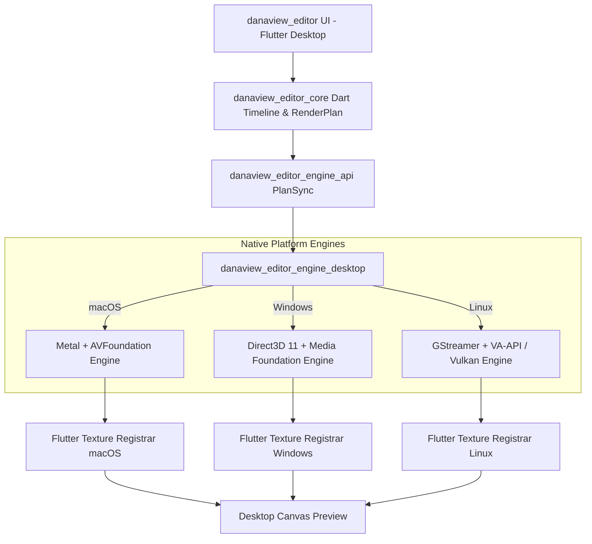

# Danaview 1.2.0: Desktop Video Editor (macOS, Windows & Linux)

> **Release:** Danaview 1.2.0 (app version `1.2.0+N`). **Date:** 2026-10-12. **Status:** Proposal & Architectural Draft.
> **Baseline:** `docs/v1.1/video-editor/ARCHITECTURE.md` (decisions D-01 to D-44, "ARCH"), `docs/v1.1/video-editor/BUILD_PLAN.md` (M0–M6), and `docs/v1.2/ai-studio/AI_STUDIO_PLAN.md` (decisions D-45 to D-70, "AIS").
> **Context:** ARCH §25 explicitly laid out the foundation for desktop editing ("Desktop later (designed now, not built)"). This document formalizes the architecture, native engines, UX enhancements, and rollout plan for **macOS, Windows, and Linux**, shipping alongside the AI Studio initiative in Danaview 1.2.0.
> **Decisions:** Proposes decisions **D-71 to D-85**. Decisions marked **[OWNER]** require confirmation from the product owner.

---

## 0. Contents

1. Summary, Goals, and Non-Goals
2. Product & Architectural Decisions (D-71 to D-85)
3. Multi-Platform Desktop Engine Architecture
   - 3.1 macOS Engine (Metal + AVFoundation via Darwin Unification)
   - 3.2 Windows Engine (Media Foundation + Direct3D 11/12)
   - 3.3 Linux Engine (GStreamer 1.x / VA-API + Vulkan/OpenGL)
   - 3.4 Audio Subsystems (CoreAudio, WASAPI, PipeWire/PulseAudio)
   - 3.5 Desktop on-device Whisper (Metal / AVX2 / CUDA)
4. Desktop UX, Workspaces & Interaction Model
   - 4.1 Three-Pane Pro Layout & Resizable Panels
   - 4.2 Precision Desktop Timeline & Cursor Tools (Razor, Slip, Ripple)
   - 4.3 Mouse, Wheel & Keyboard Interaction Matrix (J-K-L Shuttle, Hotkeys)
   - 4.4 Multi-Monitor & Detached Canvas Preview
   - 4.5 Native Drag-and-Drop & File System Integration
5. Hardware Capabilities & Graceful Degradation Matrix
6. Implementation Ticket Breakdown (DSK-01 to DSK-20)
7. Verification & Parity Guarantees

---

## 1. Summary, Goals, and Non-Goals

### 1.1 Summary

In Danaview 1.1.0, the video editor was introduced for iPhone, iPad, and Android, while the desktop platforms (macOS, Windows, Linux) had their editor entry points hidden (`ARCH §3.3, §25, D-17`). However, the player already thrives across all five platforms, powered by Flutter and `libmpv`.

Danaview 1.2.0 brings the **non-destructive video editor to Desktop**:

1. **macOS**: Full native acceleration utilizing AVFoundation, Core Image, and Metal, sharing ~90% of the tested iOS Darwin codebase.
2. **Windows**: High-performance Media Foundation and Direct3D 11 rendering pipeline with hardware-accelerated NVENC, Intel QuickSync, and AMD AMF video encoding.
3. **Linux**: Modern modular pipeline leveraging GStreamer 1.x, VA-API hardware decoding, and Vulkan/EGL texture sharing, with clear fallback handling for minimal desktop environments.
4. **Desktop-Class UX**: Adapts the mobile inspector/dock model into an expansive, responsive 3-pane workstation with multi-monitor support, dedicated razor cut tool, J-K-L scrub shuttling, native drag-and-drop, and comprehensive keyboard shortcuts.

### 1.2 Goals

| #        | Goal                                                                                                                                                                                        | Guaranteed In                                  |
| -------- | ------------------------------------------------------------------------------------------------------------------------------------------------------------------------------------------- | ---------------------------------------------- |
| **G-D1** | **Zero Core/API Duplication**: Desktop runs on the exact same `danaview_editor_core` domain models, RenderPlan schema, command history, and lowering pipelines without code divergence.     | ARCH §2, D-01, D-02, D-71                      |
| **G-D2** | **Render Parity**: A `.dnproj` file rendered on macOS, Windows, or Linux exports pixel-perfect and frame-exact matching output against iOS and Android within standard parity tolerance.    | D-04, D-71, `render_parity_test.dart` (DSK-18) |
| **G-D3** | **Hardware Acceleration**: GPU composition and hardware H.264/HEVC encoding are utilized on all supported desktop platforms where hardware encoders are present.                            | D-72, D-73, D-74, D-79                         |
| **G-D4** | **Desktop-First Ergonomics**: Native mouse wheel timeline zooming (`Cmd/Ctrl + Wheel`), razor blade tool (`C`), playhead scrubbing, marquee multi-selection, and J-K-L transport shortcuts. | D-75, D-76; DSK-12                             |
| **G-D5** | **Offline & Privacy Invariance**: Full editor and subtitle workflows operate 100% locally and offline on desktop. AI Studio remains strictly opt-in with explicit disclosure.               | AIS G-S1, G-S2, D-45                           |
| **G-D6** | **Owner Standing UI Compliance**: Desktop UI uses custom `danaview_ui_kit` components, Figtree typography, dark UI surfaces, computed contrast, and zero raw Material widgets.              | ARCH §1.3; DSK-13                              |

### 1.3 Non-Goals for 1.2.0 Desktop

- **Non-integer project frame rates**: Desktop adheres to v1's integer timeline grid (24, 25, 30, 48, 50, 60 fps; D-03).
- **Third-party plugin ecosystems**: No OpenFX, VST3, or AU plugin hosting in 1.2.0.
- **Complex multi-camera synchronization**: Switching live multicam angles remains a future release roadmap item.
- **Direct cloud project sync**: Projects remain local `.dnproj` files; external cloud sharing relies on local file sync (iCloud, OneDrive, Dropbox).

---

## 2. Product & Architectural Decisions (D-71 to D-85)

| ID       | Decision (Summary)                                                                                                                | Owner?      |
| -------- | --------------------------------------------------------------------------------------------------------------------------------- | ----------- |
| **D-71** | Unified desktop plugin structure: `danaview_editor_engine_desktop` implementing `danaview_editor_engine_api`.                     | –           |
| **D-72** | macOS engine: Unify Darwin native source with iOS (AVFoundation, Core Image, Metal).                                              | –           |
| **D-73** | Windows engine: Media Foundation source reader + Direct3D 11 texture sharing and MFT hardware encoders.                           | –           |
| **D-74** | Linux engine: GStreamer 1.x pipeline + VA-API / NVDEC with OpenGL/Vulkan texture streaming; diagnostic fallback report.           | **[OWNER]** |
| **D-75** | Desktop timeline interaction model: dedicated cursor tool modes (Select `V`, Razor `C`, Slip `Y`, Ripple `B`).                    | **[OWNER]** |
| **D-76** | Desktop transport shortcuts: industry-standard J-K-L multi-speed shuttling, space toggle, marker navigation.                      | –           |
| **D-77** | Native drag-and-drop: integration with `desktop_drop`, resolving file drops into non-destructive local assets.                    | –           |
| **D-78** | Multi-monitor & detached preview window: secondary display presentation mode via Flutter multi-window.                            | **[OWNER]** |
| **D-79** | Hardware export encoders: VideoToolbox (macOS), Media Foundation MFT (Windows), VA-API / FFmpeg (Linux).                          | –           |
| **D-80** | Desktop Whisper speech-to-text packaging: dynamic backend selection (Metal on macOS, AVX2/OpenBLAS on Windows/Linux).             | –           |
| **D-81** | Desktop file access permissions: App Sandbox security-scoped bookmarks on macOS, Windows long paths (`\\?\`), Linux portal paths. | –           |
| **D-82** | Responsive desktop layout: collapsible 3-pane layout preserving mobile inspector panels in desktop dock.                          | –           |
| **D-83** | Native application menu bar and system context menus: integration with macOS Menu Bar and platform shortcuts.                     | –           |
| **D-84** | Missing media resolution on desktop: recursive `findInSameFolder` and automatic relative path relinking.                          | –           |
| **D-85** | Feature flags & platform gating: compile-time `DANAVIEW_DESKTOP_EDITOR` with runtime capability probing.                          | –           |

### D-71 · Unified Desktop Plugin Structure

- **Architecture**: A single federated plugin `packages/danaview_editor_engine_desktop` implements `EditorEngine` from `danaview_editor_engine_api`.
- **Platform Separation**:
  - `macos/`: Swift & Metal classes reusing `sharedDarwinSource: true` with `danaview_editor_engine/darwin/`.
  - `windows/`: C++20 implementations using Windows Media Foundation (`IMFSourceReaderEx`, `IMFSinkWriter`) and DirectX 11.
  - `linux/`: C++ / GStreamer 1.20+ with GstAppSink / EGL texture sharing.
- **Consequence**: Keeps platform-specific native compilation encapsulated without bloating mobile builds.

### D-72 · macOS Engine Unification

- **Approach**: macOS reuses the proven iOS engine code. AVFoundation handles media demuxing, Core Image and Metal shaders process the RenderPlan layer graph (D-08 effect order, D-07 `.vlut`, D-06 `.vsprite`), and Metal textures are registered with Flutter's macOS texture registrar (`FlutterTexture`).
- **Memory**: Unified memory on Apple Silicon allows zero-copy texture sharing between Metal and Flutter.

### D-73 · Windows Media Foundation & D3D11 Pipeline

- **Approach**: Windows uses `IMFSourceReader` with hardware DXVA2/D3D11 acceleration enabled. Video frames are decoded directly into `ID3D11Texture2D` surfaces. The RenderPlan layer pipeline is evaluated via HLSL shaders matching the Metal reference shaders.
- **Flutter Interop**: Direct3D 11 texture sharing via `flutter_windows` texture registrar.

### D-74 · Linux Engine & Capability Fallback **[OWNER]**

- **Approach**: GStreamer 1.x pipeline (`playbin3` / custom `parsebin` + `vaapidecodebin` / `nvcodec`) with GL/Vulkan texture sharing.
- **Graceful Fallback**: On minimal or non-accelerated Linux distributions, software decoding (CPU fallback via `ffmpeg / swscale`) is enabled. If hardware encoding is absent, software H.264 (`x264enc`) is used.
- **Owner Note**: Confirm whether Linux support is marked Tier-1 (fully certified) or Community-Supported Tier-2 with diagnostic checks.

### D-75 · Desktop Timeline & Cursor Tools **[OWNER]**

- **Modes**:
  1. **Selection Tool (`V`)**: Default. Move, select, trim clip head/tail.
  2. **Razor Tool (`C`)**: Clicking any clip on the playhead or cursor splits the clip at the exact hover timestamp.
  3. **Slip Tool (`Y`)**: Drags the underlying source media without changing the clip's timeline in/out positions.
  4. **Ripple Edit Tool (`B`)**: Trimming a clip ripples downstream tracks automatically.
- **Owner Note**: Confirm whether Razor should split all unlocked overlapping tracks or only the hovered track by default (Recommendation: hovered track; `Shift+Click` splits all tracks).

### D-76 · Desktop Transport Shortcuts & J-K-L Shuttling

- **Shortcuts**:
  - `Space`: Play / Pause toggle.
  - `J`: Reverse play (1×, 2×, 4×, 8× on repeated presses).
  - `K`: Pause.
  - `L`: Forward play (1×, 2×, 4×, 8× on repeated presses).
  - `Left / Right Arrow`: Step 1 frame backward / forward.
  - `Shift + Left / Right Arrow`: Step 1 second backward / forward.
  - `I` / `O`: Mark In / Out points for export or range edits.
  - `Cmd/Ctrl + Z` / `Cmd/Ctrl + Shift + Z`: Undo / Redo.
  - `Cmd/Ctrl + B` or `Cmd/Ctrl + K`: Split clip at playhead.

---

## 3. Multi-Platform Desktop Engine Architecture



### 3.1 macOS Engine (`darwin/`)

- Shares code with iOS under `packages/danaview_editor_engine/darwin/`.
- **Decoding**: `AVAssetReader` with `kCVPixelBufferMetalCompatibilityKey`.
- **Composition**: Metal pipeline executing Danaview fragment shaders:
  - Chroma keying with spill suppression (D-08).
  - Exposure, contrast, saturation, temperature, tint grading.
  - 3D LUT sampling via 2D tiled texture (D-07 `.vlut`).
  - Gaussian blur passes and unsharp mask.
  - Geometry transform, canvas mask clipping, and `.vsprite` overlay (D-06).
- **Export**: `AVAssetWriter` configured for ProRes, H.264, or HEVC (Hardware VideoToolbox).

### 3.2 Windows Engine (`windows/`)

- Written in modern C++20.
- **Decoding**: Windows Media Foundation (`IMFSourceReaderEx`) configured with `MF_SOURCE_READER_ENABLE_ADVANCED_VIDEO_PROCESSING` and DirectX Video Acceleration (DXVA2 / Direct3D 11).
- **Shader Pipeline**: HLSL pixel shaders matching the Metal reference math in IEEE-754 float32.
- **Texture Sharing**: Render targets wrapped in `ID3D11Texture2D` registered directly with Flutter's Win32 texture registrar (`FlutterDesktopTextureRegistrarRegisterExternalTexture`).
- **Export**: `IMFSinkWriter` with hardware MFTs (NVENC, AMF, QuickSync) encoding MP4 (H.264/HEVC) and AAC audio.

### 3.3 Linux Engine (`linux/`)

- Written in C++20 / C.
- **Pipeline**: GStreamer 1.20+ pipeline:
  `uridecodebin3 ! vaapipostproc ! appsink`
- **Render Prep**: EGLImage / DMA-BUF texture sharing into OpenGL/Vulkan texture IDs consumed by Flutter Engine Linux.
- **Software Fallback**: Where VA-API is unavailable, CPU decoding via `avdec_h264` / `swscale` with warning pill in Diagnostics.

### 3.4 Audio Subsystems

- **Audio Mixing**: Evaluated on an audio isolate via `danaview_editor_core` mixer math (fades, volume curves, EQ, pitch-preserved time-stretch via SoundTouch).
- **Playback**:
  - macOS: CoreAudio / `AVAudioEngine`.
  - Windows: WASAPI (Low Latency Exclusive or Shared Mode).
  - Linux: PipeWire (preferred) or PulseAudio client library.

### 3.5 Desktop on-device Whisper (`danaview_whisper`)

- **macOS**: Built with Metal acceleration for Apple Silicon and Accelerate framework for Intel.
- **Windows**: Built with AVX2/FMA CPU optimizations, with optional CUDA 12 runtime detection for NVIDIA GPUs.
- **Linux**: Built with OpenBLAS / AVX2 CPU optimizations.

---

## 4. Desktop UX, Workspaces & Interaction Model

```
+---------------------------------------------------------------------------------------------------+
|  File   Edit   View   Timeline   Clip   AI Studio   Help                         [ _ ] [ 口 ] [ X ]|
+---------------------------------------------------------------------------------------------------+
|  [Media Bin]  [Effects]  [Audio]  [AI Studio]   |                     PREVIEW CANVAS              |
|  +--------------------------------------------+ | +---------------------------------------------+ |
|  | [Import]  Search...           [Grid/List]  | | |                                             | |
|  | +--------+  +--------+  +--------+         | | |                                             | |
|  | | Clip 1 |  | Clip 2 |  | Clip 3 |         | | |                   16:9                      | |
|  | +--------+  +--------+  +--------+         | | |                                             | |
|  | +--------+  +--------+  +--------+         | | |                                             | |
|  | | Clip 4 |  | Audio1 |  | Subtitle|        | | |                                             | |
|  | +--------+  +--------+  +--------+         | | +---------------------------------------------+ |
|  +--------------------------------------------+ | [|<] [<<] [ > ] [>>] [>|]   00:01:23:14 / 4K  |
|                                                 | Scale: Fit [v]  Detached Preview [^]  Snap [x]|
+-------------------------------------------------+-------------------------------------------------+
|  TOOLS: [V] Select  [C] Razor  [Y] Slip  [B] Ripple  | Zoom: [ - ]====o====[ + ]   Snapping: ON    |
+---------------------------------------------------------------------------------------------------+
|  T2: Text / Titles      [===== Title Overlay =====]                 [==== Lower Third ====]       |
|  S1: Subtitles (AI)     [= Sub 1 =] [= Sub 2 =]                     [= Sub 3 =] [= Sub 4 =]       |
|  V2: Video B-Roll PIP                           [======= PIP Clip =======]                        |
|  V1: Main Video Track   [=========== Clip A ===========][=========== Clip B ====================] |
|  A1: Main Audio Track   [~~~~~~~~~~~ Clip A Audio ~~~~~][~~~~~~~~~~~ Clip B Audio ~~~~~~~~~~~~~~] |
|  A2: Background Music   [~~~~~~~~~~~~~~~~~~~~~~~~ Background Score ~~~~~~~~~~~~~~~~~~~~~~~~~~~~~] |
+---------------------------------------------------------------------------------------------------+
```

### 4.1 Responsive Workspace Layout

- **Left Panel (Media & Asset Browser)**: Tabs for Media Bin, Transitions, Video Effects, Audio Effects, Titles & Fonts, AI Studio.
- **Center Canvas**: Floating or pinned high-DPI canvas preview with zoom presets (Fit, 25%, 50%, 100%, 200%), safe zones (Title & Action), and over-canvas transport bar.
- **Right Inspector**: Context-sensitive properties (Transform, Crop, Chroma Key, Color Grading, Speed, Audio EQ, Volume).
- **Bottom Timeline**: Expansive multi-track timeline taking up 40–55% of vertical space, resizable via splitter handle.

### 4.2 Precision Desktop Timeline Interactions

- **Timeline Zoom**: Smooth horizontal zooming anchored to playhead via `Cmd/Ctrl + Mouse Wheel` or Pinch-to-Zoom on trackpads.
- **Track Resizing**: Dragging track separators adjusts track height; `Alt + Wheel` over track headers scales track heights uniformly.
- **Marquee Selection**: Clicking and dragging in timeline dead space draws a selection rectangle to group-select clips across tracks.
- **Magnetic Snapping**: Snapping to clip edges, playhead, markers, and audio beats with toggle (`N` key).

### 4.3 Native Drag-and-Drop & File System

- **Drag from System**: Dropping media files or folders directly into the Media Bin or directly onto a timeline track imports them without blocking the UI.
- **Relink on Desktop**: Reuses `findInSameFolder` to automatically reconnect broken media references across external hard drives.

---

## 5. Hardware Capabilities & Graceful Degradation Matrix

| Feature               | macOS (Apple Silicon) | macOS (Intel)   | Windows (NV/AMD/Intel) | Linux (VA-API/NVDEC) | Linux (Software)    |
| --------------------- | --------------------- | --------------- | ---------------------- | -------------------- | ------------------- |
| **Timeline Playback** | Metal 60 fps          | Metal 60 fps    | D3D11 60 fps           | GStreamer GL 60 fps  | CPU fallback 30 fps |
| **H.264/HEVC Decode** | VideoToolbox HW       | VideoToolbox HW | DXVA2 / D3D11 HW       | VA-API / NVDEC HW    | FFmpeg SW decode    |
| **Hardware Export**   | VideoToolbox          | VideoToolbox    | MFT (NVENC/AMF/QSV)    | VA-API H.264         | libx264 software    |
| **ProRes Export**     | Native HW/SW          | Native SW       | Optional (via FFmpeg)  | Optional             | Optional            |
| **Whisper Subtitles** | Metal GPU (Instant)   | CPU Accelerate  | CPU AVX2 / CUDA        | CPU AVX2 / OpenBLAS  | CPU OpenBLAS        |
| **Detached Preview**  | Multi-window          | Multi-window    | Multi-window           | Multi-window         | Multi-window        |

---

## 6. Implementation Ticket Breakdown (DSK-01 to DSK-20)

| Ticket     | Scope & Summary                                                                         | Depends On     |
| ---------- | --------------------------------------------------------------------------------------- | -------------- |
| **DSK-01** | Create `packages/danaview_editor_engine_desktop` plugin scaffold and platform channels. | ARCH §25       |
| **DSK-02** | Implement macOS Darwin native engine integration with Metal renderer.                   | DSK-01         |
| **DSK-03** | Implement Windows Media Foundation `IMFSourceReaderEx` video decoder.                   | DSK-01         |
| **DSK-04** | Implement Windows Direct3D 11 RenderPlan HLSL shader pipeline and texture registrar.    | DSK-03         |
| **DSK-05** | Implement Linux GStreamer 1.x pipeline and EGL/Vulkan texture interop.                  | DSK-01         |
| **DSK-06** | Windows hardware export encoder via `IMFSinkWriter` (NVENC / QuickSync / AMF).          | DSK-04         |
| **DSK-07** | macOS hardware export encoder via VideoToolbox `AVAssetWriter`.                         | DSK-02         |
| **DSK-08** | Linux export encoder (VA-API H.264 / GStreamer `x264enc` fallback).                     | DSK-05         |
| **DSK-09** | Desktop Audio output backends: CoreAudio, WASAPI, PipeWire/PulseAudio.                  | DSK-01         |
| **DSK-10** | Desktop on-device Whisper native binaries and packaging for macOS/Win/Linux.            | DSK-01         |
| **DSK-11** | Responsive 3-pane desktop workspace layout, resizable panels, and docking host.         | UX-01          |
| **DSK-12** | Desktop timeline interactions: mouse wheel zoom, track resizing, marquee select.        | DSK-11         |
| **DSK-13** | Desktop cursor tools: Select (`V`), Razor (`C`), Slip (`Y`), Ripple (`B`).              | DSK-12         |
| **DSK-14** | Transport shortcuts and J-K-L shuttling controller.                                     | DSK-12         |
| **DSK-15** | Native drag-and-drop integration from desktop file managers via `desktop_drop`.         | DSK-11         |
| **DSK-16** | Native App Menu Bar (macOS) and system title bar menus (Windows/Linux).                 | DSK-11         |
| **DSK-17** | Secondary display / detached canvas preview window support.                             | DSK-11         |
| **DSK-18** | Render parity suite validation: desktop engines vs mobile reference frames.             | DSK-06, DSK-07 |
| **DSK-19** | Desktop missing media relinker with recursive folder discovery.                         | DSK-15         |
| **DSK-20** | Flip `EditorAvailability.platform` for desktop platforms and release gate.              | DSK-18         |

---

## 7. Verification & Parity Guarantees

1. **Parity Golden Tests (`DSK-18`)**: An identical 10-second multi-track RenderPlan containing transforms, chroma keying, 3D LUTs, text titles, and audio fades is rendered to disk across macOS, Windows, Linux, iOS, and Android. Frame-by-frame structural similarity (SSIM ≥ 0.99) and identical A/V timestamps prove engine parity.
2. **Audio Sync Verification**: Continuous playback over 30 minutes must demonstrate zero audio drift (< 1 ms deviation against video frame presentation).
3. **Memory Stability**: Peak RAM usage on desktop must remain under 750 MB for 4K timeline scrubbing.
