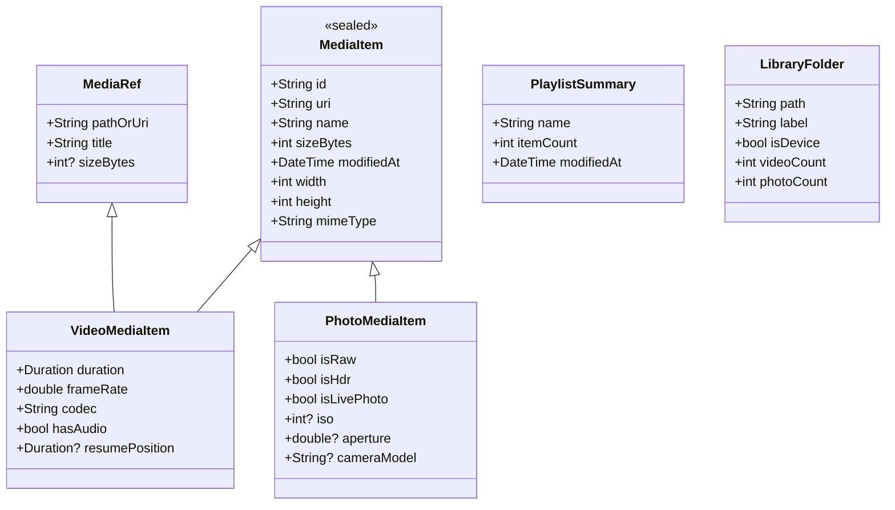

# Danaview 1.2.0: Files & Media Home (Photos, Videos & Documents)

> **Release:** Danaview 1.2.0 (app version `1.2.0+N`), moved from 1.3.0 by the owner on 2026-10-15. **Date:** 2026-10-12. **Status:** Proposal & Architectural Draft (Updated).
> **Baseline:** `docs/v1.1/editor/ARCHITECTURE.md`, `docs/v1.2/ai-studio/AI_STUDIO_PLAN.md`, `docs/v1.2/video-editor-update/VIDEO_EDITOR_UPDATE_PLAN.md` (shipping in the same release), and current production `DanaviewHomeScreen` (`packages/danaview_features/lib/src/library/danaview_home_screen.dart`).
> **Core Mandate:** **100% Preservation of Existing Player, Playlists, Queue, and Library Features**. Absolutely zero existing player functionality is removed, hidden, or compromised. The Home Screen expands additively to embrace photos and camera captures alongside the existing video playback ecosystem.
> **Release placement (2026-10-15):** 1.2.0 ships this Home screen together with AI Studio and the Unified Photo & Video Editor; the desktop editor and the in-house camera follow in 1.3.0. Consequences: "Edit in Editor" (HOM-11) and "Make Video Montage" (HOM-12) appear only where the editor runs (iOS and Android in 1.2.0, ARCH D-17); on macOS, Windows and Linux the Home screen still gains photo browsing (HOM-03) but hides editor actions until the 1.3.0 desktop editor; camera captures appear in the library once the 1.3.0 camera exists.
> **Widened on 2026-10-16 (owner):** the Home screen becomes the **Files & Media Home**. Besides photos and videos it now holds **documents** (PDF, Word, Excel, PowerPoint, text/CSV and other files), app-private **Danaview folders**, import from other apps, file actions, native viewers and **PDF tools**. The player preservation guarantees (§1.2) are unchanged. The additions are in §8 (decisions D-98a to D-98k) and §9 (tickets HOM-16 to HOM-32).
> **Renamed on 2026-10-16:** this plan moved from `docs/v1.2/home-photo-video-view/HOME_PHOTO_VIDEO_PLAN.md` to `docs/v1.2/files-media-home/FILES_MEDIA_HOME_PLAN.md` to match its wider scope; links in the other plans, the roadmaps and the README were updated.
> **Decisions:** Proposes decisions **D-86 to D-98**, plus **D-98a to D-98k** for files and documents (lettered so they don't clash with the numbers other plans use). Decisions marked **[OWNER]** require confirmation from the product owner; **[VERIFY]** marks a claim a spike or ticket must prove.

---

## 0. Contents

1. Executive Summary, Goals, and Absolute Preservation Guarantees
2. Preservation Register: Existing Player, Playlist, Queue & Folder Features
3. Decisions Log (D-86 to D-98)
4. Unified Architecture & Data Domain Model
   - 4.1 Unified `MediaItem` & `MediaFolder` Hierarchy
   - 4.2 Multi-Tier Thumbnail Generation & High-Speed Caching
   - 4.3 Native Media Scanning (PhotoKit, MediaStore, Desktop Filesystem)
5. Home Screen UX & Layout Integration
   - 5.1 Default "Overview / Home" Experience (Full Player Hub Preserved)
   - 5.2 Filter Tabs: [Home / Overview], [All Media], [Videos], [Photos], [Playlists], [Folders], [Projects]
   - 5.3 Masonry & Adaptive Grid Views for Photos & Videos
   - 5.4 Media Opening Flows: Player, Photo Viewer, Unified Editor (Photo & Video Modes)
   - 5.5 Multi-Selection & Batch Actions (Video Montage / Slideshow Generation)
6. Platform Matrix & Graceful Degradation
7. Implementation Ticket Breakdown (HOM-01 to HOM-15)
8. Files & Documents (added 2026-10-16; decisions D-98a to D-98k)
   - 8.1 Library, filters and Danaview folders
   - 8.2 Import and "Open with Danaview"
   - 8.3 File actions and getting files out
   - 8.4 Viewers (native first)
   - 8.5 PDF tools
   - 8.6 Non-goals and platform notes
9. Documents Tickets (HOM-16 to HOM-32)

---

## 1. Executive Summary, Goals, and Absolute Preservation Guarantees

### 1.1 Executive Summary
Prior to v1.2.0, Danaview's Home Screen served as a beloved video player hub: "Now Playing" cards, quick actions ("Open file", "Open folder", "Open link"), "Continue watching" with resume progress bars, playlists management, and folder browsing.

In v1.2.0, with the arrival of the **Unified Photo & Video Editor** (and ahead of the **In-House Native Camera** in v1.3.0), Danaview evolves into a **Unified Visual Media Hub**. Crucially, **all existing player, playlist, queue, folder, and streaming features remain 100% active, prominent, and unchanged**. The user loses nothing; instead, photo viewing, album browsing, and creation tools are seamlessly integrated as additive capabilities.

**Widened on 2026-10-16:** Home is now the **Files & Media Home**. It also keeps documents (PDF, Word, Excel, PowerPoint, text/CSV and other files) in app-private Danaview folders, imports from Photos/Gallery, Files and other apps, opens each file type in a native viewer, and ships PDF tools (merge, split, reorder, rotate, delete pages, annotate, sign, compress). Office files are viewed, never edited. See §8 and §9.

### 1.2 Absolute Preservation Guarantees

| # | Existing Player / Library Feature | Preservation Guarantee |
|---|---|---|
| **P-1** | **Now Playing Card (`_NowPlayingCard`)** | Renders at the top whenever media is playing or paused; single-tap returns to active player. |
| **P-2** | **Continue Watching (`Continue watching`)** | 100% preserved: progress bars, resume points, episode tags (S01E02), "Clear history", "Show all N", item context menu ("Play", "Add to playlist…", "Remove from history"). |
| **P-3** | **Quick Actions (`_QuickActions`)** | "Open file" (video picker), "Open folder" (device/folder picker), and "Open link" (streaming URL dialog with all network protocols) remain in place. |
| **P-4** | **Playlists (`Playlists`)** | Creation (`promptNewPlaylist`), renaming, deletion, drag-to-reorder, shuffle play, "Play all", and add-to-playlist sheets remain fully functional. |
| **P-5** | **Folders (`Folders`)** | Device storage root (`isDevice`), user-added folders, breadcrumb navigation, natural sorting, "Play all", "Shuffle", and "Add to queue" remain completely intact. |
| **P-6** | **Playback Queue & Background Audio** | Full queue management (reorder, repeat Off/All/One, shuffle restore, next-up auto-advance) functions identically. |
| **P-7** | **Network & Stream Playback** | http, https, rtsp, rtmp, srt, udp, rtp, mms, and local file streams open with zero regression. |
| **P-8** | **Desktop Drag & Drop & Links** | `desktop_drop` onto home/player and system `danaview://` URL schemes operate without change. |

### 1.3 Goals for v1.2.0 Additions

| # | Goal | Where Guaranteed |
|---|---|---|
| **G-H1** | **Seamless Media Coexistence**: Photos and videos live harmoniously with clear badges, instant filtering, and consistent thumbnail quality. | D-86, D-87; HOM-02 |
| **G-H2** | **Smooth Performance at Scale**: 60/120 fps scrolling across libraries with 50,000+ mixed media items via virtualized viewport loading. | D-89; HOM-04 |
| **G-H3** | **Non-Destructive & Read-Only**: Original media files are treated as immutable. Scanning and caching never alter timestamps or directories. | ARCH G2, D-88; HOM-05 |
| **G-H4** | **Bridge to Creators**: One-tap action to edit photos or videos in the Unified Editor, play media in Player, or select mixed media to build a Video Editor timeline. | D-91, D-92; HOM-07 |
| **G-H5** | **One home for files**: photos, videos and documents live together in app-private Danaview folders, with favourites, recents, search and sort, and leave the app through Save to Files / Save to Downloads and share. | D-98a…D-98f; HOM-16…HOM-22 |
| **G-H6** | **Native viewers, no paid SDKs**: every file type opens with the platform's own viewer or a simple in-app viewer; PDF tools use the native PDF engines only. Imports and PDF tools never modify the original file. | D-98c, D-98g…D-98j; HOM-23…HOM-31 |

---

## 2. Preservation Register: Existing Player, Playlist, Queue & Folder Features

To ensure no code or UX regressions occur, the v1.2.0 Home Screen architecture maps 1-to-1 with existing domain controllers and services:

```
+---------------------------------------------------------------------------------------------------+
|                                  DANAVIEW HOME SCREEN ARCHITECTURE                                |
+---------------------------------------------------------------------------------------------------+
|  [Header] Danaview Logo | [📷 Camera] | [✂️ Editor] | [⚙️ Settings]                                   |
+---------------------------------------------------------------------------------------------------+
|  [NAVIGATION TABS]                                                                                |
|  [ ⭐ Home / Overview ]  [ 🎬 Videos ]  [ 📷 Photos ]  [ 🗂️ All Media ]  [ 🎵 Playlists ]  [ 📁 Folders ]|
+---------------------------------------------------------------------------------------------------+
|                                                                                                   |
|  1. NOW PLAYING CARD (Preserved)                                                                  |
|     - Active media title, time elapsed / total, live progress indicator, Tap to return.          |
|                                                                                                   |
|  2. QUICK ACTIONS TRAY (Preserved & Enhanced)                                                     |
|     - [Open file]   (Pick videos to play directly in Player)                                      |
|     - [Open folder] (Browse video directories or device storage)                                  |
|     - [Open link]   (Stream from HTTP, RTSP, RTMP, SRT, UDP, etc.)                                |
|     - [Open photo]  (NEW: Pick photos to view or edit)                                            |
|                                                                                                   |
|  3. CONTINUE WATCHING TRAY (Preserved)                                                            |
|     - Resume points, progress bars, S01E02 badges, "Clear history", "Show all N".                 |
|     - Three-dot menu: "Play", "Add to playlist…", "Remove from history".                          |
|                                                                                                   |
|  4. PLAYLISTS SECTION (Preserved)                                                                 |
|     - "New playlist" button, item counts, Play, Shuffle, Rename, Delete.                         |
|     - Queue integration, drag-to-reorder, repeat modes.                                           |
|                                                                                                   |
|  5. FOLDERS SECTION (Preserved)                                                                   |
|     - Device Storage ("On My iPhone" / Android root), user added folders.                         |
|     - "Play all", "Shuffle", breadcrumbs, natural sorting, episode badges.                        |
|                                                                                                   |
|  6. NEW: RECENT PHOTOS & CAMERA CAPTURES TRAY (Additive)                                          |
|     - Horizontal carousel of latest photos, stills, and camera recordings.                        |
|     - Single tap opens Photo Viewer / Edit in Unified Editor.                                     |
|                                                                                                   |
+---------------------------------------------------------------------------------------------------+
```

---

## 3. Decisions Log (D-86 to D-98)

| ID | Decision (Summary) | Owner? |
|---|---|---|
| **D-86** | Home Screen navigation model: Top filter tabs (`Home / Overview`, `Videos`, `Photos`, `All Media`, `Playlists`, `Folders`, `Projects`) with `Home` preserving the classic layout. **Updated 2026-10-16 (D-98a):** the library filters are `All`, `Videos`, `Photos` and `Documents` (`All Media` becomes `All` and includes documents); `Folders` also shows Danaview folders. The ASCII sketches in §2 and §5.1 predate the `Documents` filter. | – |
| **D-87** | Adaptive view presentation: Classic row-based groups on `Home`, Masonry grid on `Photos`, standard cards on `Videos`. | – |
| **D-88** | Privacy & Permissions: Zero network telemetry, local storage only, granular iOS limited photo library and Android 13+ partial access. | **[OWNER]** |
| **D-89** | Multi-tier thumbnail caching: in-memory 64 MB LRU + disk WebP cache + native platform thumbnailers (`QLThumbnailGenerator`, `ContentResolver`). | – |
| **D-90** | Broad media formats: JPEG, PNG, WebP, HEIC/HEIF, AVIF, RAW (DNG, CR2, NEF, ARW) alongside all video formats (MKV, MP4, MOV, WebM, AVI). | – |
| **D-91** | Media tap actions: Videos launch Danaview Player with resume; Photos launch fullscreen viewer with "Edit" button. | – |
| **D-92** | Multi-select creation bar: "Create Video Story / Montage", "Batch Edit Photos", "Add to Playlist", "Play All". | **[OWNER]** |
| **D-93** | Folders & Albums integration: System photo albums (Favorites, Recents, Selfies) and physical device directories coexist cleanly. | – |
| **D-94** | Desktop file browser: sidebar shortcuts, external drive auto-detection, and native drag-and-drop. | – |
| **D-95** | Media badges: video duration pill, RAW/HDR/Live Photo badge, resolution (4K/1080p), and frame rate pills. | – |
| **D-96** | Background media scanner: incremental change tracking via PhotoKit change observers and Android ContentObservers. | – |
| **D-97** | Sorting and grouping: Group by Date (Today, Yesterday, This Month), Location, or Physical Folder. | – |
| **D-98** | Owner UI rules: Figtree typography, custom `danaview_ui_kit` components, solid surfaces, computed contrast $\ge 4.5:1$. | ARCH §1.3 |
| **D-98a** | **Files & Media Home scope and filters:** filters `All`, `Videos`, `Photos`, `Documents`; document sub-filters `PDF`, `Word`, `Excel`, `PowerPoint`, `Text/CSV`, `Other`. Types are classified by UTType (Apple), MIME type (Android) and file extension. (§8.1) | owner 2026-10-16 |
| **D-98b** | **Danaview folders are app-private:** they live inside Danaview's own storage and are included in app backups. Create, rename, move, delete and nest folders; a folder holds any mix of file types. Showing the folders in the iOS Files app is a possible later setting. (§8.1) | owner 2026-10-16; backup limits **[VERIFY]**, Recently deleted **[OWNER]** |
| **D-98c** | **Import, originals never modified:** import from Photos/Gallery, from Files/storage, and through "Open with Danaview" from other apps. An import copies the file into a Danaview folder; the source is never changed, moved or deleted (the editor's non-destructive rule, ARCH G2). (§8.2) | owner 2026-10-16 |
| **D-98d** | **Getting files out:** "Save to Files" on iOS, "Save to Downloads" on Android, the system share sheet, and "Open in another app". (§8.3) | owner 2026-10-16 |
| **D-98e** | **File actions:** share, copy, move, rename, file info, open in another app, delete, and a multi-select bar. "Make video montage" stays for media selections. (§8.3) | owner 2026-10-16 |
| **D-98f** | **Organise:** favourites, recents, search (names first; the on-device search index of AI Studio plan D-70d when it lands) and sort by name, date, size or type. (§8.1) | owner 2026-10-16 |
| **D-98g** | **Viewers, native first:** photos native; videos in the existing player; PDF with PDFKit (iOS/macOS) and `PdfRenderer` (Android); Word, Excel, PowerPoint, text, CSV and others with Quick Look on iOS/macOS. (§8.4) | owner 2026-10-16 |
| **D-98h** | **Office files on Android:** text and CSV get an in-app viewer; Word, Excel and PowerPoint get a file card with "Open in another app". No paid SDK and no server conversion; revisit later if users ask. (§8.4) | owner 2026-10-16 |
| **D-98i** | **No Office editing.** Word, Excel and PowerPoint files are viewed, shared and organised, never edited. (§8.6) | owner 2026-10-16 (non-goal) |
| **D-98j** | **PDF tools in 1.2.0:** merge, split, reorder, rotate and delete pages; annotate and highlight; sign; compress. Native PDF engines only, through one shared `danaview_pdf` plugin that the 1.3.0 camera's scan-to-PDF reuses. Results are saved as new files. (§8.5) | owner 2026-10-16; Android write path **[VERIFY]** / **[OWNER]** |
| **D-98k** | **Desktop documents:** on macOS the same PDFKit and Quick Look paths as iOS. On Windows and Linux in 1.2.0: library, folders, import, file actions, the in-app text/CSV viewer, and "Open in another app" for PDF and Office files; native PDF viewing and tools there follow with the 1.3.0 desktop work. (§8.6) | **[OWNER]** |

---

## 4. Unified Architecture & Data Domain Model



### 4.1 Unification with Existing `MediaRef`
- To maintain 100% backward compatibility with `danaviewPlayItems(ref, items)` and `LibraryController`:
  - `VideoMediaItem` implements or wraps `MediaRef`.
  - All existing player methods (`_play`, `_playRecent`, `_playPlaylist`, `_playFolder`) continue to receive `MediaRef` instances without modification.
  - Photos are represented via `PhotoMediaItem`, which cleanly implements `MediaItem` for gallery display, viewer inspection, and photo editing.

---

## 5. Home Screen UX & Layout Integration

### 5.1 The Default "Home / Overview" Tab
When the user launches Danaview, the default view is **"Home / Overview"**. This view retains the exact hierarchy users know and love:

```
+---------------------------------------------------------------------------------------------------+
|  🎬 Danaview             [ 📷 Camera ]  [ ✂️ Editor ]  [ 🔍 ]  [ ⚙️ ]                             |
+---------------------------------------------------------------------------------------------------+
|  [ ⭐ Home ]   [ 🎬 Videos ]   [ 📷 Photos ]   [ 🗂️ All Media ]   [ 🎵 Playlists ]   [ 📁 Folders ]  |
+---------------------------------------------------------------------------------------------------+
|                                                                                                   |
|  +---------------------------------------------------------------------------------------------+  |
|  |  ▶️ NOW PLAYING: Inception (2010) [4K HDR]                               01:14:22 / 02:28:07 |  |
|  +---------------------------------------------------------------------------------------------+  |
|                                                                                                   |
|  QUICK ACTIONS:                                                                                   |
|  +------------------------+  +------------------------+  +------------------------+  +---------+  |
|  | 🎥 Open file           |  | 📁 Open folder         |  | 🔗 Open link           |  | 📷 Photo|  |
|  | Pick videos to play    |  | Browse a folder/device |  | Stream from a URL      |  | View/Edit| |
|  +------------------------+  +------------------------+  +------------------------+  +---------+  |
|                                                                                                   |
|  CONTINUE WATCHING                                                                 [ Clear ]      |
|  +---------------------------------------------------------------------------------------------+  |
|  | 🎬 Stranger Things - S04E07.mkv                     00:48:12 / 01:25:00   [==========----]  |  |
|  | 🎬 Dune Part Two.mp4                                01:12:00 / 02:46:00   [=======-------]  |  |
|  +---------------------------------------------------------------------------------------------+  |
|  [ Show all 8 ]                                                                                   |
|                                                                                                   |
|  RECENT PHOTOS & STILLS (Additive Section)                                          [ See all ]   |
|  [ Sunset.heic ]  [ Portrait_4K.dng ]  [ Camera_001.jpg ]  [ Studio_Shoot.png ]  [ Nature.heic ]  |
|                                                                                                   |
|  PLAYLISTS                                                                          [ + New ]     |
|  +---------------------------------------------------------------------------------------------+  |
|  | 🎵 Sci-Fi Classics (12 videos)                                           [ Play ] [ Shuffle ] |  |
|  | 🎵 Music Videos 4K (45 videos)                                           [ Play ] [ Shuffle ] |  |
|  +---------------------------------------------------------------------------------------------+  |
|                                                                                                   |
|  FOLDERS                                                                            [ + Add ]     |
|  +---------------------------------------------------------------------------------------------+  |
|  | 📱 Device Storage (Files app › On My iPhone › Danaview)                                        |  |
|  | 📁 Movies & Series (/Volumes/Storage/Movies)                             [ Play all ] [ > ]    |  |
|  +---------------------------------------------------------------------------------------------+  |
|                                                                                                   |
+---------------------------------------------------------------------------------------------------+
```

### 5.2 Filter Views
- **`Videos` Tab**: Pure video focus. Displays `Now Playing`, `Continue watching`, video playlists, video folders, and a video-only grid with duration pills and resolution badges.
- **`Photos` Tab**: Pure photo gallery. High-speed Masonry grid, system albums (Favorites, Panoramas, RAW, Bursts), and one-tap editing in the Unified Editor (Still Photo mode).
- **`All` Tab** (was `All Media`; D-86 update, D-98a): Chronological timeline combining all captured and imported photos, videos and documents.
- **`Documents` Tab** (new, D-98a): every document in Danaview folders and in the user's linked folders, with sub-filter chips `PDF`, `Word`, `Excel`, `PowerPoint`, `Text/CSV` and `Other`. Rows show a type icon or a first-page thumbnail (PDF), name, size, date and page count where known. See §8.1.
- **`Playlists` Tab**: Comprehensive playlist manager with drag reordering, track queuing, and playlist sharing.
- **`Folders` Tab**: Complete folder hierarchy exploring local storage, SD cards, and external drives for both video files and photo directories. **From 2026-10-16** it shows two groups: **Danaview folders** (app-private, any file type, D-98b) and **Linked folders** (the existing user-added and device folders, unchanged, P-5).
- **Tabs where the editor doesn't run:** on desktop in 1.2.0 the editor actions stay hidden (release placement note); the `Documents` tab and Danaview folders appear on every platform, with the viewer limits of §6 and D-98k.

### 5.3 Multi-Selection Actions: "Make Video Montage"
Selecting a mixture of photos and videos activates the bottom action bar:
- **"Make Video Montage"**: Automatically launches the Unified Editor in timeline mode (`danaview_editor`), laying out photos as 3-second animated stills and videos as chronological clips on the main track.
- **"Play in Player"**: Immediately queues selected media into the player queue as a seamless mixed playback slideshow.
- **"Add to Playlist"**: Adds the selected video items into any existing or new playlist.
- **"Batch Edit in Editor"**: Opens the Unified Editor in still batch mode to apply adjustments across all selected photos.

---

## 6. Platform Matrix & Graceful Degradation

| Feature | iOS / iPadOS | Android | macOS | Windows | Linux |
|---|---|---|---|---|---|
| **Now Playing & Player** | Native AV / libmpv | Media3 / libmpv | libmpv | libmpv | libmpv |
| **Playlists & Queue** | 100% Shared Dart | 100% Shared Dart | 100% Shared Dart | 100% Shared Dart | 100% Shared Dart |
| **Continue Watching** | 100% Shared Dart | 100% Shared Dart | 100% Shared Dart | 100% Shared Dart | 100% Shared Dart |
| **System Photo Library** | PhotoKit | MediaStore | PhotoKit / Files | Windows Photos / Files | Filesystem Folders |
| **Folder Picking** | iOS Files Document | Scoped Storage | AppKit Picker | Win32 Picker | GTK / Portal Picker |
| **Network Streams** | HTTP, RTSP, RTMP | HTTP, RTSP, RTMP | HTTP, RTSP, RTMP | HTTP, RTSP, RTMP | HTTP, RTSP, RTMP |
| **Danaview folders, import, file actions** | Shared Dart + iOS pickers | Shared Dart + SAF / Photo Picker | Shared Dart + AppKit | Shared Dart + Win32 | Shared Dart + GTK / Portal |
| **PDF viewer** | PDFKit | `PdfRenderer` | PDFKit | Open in another app (D-98k) | Open in another app (D-98k) |
| **Word / Excel / PowerPoint** | Quick Look | File card + Open in another app | Quick Look | File card + Open in another app | File card + Open in another app |
| **Text / CSV** | Quick Look | In-app viewer | Quick Look | In-app viewer | In-app viewer |
| **PDF tools (D-98j)** | PDFKit | Android write path per HOM-27 **[VERIFY]** | PDFKit | 1.3.0 (D-98k) | 1.3.0 (D-98k) |
| **Getting files out** | Save to Files, share | Save to Downloads, share | Save dialog, share | Save dialog | Save dialog |

---

## 7. Implementation Ticket Breakdown (HOM-01 to HOM-15)

| Ticket | Scope & Summary | Depends On |
|---|---|---|
| **HOM-01** | Create `MediaItem`, `VideoMediaItem`, and `PhotoMediaItem` domain models; ensure `VideoMediaItem` interoperates with `MediaRef`. | v1.1 Core |
| **HOM-02** | Implement native photo library platform channels (PhotoKit on iOS, MediaStore on Android). | HOM-01 |
| **HOM-03** | Implement desktop photo directory discovery for macOS, Windows, and Linux. | HOM-01 |
| **HOM-04** | Build multi-tier thumbnail cache service (64 MB memory LRU + disk WebP cache + OS thumbnailers). | HOM-02 |
| **HOM-05** | Update `DanaviewHomeScreen` layout to integrate the top filter tabs while preserving 100% of the player layout. | HOM-04 |
| **HOM-06** | Preserve and test `_NowPlayingCard`, `Continue watching` tray, and `_QuickActions` without visual or behavioral change. | HOM-05 |
| **HOM-07** | Preserve and test `Playlists` section (New, Play, Shuffle, Rename, Delete, Drag-reorder). | HOM-05 |
| **HOM-08** | Preserve and test `Folders` section (Device storage, custom roots, breadcrumbs, Play all). | HOM-05 |
| **HOM-09** | Build the "Recent Photos & Stills" additive carousel for the default Overview tab. | HOM-04, HOM-05 |
| **HOM-10** | Implement Masonry and adaptive photo grid view for the dedicated `Photos` tab. | HOM-04 |
| **HOM-11** | Build Fullscreen Photo Viewer with pinch-to-zoom, EXIF metadata sheet, and "Edit in Editor" action button. | HOM-10 |
| **HOM-12** | Implement multi-select bar with "Make Video Montage" bridge and "Play in Player" slideshow. | HOM-05, v1.1 Editor (mobile only in 1.2.0; desktop after DSK-20 in 1.3.0) |
| **HOM-13** | Add media badges (Duration pill, 4K/60fps, RAW, HDR, Live Photo indicators). | HOM-10 |
| **HOM-14** | Stress test: verify smooth 60/120 fps scrolling with 50,000+ mixed photos and videos. | HOM-04 |
| **HOM-15** | Regression test suite: verify zero regressions across existing player and playlist unit/widget tests. | HOM-06, HOM-07, HOM-08 |

---

## 8. Files & Documents (added 2026-10-16; decisions D-98a to D-98k)

The owner widened the Home screen on 2026-10-16. Everything in §1.2 still holds: the player hub, Continue watching, playlists, linked folders, streams and drag-and-drop are unchanged. This section adds documents, Danaview folders, import, file actions, viewers and PDF tools. The decisions are in §3 (D-98a to D-98k); the tickets are in §9.

### 8.1 Library, filters and Danaview folders

**Filters (D-98a).** The library filters become `All`, `Videos`, `Photos` and `Documents`. `Documents` has sub-filter chips:

| Sub-filter | Matches (UTType / MIME / extension) |
|---|---|
| `PDF` | `com.adobe.pdf`, `application/pdf`, `.pdf` |
| `Word` | `.doc`, `.docx`, `.odt`, `.rtf`, `.pages` |
| `Excel` | `.xls`, `.xlsx`, `.ods`, `.numbers` |
| `PowerPoint` | `.ppt`, `.pptx`, `.odp`, `.key` |
| `Text/CSV` | `public.plain-text`, `text/*`, `.txt`, `.md`, `.csv`, `.tsv`, `.json`, `.log` |
| `Other` | anything else (archives, e-books, unknown types) |

The type is decided by UTType on Apple platforms, by the MIME type the content resolver reports on Android, and by the file extension everywhere else or when the first two disagree with an obviously wrong value. The classifier is one table in shared Dart (HOM-16) with a test per row.

**Item model.** `MediaItem` (§4) gains a `DocumentItem` subtype (`kind`, `pageCount?`, `textEncoding?`), and every library entry gets a small `FileEntry` record: `id`, `folderId`, `displayName`, `kind`, `sizeBytes`, `addedAt`, `modifiedAt`, `isFavourite`, `lastOpenedAt`, `sourceHint` (where it was imported from). The kind list is open: the 1.3.0 camera adds **Saved codes** as another item type (`docs/v1.3/camera-photo-video/NATIVE_CAMERA_PLAN.md` §13, ticket CAM-56), which needs only a new kind, a row in the classifier and a viewer route.

**Danaview folders (D-98b).**
- They are **app-private**: they live in Danaview's own storage, under `Library/Application Support/DanaviewLibrary/` on iOS and macOS and under the app's internal files directory on Android (`getFilesDir()/library/`). On iOS this is deliberately **not** `Documents/`, because the app already sets `UIFileSharingEnabled` and `LSSupportsOpeningDocumentsInPlace`, so `Documents/` is visible in the Files app ("On My iPhone › Danaview", P-5).
- They are **included in app backups**: iOS device and iCloud backups include Application Support unless a file is marked excluded, and Danaview never marks library files excluded (thumbnails and caches are excluded). On Android the backup rules (`dataExtractionRules` on Android 12+, `fullBackupContent` before that) include `library/`. **[VERIFY: HOM-17]** Android cloud Auto Backup stops at 25 MB per app, so a large library will only move fully through device-to-device transfer; the Settings screen says so plainly instead of promising a full cloud backup.
- Users can create, rename, move, delete and nest folders to any depth. A folder can hold any mix of photos, videos, documents and (from 1.3.0) saved codes.
- Deleting a folder or file asks first. **[OWNER]** Whether deletes go to a "Recently deleted" folder for 30 days (proposed) or are removed at once.
- **Later setting (not in 1.2.0):** "Show Danaview folders in the Files app". It would expose the library through a File Provider extension or by moving it under `Documents/`. **[OWNER]** when, if ever.
- **Linked folders** (the existing user-added and device folders, P-5) stay as they are. Their documents also appear under `Documents`, read-only; actions that change a file (rename, move, delete, PDF tools that overwrite) are offered only inside Danaview folders. Linked-folder files can be imported (copied) into a Danaview folder.

**Organise (D-98f).**
- **Favourites:** a star on any file or folder; a `Favourites` row on the Overview and a filter chip.
- **Recents:** the last 50 files opened in any viewer; one clear button; never synced.
- **Search:** in 1.2.0 it matches names, folder names and file types across the whole library, as you type. When the on-device search index of the AI Studio plan (D-70d, AIS-50) is enabled, search also matches text inside documents, OCR text in photos, transcripts and captions. Cloud help with search is opt-in and covered entirely by that plan.
- **Sort:** name (natural order, as today), date added, date modified, size, type; ascending or descending; remembered per folder.

### 8.2 Import and "Open with Danaview" (D-98c)

| Source | iOS / iPadOS | Android | macOS | Windows / Linux |
|---|---|---|---|---|
| Photos / Gallery | `PHPickerViewController` (no full library permission needed) | Android Photo Picker (`ACTION_PICK_IMAGES`, back-ported through Google Play services on older versions) | `PHPickerViewController` | – |
| Files / storage | `UIDocumentPickerViewController` (import mode) | Storage Access Framework (`ACTION_OPEN_DOCUMENT`, multiple) | `NSOpenPanel` | Win32 / GTK or portal picker |
| From other apps | `CFBundleDocumentTypes` for documents and images, handler rank **Alternate** so Danaview never takes over PDFs or Office files from their usual app; the existing video types keep rank Owner | `ACTION_VIEW`, `ACTION_SEND` and `ACTION_SEND_MULTIPLE` intent filters for `application/pdf`, Office MIME types, `text/*`, `image/*` | Finder "Open With", drag onto the window (P-8) | File association "Open with", drag-and-drop (P-8) |
| Share sheet target | Share Extension **[OWNER]** (needed for "Share → Danaview" from Photos and many apps; adds an app extension target) | covered by `ACTION_SEND` | Share extension later | – |

Rules:
- **An import is a copy.** The file is copied into the chosen Danaview folder (default `Imported`), with a progress row for large files and resume after the app is killed. The source file, photo or asset is never changed, moved or deleted (ARCH G2).
- **Duplicates:** the same name in the same folder gets a suffix (`Report (2).pdf`); identical content (size plus hash) asks "Already in Danaview: keep both or skip?".
- **Incoming videos keep today's behaviour:** a video opened from another app plays at once in the player (P-7, P-8). The player gains "Save to Danaview folder" in its menu.
- **Incoming documents and photos** are copied into `Imported` and opened in the matching viewer (§8.4).
- **Permissions:** the photo and file pickers need no broad library permission. Full photo library access stays as D-88 describes and is only needed for the Photos tab's library view.

### 8.3 File actions and getting files out (D-98d, D-98e)

**Actions on one file** (long-press menu and the viewer's toolbar): Share, Copy to…, Move to…, Rename, File info (type, size, dates, page count, dimensions or duration, where it came from), Open in another app, Add to favourites, Delete. Media keep their existing actions (Play, Add to playlist, Edit in Editor where the editor runs).

**Multi-select bar:** select across types, then Share, Move, Copy, Favourite, Delete and Save out. When the selection holds only photos and videos, **"Make video montage"** and "Play in Player" stay (§5.3). When it holds only PDFs or images, "Merge into PDF" appears (§8.5; "Export as PDF" for photos arrives with the 1.3.0 camera plan, D-115d).

**Getting files out:**

| Action | iOS / iPadOS | Android | macOS | Windows / Linux |
|---|---|---|---|---|
| Save a copy outside Danaview | **"Save to Files"**: `UIDocumentPickerViewController(forExporting:)` | **"Save to Downloads"**: `MediaStore.Downloads` on Android 10+, `ACTION_CREATE_DOCUMENT` below that (no storage permission either way) | Save panel | Save dialog |
| Share | `UIActivityViewController` | `ACTION_SEND` / `ACTION_SEND_MULTIPLE` through a `FileProvider` URI | `NSSharingServicePicker` | – (Save dialog instead) |
| Open in another app | `UIDocumentInteractionController` "Open in…" | `ACTION_VIEW` with a `FileProvider` URI and read permission | `NSWorkspace` open with default app | default app / `xdg-open` |
| Save photos and videos to the system library | Photos (add-only permission, already used by exports) | MediaStore `Pictures` / `Movies` | Photos | – |

Shared copies are temporary: share and "Open in another app" hand over a read-only URI, and nothing outside Danaview can change the library copy.

### 8.4 Viewers, native first (D-98g, D-98h)

One viewer router (HOM-23) picks the viewer by kind and platform:

| Kind | iOS / iPadOS | Android | macOS | Windows / Linux |
|---|---|---|---|---|
| Photo | Existing photo viewer (HOM-11) | Existing photo viewer | Existing photo viewer | Existing photo viewer |
| Video | Existing Danaview player | Existing Danaview player | Existing player | Existing player |
| PDF | **PDFKit** (`PDFView` in a platform view): zoom, page thumbnails, text search and selection, outline | **`PdfRenderer`** rendered into tiles: zoom, page thumbnails; text search and selection where the platform offers them **[VERIFY: HOM-25]** | PDFKit | File card + Open in another app (D-98k) |
| Word, Excel, PowerPoint | **Quick Look** (`QLPreviewController`) | **File card**: icon, name, size, dates, and "Open in another app" (D-98h) | Quick Look (`QLPreviewView`) | File card + Open in another app |
| Text, CSV, TSV, JSON, Markdown, logs | Quick Look | **In-app text viewer**; CSV/TSV as a read-only grid | Quick Look | In-app text viewer |
| Other | Quick Look where it can preview the type, else file card | File card | Quick Look or file card | File card |

Details:
- **Quick Look editing is turned off** (`previewController(_:editingModeFor:)` returns `.disabled`), so Markup in Quick Look never edits the stored file. Annotating a PDF goes through the PDF tools (§8.5), which save a new file.
- **In-app text viewer** (shared Dart): detects UTF-8, UTF-16 (byte-order mark) and falls back to Latin-1 with a "change encoding" menu; virtualised lines so a 50 MB log scrolls smoothly; files above 50 MB show the first 50 MB and offer "Open in another app". The CSV grid sniffs the delimiter (`,` `;` tab), keeps a fixed header row, and is read-only.
- **Thumbnails:** `QLThumbnailGenerator` for documents on iOS/macOS (first page or type icon); the first PDF page through `PdfRenderer` on Android; type icons elsewhere. They go into the same thumbnail cache as photos and videos (D-89).
- **Android Office files (D-98h):** no paid viewer SDK and no server conversion. If users ask for in-app Office viewing later, the options are re-assessed then (an open-source renderer, or a paid SDK with its cost stated).
- **Password-protected PDFs:** PDFKit unlocks them with a password prompt. On Android, older `PdfRenderer` versions can't open them and show the file card with "Open in another app" **[VERIFY: HOM-25]**.

### 8.5 PDF tools (D-98j)

Tools in 1.2.0, all on-device, all saving the result as a **new file** next to the original (`Report (edited).pdf`) unless the user picks "Replace" for a file in a Danaview folder:

| Tool | What the user does | iOS / macOS (PDFKit) | Android |
|---|---|---|---|
| Merge | pick 2+ PDFs (or images), order them, Merge | `PDFDocument.insert(_:at:)` | per HOM-27 |
| Split | split by page ranges, every N pages, or "extract selected pages" | new `PDFDocument` per range | per HOM-27 |
| Reorder | drag page thumbnails | `exchangePage(at:withPageAt:)` | per HOM-27 |
| Rotate | rotate selected pages 90° | `PDFPage.rotation` | per HOM-27 |
| Delete pages | select pages, Delete | `removePage(at:)` | per HOM-27 |
| Annotate and highlight | highlight, underline, strike-through on text; freehand ink; text notes | `PDFAnnotation` (highlight, underline, strikeOut, ink, freeText); PencilKit for ink on iPad | per HOM-27 |
| Sign | draw, type or import a signature, place and resize it on a page | stamp annotation with the signature image, burned into the page on save **[VERIFY: HOM-30]** | per HOM-27 |
| Compress | presets High / Medium / Small, showing the before and after size | `write(to:withOptions:)` with image JPEG and screen-optimisation options (iOS 16+, macOS 13+) **[VERIFY: HOM-31]** | per HOM-27 |

- **One plugin:** the native code sits in a new `danaview_pdf` package (Pigeon API, iOS/macOS Swift, Android Kotlin), so the 1.3.0 camera's scan-to-PDF, image-to-PDF and merge reuse it instead of duplicating it (NATIVE_CAMERA_PLAN D-115e).
- **Signatures are visual signatures**, not certificate-based digital signatures (non-goal, §8.6). Saved signatures stay on the device in app-private storage, behind the device's normal app protection; the user can delete them.
- **Android write path [VERIFY: HOM-27] / [OWNER].** `PdfRenderer` only reads, and `android.graphics.pdf.PdfDocument` only draws new pages, so rebuilding a document with it would turn text into pictures. The spike compares: (a) platform and Jetpack APIs only (`PdfRenderer` editing additions on Android 15+, `androidx.pdf`), with page images as the fallback on older versions; (b) **PdfBox-Android** (Apache-2.0, on-device, free); (c) a bundled **PDFium** build (BSD-3-Clause/Apache-2.0). Criteria: text stays selectable, app size, minimum Android version, speed on a 200-page file, licence. The owner picks between (a) and an open-source library if (a) loses text on supported versions; no paid SDK and no server in any case.
- **Large files:** tools run off the UI thread with a progress bar and can be cancelled; the original is never touched until a "Replace" save has completed.

### 8.6 Non-goals and platform notes

**Non-goals in 1.2.0:**
- **No Office editing (D-98i).** Word, Excel and PowerPoint files are viewed, shared, organised and exported, never edited.
- No PDF form authoring, no OCR (OCR arrives with the 1.3.0 camera's document scanning and AI Studio's search index), no certificate-based digital signatures, no PDF/A conversion, no password-protecting PDFs.
- No cloud drive syncing (iCloud Drive, Google Drive, Dropbox) beyond what the system pickers already offer.
- No server-side conversion of any kind.

**Platform notes (D-98k):**
- **macOS** uses the same PDFKit, Quick Look and `danaview_pdf` paths as iOS, so it gets the full feature set in 1.2.0.
- **Windows and Linux** in 1.2.0 get the library, filters, Danaview folders, import, file actions, the in-app text/CSV viewer, and "Open in another app" for PDF and Office files. Native PDF viewing and PDF tools there follow with the 1.3.0 desktop work. **[OWNER]** Confirm that desktop PDF tools may wait for 1.3.0.

---

## 9. Documents Tickets (HOM-16 to HOM-32)

| Ticket | Scope & Summary | Depends On |
|---|---|---|
| **HOM-16** | File model and classifier: `DocumentItem`, `FileEntry`, open kind list (ready for the camera's saved codes), UTType / MIME / extension table with a test per row (D-98a). | HOM-01 |
| **HOM-17** | Danaview folder store: app-private root per platform (§8.1), folder tree (create, rename, move, delete, nest), library database for entries, favourites and recents, atomic file moves, backup rules (iOS backup inclusion, Android `dataExtractionRules` / `fullBackupContent`). Closes **[VERIFY]** on Android backup limits. Recently deleted per **[OWNER]** answer (D-98b). | HOM-16 |
| **HOM-18** | Filters and tabs: `All`, `Videos`, `Photos`, `Documents` with document sub-filters; `Folders` tab with Danaview and Linked groups (D-86 update, §5.2). *Player hub and existing tabs unchanged (HOM-06…HOM-08 still pass).* | HOM-05, HOM-16 |
| **HOM-19** | Organise: favourites, recents, name search across the library, sort by name/date added/date modified/size/type per folder; search hook for the AI Studio on-device index (D-98f, AIS-50). | HOM-17 |
| **HOM-20** | Import from Photos/Gallery and Files/storage on every platform (§8.2): copy-in with progress and resume, duplicate handling, `Imported` default folder. *Test: the source file's bytes and timestamps are unchanged after import* (D-98c). | HOM-17 |
| **HOM-21** | "Open with Danaview": iOS `CFBundleDocumentTypes` (rank Alternate for documents), Android `VIEW` / `SEND` / `SEND_MULTIPLE` intent filters, desktop file associations; incoming videos still play at once; "Save to Danaview folder" in the player menu. iOS Share Extension only if the owner says yes (§8.2 **[OWNER]**). | HOM-20 |
| **HOM-22** | File actions and the multi-select bar (Share, Copy, Move, Rename, File info, Open in another app, Favourite, Delete); getting files out (Save to Files, Save to Downloads, save dialogs, share sheets, `FileProvider` URIs). "Make video montage" kept for media selections (D-98d, D-98e). | HOM-17, HOM-12 |
| **HOM-23** | Viewer router and the shared in-app text/CSV viewer (encoding detection, virtualised lines, 50 MB cap, CSV grid) and the file card (D-98g, D-98h). | HOM-16 |
| **HOM-24** | `danaview_pdf` package skeleton (Pigeon API, iOS/macOS/Android stubs) and the PDFKit viewer on iOS and macOS: zoom, thumbnails, search, selection, outline, password prompt. | HOM-23 |
| **HOM-25** | Android PDF viewer on `PdfRenderer`: tiled rendering, zoom, thumbnails; search and selection where available; password-protected fallback. Closes **[VERIFY]** on text search/selection and passwords per Android version. | HOM-24 |
| **HOM-26** | Quick Look on iOS and macOS for Office, text, CSV and other types, with editing disabled; document thumbnails through `QLThumbnailGenerator` into the shared cache (D-89). | HOM-23, HOM-04 |
| **HOM-27** | **Spike:** Android PDF write path (§8.5 options a/b/c). *Report with text-preservation results, app-size cost, minimum Android version, timings on a 200-page file, licences; owner picks the path.* Closes **[VERIFY]** / **[OWNER]** on D-98j. | HOM-24 |
| **HOM-28** | PDF page tools: merge (PDFs and images), split, reorder, rotate, delete pages; shared page-organiser UI with drag thumbnails; saves as a new file or Replace (Danaview folders only). | HOM-24, HOM-27 |
| **HOM-29** | Annotate and highlight: highlight, underline, strike-through, freehand ink (PencilKit on iPad), text notes; undo/redo; saved into a new file. | HOM-28 |
| **HOM-30** | Sign: draw, type or import a signature, saved signatures (app-private, deletable), place and resize, burn into the page on save. Closes **[VERIFY]** on burning annotations in. | HOM-29 |
| **HOM-31** | Compress: High / Medium / Small presets, before/after size, cancelable progress. Closes **[VERIFY]** on PDFKit write options and the Android path. | HOM-28 |
| **HOM-32** | Documents test pass: originals never modified (import, viewers, PDF tools), backup and restore of Danaview folders on a test device, 10,000-file library scroll and search timings, a11y labels and text scale 0.85–1.35 on every new screen, and a full re-run of HOM-15 (zero player regressions). | HOM-18…HOM-31, HOM-15 |

Lane hints: HOM-16…HOM-19, HOM-22, HOM-23 and HOM-28's UI are shared Dart; HOM-24 and HOM-26 are the Mac lane; HOM-25 and HOM-27 are the Android lane (Windows laptop); HOM-20, HOM-21, HOM-29…HOM-31 need both. Effort for §9: about **2–2.5 weeks** with the two lanes in parallel, of which the Android PDF write path (HOM-27, HOM-28 on Android) is the largest unknown.
