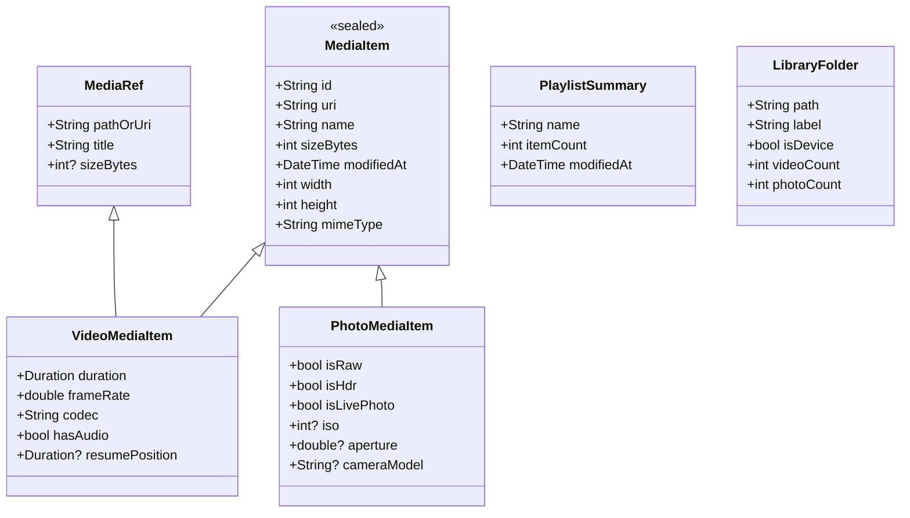

# Danaview 1.2.0: Unified Media Home Screen (Photos & Videos)

> **Release:** Danaview 1.2.0 (app version `1.2.0+N`), moved from 1.3.0 by the owner on 2026-10-15. **Date:** 2026-10-12. **Status:** Proposal & Architectural Draft (Updated).
> **Baseline:** `docs/v1.1/editor/ARCHITECTURE.md`, `docs/v1.2/ai-studio/AI_STUDIO_PLAN.md`, `docs/v1.2/video-editor-update/VIDEO_EDITOR_UPDATE_PLAN.md` (shipping in the same release), and current production `DanaviewHomeScreen` (`packages/danaview_features/lib/src/library/danaview_home_screen.dart`).
> **Core Mandate:** **100% Preservation of Existing Player, Playlists, Queue, and Library Features**. Absolutely zero existing player functionality is removed, hidden, or compromised. The Home Screen expands additively to embrace photos and camera captures alongside the existing video playback ecosystem.
> **Release placement (2026-10-15):** 1.2.0 ships this Home screen together with AI Studio and the Unified Photo & Video Editor; the desktop editor and the in-house camera follow in 1.3.0. Consequences: "Edit in Editor" (HOM-11) and "Make Video Montage" (HOM-12) appear only where the editor runs (iOS and Android in 1.2.0, ARCH D-17); on macOS, Windows and Linux the Home screen still gains photo browsing (HOM-03) but hides editor actions until the 1.3.0 desktop editor; camera captures appear in the library once the 1.3.0 camera exists.
> **Decisions:** Proposes decisions **D-86 to D-98**. Decisions marked **[OWNER]** require confirmation from the product owner.

---

## 0. Contents

1. Executive Summary, Goals, and Absolute Preservation Guarantees
2. Preservation Register: Existing Player, Playlist, Queue & Folder Features
3. Decisions Log (D-86 to D-98)
4. Unified Architecture & Data Domain Model
   - 4.1 Unified `MediaItem` & `MediaFolder` Hierarchy
   - 4.2 Multi-Tier Thumbnail Generation & High-Speed Caching
   - 4.3 Native Media Scanning (PhotoKit, MediaStore, Desktop Filesystem)
5. Home Screen UX & Layout Integration
   - 5.1 Default "Overview / Home" Experience (Full Player Hub Preserved)
   - 5.2 Filter Tabs: [Home / Overview], [All Media], [Videos], [Photos], [Playlists], [Folders], [Projects]
   - 5.3 Masonry & Adaptive Grid Views for Photos & Videos
   - 5.4 Media Opening Flows: Player, Photo Viewer, Unified Editor (Photo & Video Modes)
   - 5.5 Multi-Selection & Batch Actions (Video Montage / Slideshow Generation)
6. Platform Matrix & Graceful Degradation
7. Implementation Ticket Breakdown (HOM-01 to HOM-15)

---

## 1. Executive Summary, Goals, and Absolute Preservation Guarantees

### 1.1 Executive Summary
Prior to v1.2.0, Danaview's Home Screen served as a beloved video player hub: "Now Playing" cards, quick actions ("Open file", "Open folder", "Open link"), "Continue watching" with resume progress bars, playlists management, and folder browsing.

In v1.2.0, with the arrival of the **Unified Photo & Video Editor** (and ahead of the **In-House Native Camera** in v1.3.0), Danaview evolves into a **Unified Visual Media Hub**. Crucially, **all existing player, playlist, queue, folder, and streaming features remain 100% active, prominent, and unchanged**. The user loses nothing; instead, photo viewing, album browsing, and creation tools are seamlessly integrated as additive capabilities.

### 1.2 Absolute Preservation Guarantees

| # | Existing Player / Library Feature | Preservation Guarantee |
|---|---|---|
| **P-1** | **Now Playing Card (`_NowPlayingCard`)** | Renders at the top whenever media is playing or paused; single-tap returns to active player. |
| **P-2** | **Continue Watching (`Continue watching`)** | 100% preserved: progress bars, resume points, episode tags (S01E02), "Clear history", "Show all N", item context menu ("Play", "Add to playlist…", "Remove from history"). |
| **P-3** | **Quick Actions (`_QuickActions`)** | "Open file" (video picker), "Open folder" (device/folder picker), and "Open link" (streaming URL dialog with all network protocols) remain in place. |
| **P-4** | **Playlists (`Playlists`)** | Creation (`promptNewPlaylist`), renaming, deletion, drag-to-reorder, shuffle play, "Play all", and add-to-playlist sheets remain fully functional. |
| **P-5** | **Folders (`Folders`)** | Device storage root (`isDevice`), user-added folders, breadcrumb navigation, natural sorting, "Play all", "Shuffle", and "Add to queue" remain completely intact. |
| **P-6** | **Playback Queue & Background Audio** | Full queue management (reorder, repeat Off/All/One, shuffle restore, next-up auto-advance) functions identically. |
| **P-7** | **Network & Stream Playback** | http, https, rtsp, rtmp, srt, udp, rtp, mms, and local file streams open with zero regression. |
| **P-8** | **Desktop Drag & Drop & Links** | `desktop_drop` onto home/player and system `danaview://` URL schemes operate without change. |

### 1.3 Goals for v1.2.0 Additions

| # | Goal | Where Guaranteed |
|---|---|---|
| **G-H1** | **Seamless Media Coexistence**: Photos and videos live harmoniously with clear badges, instant filtering, and consistent thumbnail quality. | D-86, D-87; HOM-02 |
| **G-H2** | **Smooth Performance at Scale**: 60/120 fps scrolling across libraries with 50,000+ mixed media items via virtualized viewport loading. | D-89; HOM-04 |
| **G-H3** | **Non-Destructive & Read-Only**: Original media files are treated as immutable. Scanning and caching never alter timestamps or directories. | ARCH G2, D-88; HOM-05 |
| **G-H4** | **Bridge to Creators**: One-tap action to edit photos or videos in the Unified Editor, play media in Player, or select mixed media to build a Video Editor timeline. | D-91, D-92; HOM-07 |

---

## 2. Preservation Register: Existing Player, Playlist, Queue & Folder Features

To ensure no code or UX regressions occur, the v1.2.0 Home Screen architecture maps 1-to-1 with existing domain controllers and services:

```
+---------------------------------------------------------------------------------------------------+
|                                  DANAVIEW HOME SCREEN ARCHITECTURE                                |
+---------------------------------------------------------------------------------------------------+
|  [Header] Danaview Logo | [📷 Camera] | [✂️ Editor] | [⚙️ Settings]                                   |
+---------------------------------------------------------------------------------------------------+
|  [NAVIGATION TABS]                                                                                |
|  [ ⭐ Home / Overview ]  [ 🎬 Videos ]  [ 📷 Photos ]  [ 🗂️ All Media ]  [ 🎵 Playlists ]  [ 📁 Folders ]|
+---------------------------------------------------------------------------------------------------+
|                                                                                                   |
|  1. NOW PLAYING CARD (Preserved)                                                                  |
|     - Active media title, time elapsed / total, live progress indicator, Tap to return.          |
|                                                                                                   |
|  2. QUICK ACTIONS TRAY (Preserved & Enhanced)                                                     |
|     - [Open file]   (Pick videos to play directly in Player)                                      |
|     - [Open folder] (Browse video directories or device storage)                                  |
|     - [Open link]   (Stream from HTTP, RTSP, RTMP, SRT, UDP, etc.)                                |
|     - [Open photo]  (NEW: Pick photos to view or edit)                                            |
|                                                                                                   |
|  3. CONTINUE WATCHING TRAY (Preserved)                                                            |
|     - Resume points, progress bars, S01E02 badges, "Clear history", "Show all N".                 |
|     - Three-dot menu: "Play", "Add to playlist…", "Remove from history".                          |
|                                                                                                   |
|  4. PLAYLISTS SECTION (Preserved)                                                                 |
|     - "New playlist" button, item counts, Play, Shuffle, Rename, Delete.                         |
|     - Queue integration, drag-to-reorder, repeat modes.                                           |
|                                                                                                   |
|  5. FOLDERS SECTION (Preserved)                                                                   |
|     - Device Storage ("On My iPhone" / Android root), user added folders.                         |
|     - "Play all", "Shuffle", breadcrumbs, natural sorting, episode badges.                        |
|                                                                                                   |
|  6. NEW: RECENT PHOTOS & CAMERA CAPTURES TRAY (Additive)                                          |
|     - Horizontal carousel of latest photos, stills, and camera recordings.                        |
|     - Single tap opens Photo Viewer / Edit in Unified Editor.                                     |
|                                                                                                   |
+---------------------------------------------------------------------------------------------------+
```

---

## 3. Decisions Log (D-86 to D-98)

| ID | Decision (Summary) | Owner? |
|---|---|---|
| **D-86** | Home Screen navigation model: Top filter tabs (`Home / Overview`, `Videos`, `Photos`, `All Media`, `Playlists`, `Folders`, `Projects`) with `Home` preserving the classic layout. | – |
| **D-87** | Adaptive view presentation: Classic row-based groups on `Home`, Masonry grid on `Photos`, standard cards on `Videos`. | – |
| **D-88** | Privacy & Permissions: Zero network telemetry, local storage only, granular iOS limited photo library and Android 13+ partial access. | **[OWNER]** |
| **D-89** | Multi-tier thumbnail caching: in-memory 64 MB LRU + disk WebP cache + native platform thumbnailers (`QLThumbnailGenerator`, `ContentResolver`). | – |
| **D-90** | Broad media formats: JPEG, PNG, WebP, HEIC/HEIF, AVIF, RAW (DNG, CR2, NEF, ARW) alongside all video formats (MKV, MP4, MOV, WebM, AVI). | – |
| **D-91** | Media tap actions: Videos launch Danaview Player with resume; Photos launch fullscreen viewer with "Edit" button. | – |
| **D-92** | Multi-select creation bar: "Create Video Story / Montage", "Batch Edit Photos", "Add to Playlist", "Play All". | **[OWNER]** |
| **D-93** | Folders & Albums integration: System photo albums (Favorites, Recents, Selfies) and physical device directories coexist cleanly. | – |
| **D-94** | Desktop file browser: sidebar shortcuts, external drive auto-detection, and native drag-and-drop. | – |
| **D-95** | Media badges: video duration pill, RAW/HDR/Live Photo badge, resolution (4K/1080p), and frame rate pills. | – |
| **D-96** | Background media scanner: incremental change tracking via PhotoKit change observers and Android ContentObservers. | – |
| **D-97** | Sorting and grouping: Group by Date (Today, Yesterday, This Month), Location, or Physical Folder. | – |
| **D-98** | Owner UI rules: Figtree typography, custom `danaview_ui_kit` components, solid surfaces, computed contrast $\ge 4.5:1$. | ARCH §1.3 |

---

## 4. Unified Architecture & Data Domain Model



### 4.1 Unification with Existing `MediaRef`
- To maintain 100% backward compatibility with `danaviewPlayItems(ref, items)` and `LibraryController`:
  - `VideoMediaItem` implements or wraps `MediaRef`.
  - All existing player methods (`_play`, `_playRecent`, `_playPlaylist`, `_playFolder`) continue to receive `MediaRef` instances without modification.
  - Photos are represented via `PhotoMediaItem`, which cleanly implements `MediaItem` for gallery display, viewer inspection, and photo editing.

---

## 5. Home Screen UX & Layout Integration

### 5.1 The Default "Home / Overview" Tab
When the user launches Danaview, the default view is **"Home / Overview"**. This view retains the exact hierarchy users know and love:

```
+---------------------------------------------------------------------------------------------------+
|  🎬 Danaview             [ 📷 Camera ]  [ ✂️ Editor ]  [ 🔍 ]  [ ⚙️ ]                             |
+---------------------------------------------------------------------------------------------------+
|  [ ⭐ Home ]   [ 🎬 Videos ]   [ 📷 Photos ]   [ 🗂️ All Media ]   [ 🎵 Playlists ]   [ 📁 Folders ]  |
+---------------------------------------------------------------------------------------------------+
|                                                                                                   |
|  +---------------------------------------------------------------------------------------------+  |
|  |  ▶️ NOW PLAYING: Inception (2010) [4K HDR]                               01:14:22 / 02:28:07 |  |
|  +---------------------------------------------------------------------------------------------+  |
|                                                                                                   |
|  QUICK ACTIONS:                                                                                   |
|  +------------------------+  +------------------------+  +------------------------+  +---------+  |
|  | 🎥 Open file           |  | 📁 Open folder         |  | 🔗 Open link           |  | 📷 Photo|  |
|  | Pick videos to play    |  | Browse a folder/device |  | Stream from a URL      |  | View/Edit| |
|  +------------------------+  +------------------------+  +------------------------+  +---------+  |
|                                                                                                   |
|  CONTINUE WATCHING                                                                 [ Clear ]      |
|  +---------------------------------------------------------------------------------------------+  |
|  | 🎬 Stranger Things - S04E07.mkv                     00:48:12 / 01:25:00   [==========----]  |  |
|  | 🎬 Dune Part Two.mp4                                01:12:00 / 02:46:00   [=======-------]  |  |
|  +---------------------------------------------------------------------------------------------+  |
|  [ Show all 8 ]                                                                                   |
|                                                                                                   |
|  RECENT PHOTOS & STILLS (Additive Section)                                          [ See all ]   |
|  [ Sunset.heic ]  [ Portrait_4K.dng ]  [ Camera_001.jpg ]  [ Studio_Shoot.png ]  [ Nature.heic ]  |
|                                                                                                   |
|  PLAYLISTS                                                                          [ + New ]     |
|  +---------------------------------------------------------------------------------------------+  |
|  | 🎵 Sci-Fi Classics (12 videos)                                           [ Play ] [ Shuffle ] |  |
|  | 🎵 Music Videos 4K (45 videos)                                           [ Play ] [ Shuffle ] |  |
|  +---------------------------------------------------------------------------------------------+  |
|                                                                                                   |
|  FOLDERS                                                                            [ + Add ]     |
|  +---------------------------------------------------------------------------------------------+  |
|  | 📱 Device Storage (Files app › On My iPhone › Danaview)                                        |  |
|  | 📁 Movies & Series (/Volumes/Storage/Movies)                             [ Play all ] [ > ]    |  |
|  +---------------------------------------------------------------------------------------------+  |
|                                                                                                   |
+---------------------------------------------------------------------------------------------------+
```

### 5.2 Filter Views
- **`Videos` Tab**: Pure video focus. Displays `Now Playing`, `Continue watching`, video playlists, video folders, and a video-only grid with duration pills and resolution badges.
- **`Photos` Tab**: Pure photo gallery. High-speed Masonry grid, system albums (Favorites, Panoramas, RAW, Bursts), and one-tap editing in the Unified Editor (Still Photo mode).
- **`All Media` Tab**: Chronological timeline combining all captured and imported photos and videos.
- **`Playlists` Tab**: Comprehensive playlist manager with drag reordering, track queuing, and playlist sharing.
- **`Folders` Tab**: Complete folder hierarchy exploring local storage, SD cards, and external drives for both video files and photo directories.

### 5.3 Multi-Selection Actions: "Make Video Montage"
Selecting a mixture of photos and videos activates the bottom action bar:
- **"Make Video Montage"**: Automatically launches the Unified Editor in timeline mode (`danaview_editor`), laying out photos as 3-second animated stills and videos as chronological clips on the main track.
- **"Play in Player"**: Immediately queues selected media into the player queue as a seamless mixed playback slideshow.
- **"Add to Playlist"**: Adds the selected video items into any existing or new playlist.
- **"Batch Edit in Editor"**: Opens the Unified Editor in still batch mode to apply adjustments across all selected photos.

---

## 6. Platform Matrix & Graceful Degradation

| Feature | iOS / iPadOS | Android | macOS | Windows | Linux |
|---|---|---|---|---|---|
| **Now Playing & Player** | Native AV / libmpv | Media3 / libmpv | libmpv | libmpv | libmpv |
| **Playlists & Queue** | 100% Shared Dart | 100% Shared Dart | 100% Shared Dart | 100% Shared Dart | 100% Shared Dart |
| **Continue Watching** | 100% Shared Dart | 100% Shared Dart | 100% Shared Dart | 100% Shared Dart | 100% Shared Dart |
| **System Photo Library** | PhotoKit | MediaStore | PhotoKit / Files | Windows Photos / Files | Filesystem Folders |
| **Folder Picking** | iOS Files Document | Scoped Storage | AppKit Picker | Win32 Picker | GTK / Portal Picker |
| **Network Streams** | HTTP, RTSP, RTMP | HTTP, RTSP, RTMP | HTTP, RTSP, RTMP | HTTP, RTSP, RTMP | HTTP, RTSP, RTMP |

---

## 7. Implementation Ticket Breakdown (HOM-01 to HOM-15)

| Ticket | Scope & Summary | Depends On |
|---|---|---|
| **HOM-01** | Create `MediaItem`, `VideoMediaItem`, and `PhotoMediaItem` domain models; ensure `VideoMediaItem` interoperates with `MediaRef`. | v1.1 Core |
| **HOM-02** | Implement native photo library platform channels (PhotoKit on iOS, MediaStore on Android). | HOM-01 |
| **HOM-03** | Implement desktop photo directory discovery for macOS, Windows, and Linux. | HOM-01 |
| **HOM-04** | Build multi-tier thumbnail cache service (64 MB memory LRU + disk WebP cache + OS thumbnailers). | HOM-02 |
| **HOM-05** | Update `DanaviewHomeScreen` layout to integrate the top filter tabs while preserving 100% of the player layout. | HOM-04 |
| **HOM-06** | Preserve and test `_NowPlayingCard`, `Continue watching` tray, and `_QuickActions` without visual or behavioral change. | HOM-05 |
| **HOM-07** | Preserve and test `Playlists` section (New, Play, Shuffle, Rename, Delete, Drag-reorder). | HOM-05 |
| **HOM-08** | Preserve and test `Folders` section (Device storage, custom roots, breadcrumbs, Play all). | HOM-05 |
| **HOM-09** | Build the "Recent Photos & Stills" additive carousel for the default Overview tab. | HOM-04, HOM-05 |
| **HOM-10** | Implement Masonry and adaptive photo grid view for the dedicated `Photos` tab. | HOM-04 |
| **HOM-11** | Build Fullscreen Photo Viewer with pinch-to-zoom, EXIF metadata sheet, and "Edit in Editor" action button. | HOM-10 |
| **HOM-12** | Implement multi-select bar with "Make Video Montage" bridge and "Play in Player" slideshow. | HOM-05, v1.1 Editor (mobile only in 1.2.0; desktop after DSK-20 in 1.3.0) |
| **HOM-13** | Add media badges (Duration pill, 4K/60fps, RAW, HDR, Live Photo indicators). | HOM-10 |
| **HOM-14** | Stress test: verify smooth 60/120 fps scrolling with 50,000+ mixed photos and videos. | HOM-04 |
| **HOM-15** | Regression test suite: verify zero regressions across existing player and playlist unit/widget tests. | HOM-06, HOM-07, HOM-08 |
