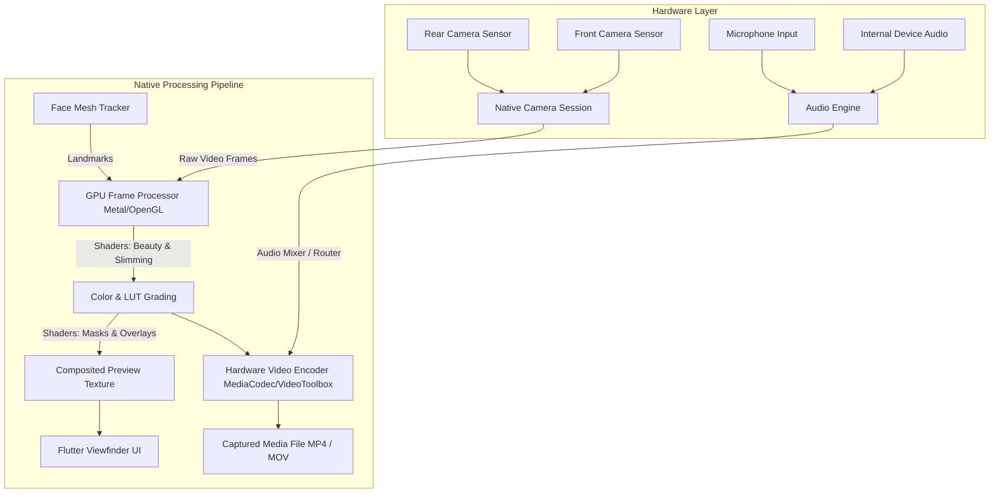

# Danaview 1.3.0: In-House Native Camera (Photo & Video Capture Engine)

> **Release:** Danaview 1.3.0 (app version `1.3.0+N`). **Date:** 2026-10-12. **Status:** Proposal & Architectural Draft.
> **Baseline:** `docs/v1.1/video-editor/ARCHITECTURE.md` (D-01 to D-44), `docs/v1.2/ai-studio/AI_STUDIO_PLAN.md` (D-45 to D-70), `docs/v1.2/editor-desktop/DESKTOP_EDITOR_PLAN.md` (D-71 to D-85), and `docs/v1.3/home-photo-video-view/HOME_PHOTO_VIDEO_PLAN.md` (D-86 to D-98).
> **Scope:** A high-performance, in-house native camera for capturing photos and videos. Built directly on native OS camera APIs without bloated third-party wrappers. Features real-time beauty & face reshaping, cinematic capture, manual pro configurations, live overlay texts/masks/fonts, dual front+back multicam capture, and flexible device background audio vs external microphone recording.
> **Decisions:** Proposes decisions **D-99 to D-115**. Decisions marked **[OWNER]** require confirmation from the product owner.

---

## 0. Contents

1. Executive Summary & Goals
2. Decisions Log (D-99 to D-115)
3. Native Architecture & Capture Pipeline
   - 3.1 Pure Native Engine Core (AVFoundation & Camera2/CameraX)
   - 3.2 Real-Time GPU Filter & Shader Graph (Metal & OpenGL ES/Vulkan)
   - 3.3 Face Landmark Tracking & Morphing Engine (Vision & ML Kit/MediaPipe)
4. Core Camera Features
   - 4.1 Beauty Suite: Skin Smoothing, Face Slimming & Feature Reshaping
   - 4.2 Cinematic Mode: 24 fps, Depth Bokeh, Anamorphic Matte & Real-Time LUTs
   - 4.3 Pro Controls: ISO, Shutter, Manual Focus & Peaking, Zebra, Histograms
   - 4.4 Live Overlays: Dynamic Text, Aesthetic Masks & Content Fonts
   - 4.5 Dual Camera Capture (Simultaneous Front + Back PIP & Split)
   - 4.6 Background & Internal Device Audio vs Microphone Recording
5. Platform Capability Probing & Graceful Degradation
6. Implementation Ticket Breakdown (CAM-01 to CAM-20)

---

## 1. Executive Summary & Goals

### 1.1 Executive Summary

Danaview 1.3.0 introduces a custom, first-party camera engine. Instead of handing off capture to the system camera app or wrapping generic Flutter plugins, Danaview interacts directly with native camera hardware pipelines (`AVFoundation` on iOS/macOS, `Camera2/CameraX` on Android, `DirectShow/MediaCapture` on Windows, and `V4L2` on Linux).

The camera provides professional-grade manual capture controls alongside cutting-edge real-time creative tools: face slimming and feature reshaping, cinematic portrait depth blur, customizable dual-camera picture-in-picture, and internal device audio recording that lets creators play backing music or game audio without picking up room noise.

### 1.2 Goals

| #        | Goal                                                                                                                                                       | Where Guaranteed     |
| -------- | ---------------------------------------------------------------------------------------------------------------------------------------------------------- | -------------------- |
| **G-C1** | **Pure Native Foundation**: Direct integration with platform camera frameworks. Zero latency preview, 60 fps rendering, zero third-party capture wrappers. | D-99; CAM-01, CAM-02 |
| **G-C2** | **Real-Time On-Device Beauty**: 60 fps GPU face mesh deformation (slimming, chin, nose, eyes) and skin smoothing with zero network communication.          | D-101, D-102; CAM-05 |
| **G-C3** | **Hardware-Aware Dual Capture**: Concurrent front and back camera recording on supported hardware with customizable PIP size, ratio, and shape.            | D-106; CAM-09        |
| **G-C4** | **Flexible Audio Routing**: Ability to capture background internal device audio while optionally muting or mixing the external microphone.                 | D-107; CAM-10        |
| **G-C5** | **Strict Graceful Degradation**: If hardware lacks dual capture, manual shutter, or depth sensors, the controls are cleanly hidden from the UI.            | D-108; CAM-12        |
| **G-C6** | **Seamless Non-Destructive Handoff**: Photos and videos captured pass directly into Danaview's Photo and Video Editors without intermediate re-encoding.   | D-109; CAM-14        |

---

## 2. Decisions Log (D-99 to D-115)

| ID        | Decision (Summary)                                                                                               | Owner?      |
| --------- | ---------------------------------------------------------------------------------------------------------------- | ----------- |
| **D-99**  | First-party camera architecture: `danaview_camera` native plugin (AVFoundation & Camera2/CameraX).               | –           |
| **D-100** | Dual photo and video mode switcher with persistent user preferences.                                             | –           |
| **D-101** | Real-time face mesh tracking: Apple Vision framework (iOS) and MediaPipe Face Mesh / ML Kit (Android).           | –           |
| **D-102** | Beauty algorithms: bilateral skin smoothing + GPU vertex mesh deformation (slimming, jaw, nose, eyes).           | **[OWNER]** |
| **D-103** | Cinematic capture: 24/25 fps cadence, 2.39:1 widescreen mask, synthetic depth bokeh via depth maps.              | –           |
| **D-104** | Pro controls: manual ISO, exposure time, white balance Kelvin, manual focus with focus peaking.                  | –           |
| **D-105** | Live overlays: Metal/OpenGL overlay shaders rendering text (FontCatalog), masks, and aesthetic frames.           | –           |
| **D-106** | Dual capture: `AVCaptureMultiCamSession` (iOS) & `ConcurrentCamera` (Android 11+); customizable PIP shape/ratio. | **[OWNER]** |
| **D-107** | Audio capture modes: Mix (Internal + Mic), Internal Audio Only (Opt-out Mic), Mic Only, Dual-Track Recording.    | **[OWNER]** |
| **D-108** | Progressive capability discovery: unsupported controls are hidden rather than disabled.                          | –           |
| **D-109** | Capture formats: RAW/DNG & HEIC/JPEG for photos; 10-bit HDR / ProRes / H.264 / HEVC MP4/MOV for video.           | –           |
| **D-110** | Camera zoom: smooth optical-to-digital lens switching (0.5× Ultra-Wide, 1× Wide, 2×/3×/5× Telephoto).            | –           |
| **D-111** | Flash and torch modes: Auto, On, Off, and Soft Screen Fill-light for front selfie camera.                        | –           |
| **D-112** | Grid and leveling aids: 3×3 Rule of Thirds, Golden Ratio, horizon leveling tilt gyro sensor.                     | –           |
| **D-113** | Desktop webcam support: integration with USB/integrated webcams with basic capture controls.                     | –           |
| **D-114** | Shutter and burst capture: tap for photo, hold for quick video, swipe left for burst photos.                     | –           |
| **D-115** | Owner UI rules: solid surfaces, dark viewfinder chrome, Figtree typography, touch targets ≥ 44 px.               | ARCH §1.3   |

---

## 3. Native Architecture & Capture Pipeline



### 3.1 Pure Native Engine Core

- **iOS / iPadOS / macOS**: Built with `AVFoundation`:
  - `AVCaptureSession` (or `AVCaptureMultiCamSession` for dual capture).
  - `AVCaptureVideoDataOutput` delivering uncompressed `CVPixelBufferRef` to Metal compute shaders.
  - `AVCapturePhotoOutput` for zero-shutter-lag HDR and RAW capture.
- **Android**: Built with `Camera2` / `CameraX`:
  - High-speed `CaptureRequest` sessions.
  - Hardware surfaces connected to OpenGL ES 3.2 / Vulkan preview textures.
  - ImageReader for high-resolution photo output and MediaCodec for real-time video encoding.

### 3.2 Real-Time GPU Filter & Shader Graph

- Video preview runs through a unified GPU processing chain:
  1. **Face Mesh Deformation**: Vertex shader warps pixel coordinates based on 468 landmark points (slimming, chin, nose, eyes).
  2. **Skin Smoothing**: Fragment shader performs edge-preserving bilateral filtering to eliminate blemishes while preserving high-frequency textures (eyes, hair, lips).
  3. **Color Grade & LUT**: Reuses Danaview's `.vlut` 3D LUT shader (D-07).
  4. **Masks & Overlays**: Alpha-blends dynamic texts, timestamps, and border masks.

---

### 4.1 Comprehensive Beauty, Retouching, Makeup & Body Suite

The native camera beauty engine runs real-time on-device facial landmark tracking (468+ points) and skeletal/body contour estimation via GPU compute shaders (Metal on iOS/macOS, OpenGL ES 3.2 / Vulkan on Android, Direct3D 11 / DirectML on Windows), operating at 60 fps during live preview, photo capture, and video recording.

#### 1. Face Shape & Slimming
- **Face Slimming / Narrow Face**: Bilateral radial deformation targeting the cheek and outer facial boundary to smoothly slim the overall facial width.
- **V-Shaped Face**: Dynamic interpolation tapering the lower jaw inward toward the chin apex for a natural V-line aesthetic.
- **Jawline Sharpening**: High-contrast contour adjustment and localized mesh lifting defining the mandibular border.
- **Chin Slimming & Shortening**: Independent two-axis chin control—narrowing breadth and adjusting vertical chin length (shorten / elongate / sharpen).
- **Forehead Width & Height Adjustment**: Smooth hairline translation and temporal boundary scaling to balance facial thirds.
- **Lower-Face Slimming**: Targeted contouring between the mouth corners and mandibular angle without affecting upper cheek structure.
- **Cheekbone Enhancement**: Inward cheekbone softening (reduce prominent zygomatic arches) or lifting/contouring for sculpted cheek definition.
- **Face Symmetry Correction**: Dual-hemisphere landmark alignment mirroring and subtly balancing asymmetric eye, jaw, or lip planes.
- **Overall Face Reshape**: Master proportion scaling harmonizing the Golden Ratio across upper, middle, and lower facial thirds.

#### 2. Eyes & Eyebrows
- **Eye Enlargement**: Spherical iris-anchored magnification preserving eye shape fidelity without distortion.
- **Eye Shape & Angle Adjustment**: Outer canthus lifting / lowering (cat-eye, puppy-eye, doe-eye tilt) and vertical aperture rounding.
- **Eye Spacing & Positioning**: Interpupillary distance adjustment (widen / narrow spacing) and vertical eye level positioning.
- **Eye Brightening**: Sclera brightening and specular reflection enhancement delivering vibrant catchlights.
- **Dark-Circle & Eye-Bag Removal**: Selective luminance lifting and bilateral chroma de-shadowing under the lower eyelid.
- **Eyebrow Thickness, Shape & Positioning**: Eyebrow arch lift, tail extension, thickness control, and brow-to-eye distance balancing.
- **Eyelash Enhancement**: Procedural upper and lower eyelash volume thickening, elongation, and curl rendering.

#### 3. Nose & Lips
- **Nose Slimming & Narrowing**: Lateral nasal bone and alar wing compression for a refined nasal silhouette.
- **Nose Length & Bridge Adjustment**: Nasal bridge elevation/straightening and vertical nose length adjustment.
- **Nose-Tip Reshaping**: Precision spherical scaling of the nasal tip (sharpen, lift, or reduce bulbous tips).
- **Lip Enlargement & Resizing**: Volumetric upper and lower lip plumping with independent vermilion border scaling.
- **Lip Shape & Thickness Adjustment**: Cupid's bow contouring, lip corner lifting, and upper-to-lower lip ratio tuning.
- **Smile Adjustment**: Bilateral oral commissure lifting creating a natural, joyful smile expression even in neutral pose.

#### 4. Skin Retouching
- **Skin Smoothing**: Multi-scale bilateral / domain-transform filter eliminating pores and uneven texture while preserving eye, hair, and clothing sharpness.
- **Acne & Blemish Removal**: Automated patch-based neural inpainting and high-frequency spot elimination.
- **Dark-Spot Removal**: Melanin-selective chrominance balancing attenuating sunspots and hyperpigmentation.
- **Skin Tone & Brightness Adjustment**: Parametric skin illumination (porcelain fair, sun-kissed warm, bronzed, neutral pink, rich deep).
- **Oiliness Reduction (Anti-Shine)**: Specular highlight attenuation on the T-zone, forehead, and chin to create a velvety matte finish.
- **Wrinkle Softening**: Non-destructive micro-contrast smoothing fading forehead lines, nasolabial folds, and crow's feet.
- **Natural Glow**: Diffuse subsurface-scattering simulation adding translucent vitality and luminous skin radiance.
- **Teeth Whitening**: Blue-balanced dental chroma desaturation and luminance elevation targeting the oral aperture.

#### 5. Makeup & Appearance
- **Foundation & Concealer**: Seamless digital foundation layer blending skin coloration with customizable coverage opacity.
- **Lipstick**: Matte, satin, glossy, and velvet finishes across curated color palettes with edge feathering and gradient ombré modes.
- **Blush & Contour**: Anatomical cheekbone blush application (coral, peach, rosy, plum) and 3D jaw/nose contour shading.
- **Eyeliner & Eyeshadow**: Winged, tightline, and smokey eyeliner styles paired with multi-tone blending eyeshadow gradients.
- **Virtual Colored Contact Lenses**: Procedural iris texture overlays (hazel, crystal gray, emerald green, deep sapphire) with natural pupil dilation.
- **Hair Color & Hairstyle Effects**: Real-time hair strand segmentation with chromatic tinting (ash blonde, chestnut, neon, highlights) and hairline fullness.
- **Freckles & Beauty Marks**: Customizable sun freckle patterns and aesthetic facial beauty marks with variable density and alpha.

#### 6. Body Slimming & Proportions
- **Body Reshaping**: Real-time skeletal pose detection adjusting full-body silhouette contours.
- **Waist Slimming**: Bilateral torso narrowing creating a natural hourglass waistline while preserving surrounding backgrounds via smart mesh anchors.
- **Arm & Leg Slimming**: Targeted cylindrical deformation slimming upper arms, thighs, and calves.
- **Hip & Shoulder Adjustments**: Shoulder width refinement (broaden / soften) and pelvic curve enhancement.
- **Leg-Length Adjustment**: Lower-extremity vertical stretching with ground-plane anchoring for statuesque proportions.
- **Height & Body-Proportion Correction**: Head-to-body ratio adjustment and postural straightening (spine and neck alignment).

#### 7. Camera, Filters & Effects
- **Real-Time Beauty Filters**: Ultra-low latency GPU shaders applying combined beauty grades at full capture frame rates.
- **Filter Styles**: "Natural Pure", "Soft Glow", "Cinematic Glam", "Vintage Film 35mm", "Retro VHS", "Pastel Dream".
- **Background Blur & Portrait Effects**: Depth-map segmentation creating adjustable optical bokeh ($f/1.4$ to $f/16$), studio lighting, and stage spotlight.
- **AR Face Masks & Interactive Stickers**: 3D face-anchored tracking for dynamic aesthetic stickers, glasses, headwear, and seasonal masks.
- **Photo & Video Retouching Cohesion**: Identical shader pipeline powers live camera capture, photo editing, and timeline video clips.
- **Before-and-After Comparison**: Split-screen swipe or press-and-hold instant toggle comparing original unretouched and beautified streams.
- **Adjustable Effect Intensity**: Universal master slider (0–100%) plus granular per-feature micro-sliders.
- **Undo, Redo & Reset**: Full history stack for manual adjustments with one-tap section resets.

#### 8. Advanced Intelligence & Management
- **AI Face Detection & Facial Landmarks**: 468 3D landmark points tracking under extreme head pose angles ($\pm 60^\circ$ yaw/pitch).
- **Automatic Face Enhancement**: One-tap smart enhancement automatically analyzing facial structure and applying ideal harmonious values.
- **Manual Adjustment Sliders**: Precision floating point numeric control for pro creators.
- **HD Photo Export & 4K Video Retouching**: Full-bitness rendering preserving native sensor resolution without downsampling artifacts.
- **Preset Beauty Styles**: Factory curated profiles: "Everyday Clean", "Editorial Model", "K-Beauty Dewy", "Bronze Glow", "Studio Portrait".
- **Save Custom Beauty Settings**: Export and save user-tailored beauty parameter presets stored in local secure JSON preferences.

```
+---------------------------------------------------------------------------------------------------+
|  DANAVIEW CAMERA BEAUTY SUITE                                                    [ Before / After ]|
+---------------------------------------------------------------------------------------------------+
|  [ Face Shape ]  [ Eyes/Brows ]  [ Nose/Lips ]  [ Skin ]  [ Makeup ]  [ Body ]  [ Filters ]  [ Presets ]
+---------------------------------------------------------------------------------------------------+
|  Master Beauty: [ ON ]                                               Intensity: [====o===] 75%    |
|                                                                                                   |
|  Face Slimming:    [ - ]======o===========[ + ] 55%    Skin Smoothing:    [ - ]=======o========[ + ] 65%  |
|  V-Shape Face:     [ - ]====o=============[ + ] 40%    Acne / Blemishes:  [ - ]=========o======[ + ] 85%  |
|  Jawline Sharpen:  [ - ]=====o============[ + ] 50%    Dark Circles:      [ - ]=======o========[ + ] 60%  |
|  Chin Slim/Length: [ - ]====o=============[ + ] 35%    Teeth Whitening:   [ - ]========o=======[ + ] 75%  |
|  Eye Enlarge:      [ - ]===o==============[ + ] 30%    Lipstick (Matte):  [ - ]=====o==========[ + ] 45%  |
|  Nose Slimming:    [ - ]====o=============[ + ] 42%    Waist Slimming:    [ - ]====o===========[ + ] 38%  |
|  Nose Bridge/Tip:  [ - ]=====o============[ + ] 48%    Leg Elongation:    [ - ]===o============[ + ] 25%  |
+---------------------------------------------------------------------------------------------------+
|  [ 🔄 Reset Section ]                         [ 💾 Save Preset ]                     [ ✨ Auto Enhance ]|
+---------------------------------------------------------------------------------------------------+
```

### 4.2 Cinematic Mode

- **Cadence**: Locks sensor shutter angle to 180° at 24.000 or 25.000 fps (D-03).
- **Depth Bokeh**: Uses hardware depth sensors (LiDAR, TrueDepth, dual-lens disparity) to compute a depth matte. Renders an optical disc-blur bokeh with customizable virtual f-stop ($f/1.4$ to $f/16$).
- **Aspect Matte**: Selectable live framing: 2.39:1 Anamorphic, 2:1 Univisium, 4:3 Academy, 1:1 Square, with translucent guide bars.
- **Cinematic LUTs**: Live preview and burning of curated grades: "Teal & Orange", "Bleach Bypass", "Vintage 35mm", "Golden Hour", "Monochrome 400".

### 4.3 Pro Manual Configurations

- **ISO**: 50 to 6400 (or sensor maximum).
- **Shutter Speed**: 1/8000s to 1s.
- **Manual Focus**: Linear distance slider with **Focus Peaking** (sharp edges outlined in vivid green or cyan).
- **White Balance**: Kelvin temperature slider (2,000K to 10,000K) + green/magenta tint slider.
- **Exposure Tools**:
  - Live **Zebra Stripes** overlay for overexposed highlights (threshold adjustable from 80% to 100%).
  - Live **RGB & Luminance Histogram** in top corner.
  - Multi-point EV metering (tap to meter, drag to separate focus and exposure points).

### 4.4 Live Overlay Texts, Masks, and Fonts

- **Dynamic Text**: Embed live timestamps, GPS locations, speed/altitude telemetry, custom titles, or watermarks.
- **Font Catalog**: Full access to Danaview's bundled content fonts (Figtree, Outfit, Roboto, plus imported fonts).
- **Aesthetic Masks**:
  - Retro VHS date/time overlay with scanline shader.
  - 35mm film perforations and vintage border frames.
  - Split-screen viewfinders and technical camera crosshairs.

### 4.5 Dual Camera Capture (Front + Back Simultaneous)

- Available on devices supporting concurrent multicam sessions:
  - iOS: `AVCaptureMultiCamSession` on iPhone XS/XR and newer.
  - Android: Devices with `PackageManager.FEATURE_CAMERA_CONCURRENT`.
- **Placement & Layouts**:
  - **PIP Mode**: One camera fills the screen; the other renders in a floating PIP box. Single-tap swaps primary and secondary feeds.
  - **Split Mode**: 50/50 horizontal split (top/bottom) or vertical split (left/right).
- **PIP Customization**:
  - **Ratios**: 1:1 (Square), 4:3, 16:9, 9:16.
  - **Shapes**: Rounded Rectangle, Circle, Pill / Oval, Teardrop, Heart, Diamond.
  - **Positioning**: Freely draggable with magnetic edge snapping.

```
+-------------------------------------------------------------------------------+
|  DUAL CAMERA PIP MODES:                                                       |
|                                                                               |
|  [ Full + Circle PIP ]    [ Full + Square PIP ]    [ 50/50 Split Screen ]     |
|  +-------------------+    +-------------------+    +-------------------+      |
|  | [BACK CAM FULL]   |    | [BACK CAM FULL]   |    | [BACK]    | [FRONT]   |      |
|  |     ( FRONT )     |    |     +-------+     |    |           |           |      |
|  |     (  PIP  )     |    |     | FRONT |     |    |           |           |      |
|  |                   |    |     +-------+     |    |           |           |      |
|  +-------------------+    +-------------------+    +-------------------+      |
+-------------------------------------------------------------------------------+
```

### 4.6 Background Device Audio & Internal Audio Recording

Creators often want to record videos while playing background music (Spotify, Apple Music, YouTube) or game audio directly on the device. Danaview 1.3.0 provides advanced audio routing:

- **Audio Modes**:
  1. **Mixed (Internal + Mic)**: Records background music/game audio AND external voice from the microphone. Ideal for vlogging, tutorials, and sing-alongs.
  2. **Internal Audio ONLY (Opt-out Mic)**: Completely disables external microphone input. Records crystal-clear internal device sound with zero ambient room noise.
  3. **Microphone ONLY**: Traditional camera audio recording.
  4. **Dual-Track Multi-Channel Recording**: Writes internal device audio to Track 1 and microphone audio to Track 2 inside the MP4/MOV container. This allows adjusting music vs voice volume later in the Danaview Video Editor.

---

## 5. Platform Capability Probing & Graceful Degradation

> **Architectural Law**: If a specific feature or sensor is not supported on a platform, device, or operating system version, **the feature is completely hidden from the user interface**. Danaview never presents dead-end disabled buttons or runtime error alerts for missing hardware.

| Feature                       | iOS Hardware            | Android Hardware                 | Desktop (macOS/Win/Linux)     | If Unsupported:                |
| ----------------------------- | ----------------------- | -------------------------------- | ----------------------------- | ------------------------------ |
| **Dual Capture (Front+Back)** | iPhone XS/XR+           | Android 11+ Concurrent           | Multiple USB webcams          | Dual capture button hidden     |
| **Face Slimming / Reshaping** | All (Metal)             | GLES 3.2 / Vulkan                | Desktop GPU                   | Face reshaping panel hidden    |
| **Cinematic Depth Blur**      | Dual Cam / LiDAR        | Dual Cam / ToF                   | Monocular (Depth ML)          | Blur slider hidden             |
| **Internal Device Audio**     | iOS 13+ ReplayKit/Audio | Android 10+ AudioPlaybackCapture | WASAPI / CoreAudio / PipeWire | "Internal Audio" toggle hidden |
| **Manual Shutter / ISO**      | All iOS                 | Camera2 Level 3 / Full           | Limited UVC controls          | Pro manual mode hidden         |
| **RAW Photo Capture**         | Pro models (ProRAW)     | Camera2 RAW capability           | Raw sensor cameras            | RAW pill hidden (JPEG only)    |

---

## 6. Implementation Ticket Breakdown (CAM-01 to CAM-20)

| Ticket     | Scope & Summary                                                                                         | Depends On          |
| ---------- | ------------------------------------------------------------------------------------------------------- | ------------------- |
| **CAM-01** | Create `danaview_camera` native plugin with iOS `AVFoundation` implementation.                          | v1.1 Native         |
| **CAM-02** | Implement Android `Camera2` / `CameraX` capture session with OpenGL ES 3.2 preview.                     | CAM-01              |
| **CAM-03** | Develop desktop webcam capture driver for macOS, Windows, and Linux.                                    | CAM-01              |
| **CAM-04** | Build real-time face landmark tracking engine (Vision on iOS, MediaPipe on Android).                    | CAM-01, CAM-02      |
| **CAM-05** | Implement GPU face mesh deformation shaders (face slimming, chin, nose, eyes).                          | CAM-04              |
| **CAM-06** | Implement bilateral skin smoothing and blemish reduction shader passes.                                 | CAM-05              |
| **CAM-07** | Implement cinematic capture mode: 24 fps cadence, 2.39:1 matte, depth bokeh.                            | CAM-01, CAM-02      |
| **CAM-08** | Implement manual pro controls: ISO, shutter speed, manual focus with focus peaking.                     | CAM-01, CAM-02      |
| **CAM-09** | Develop dual camera concurrent capture session (`AVCaptureMultiCamSession` & Android concurrent).       | CAM-01, CAM-02      |
| **CAM-10** | Implement PIP customization: ratio selection (1:1, 4:3, 16:9) and shape clipping (circle, pill, heart). | CAM-09              |
| **CAM-11** | Build audio capture routing: Internal Device Audio, Mic opt-out, and multi-track audio writing.         | CAM-01, CAM-02      |
| **CAM-12** | Implement hardware capability discovery probe and UI dynamic visibility gating.                         | CAM-01              |
| **CAM-13** | Implement live dynamic text, aesthetic masks, and font overlay rendering.                               | CAM-01, FontCatalog |
| **CAM-14** | Build direct capture handoff into Photo Editor and Video Editor timelines.                              | CAM-01, HOM-01      |
| **CAM-15** | Implement zoom controller with smooth optical lens switching (0.5×, 1×, 2×, 3×, 5×).                    | CAM-01, CAM-02      |
| **CAM-16** | Add exposure metering aids: live zebra stripes and RGB/luminance histogram.                             | CAM-08              |
| **CAM-17** | Implement flash, torch, and soft front screen fill-light modes.                                         | CAM-01, CAM-02      |
| **CAM-18** | Build custom camera viewfinder UI complying strictly with Owner standing UI rules.                      | ARCH §1.3           |
| **CAM-19** | Battery and thermal throttling tests: verify continuous 4K 60fps recording without frame drops.         | CAM-01, CAM-02      |
| **CAM-20** | Automated capability matrix test suite across simulated device profiles.                                | CAM-12              |
