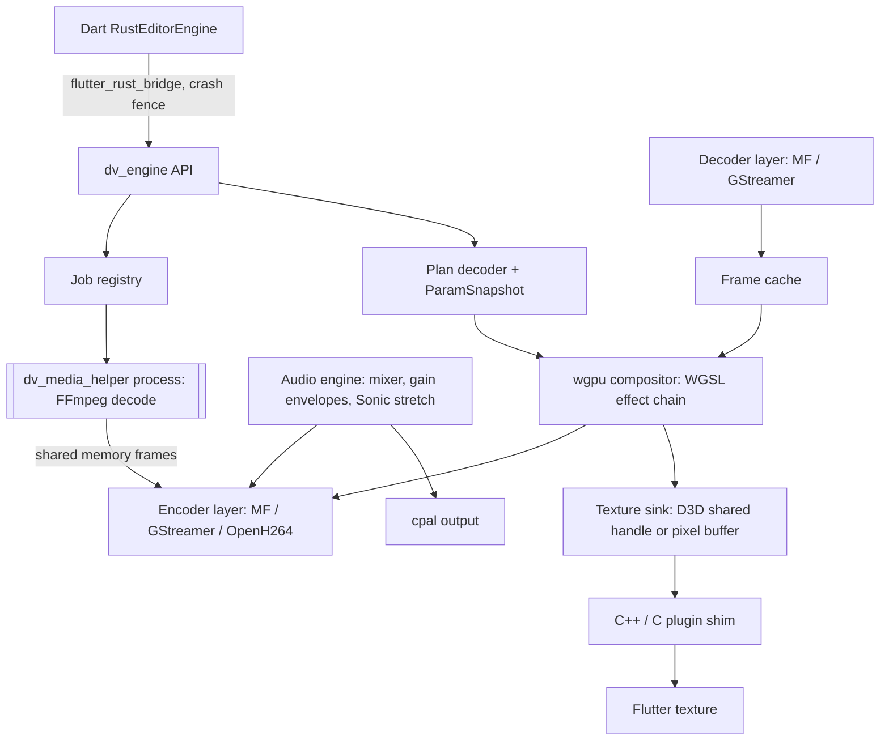

# Danaview 1.3.0: Desktop Photo & Video Editor (macOS, Windows, Linux)

> **Release:** Danaview 1.3.0 (app version `1.3.0+N`), moved from 1.2.0 by the owner on 2026-10-15. **Date:** 2026-10-12, rewritten 2026-10-15 with the owner's decisions (§2). **Status:** plan, ready for the planning review that turns §9 into a BUILD_PLAN-style ticket file.
> **Baseline:** `docs/v1.1/editor/ARCHITECTURE.md` ("ARCH", decisions D-01 to D-45) and `docs/v1.1/editor/BUILD_PLAN.md` ("BP", 166 tickets), plus the 1.2.0 plans this release builds on: `docs/v1.2/ai-studio/AI_STUDIO_PLAN.md` ("AIS"), `docs/v1.2/video-editor-update/VIDEO_EDITOR_UPDATE_PLAN.md` ("VED") and `docs/v1.2/home-photo-video-view/HOME_PHOTO_VIDEO_PLAN.md` ("HOM").
> **Scope:** every editor feature the phones have in 1.1 and 1.2, on macOS, Windows and Linux, plus a small set of desktop-only features (§5). Work starts after 1.2.0 ships.
> **Decisions:** D-71 to D-85 (this plan's range; the earlier draft's decisions are replaced). **[OWNER]** marks the few still open. **[VERIFY]** marks a claim a spike or ticket must prove; the closing ticket is named.
> **Priorities set by the owner (2026-10-15):** production-ready, secure, no crashes, fast.

---

## 0. Contents

1. Summary, goals, non-goals, what already exists
2. Decisions D-71 to D-85
3. Architecture
4. Parity table: every phone feature → its desktop ticket
5. Desktop-only features
6. Desktop UX
7. Capabilities, tiers and graceful degradation
8. Reliability, security and testing
9. Tickets (milestones, lanes, index, ticket specs)
10. Risks, [VERIFY] register, open questions, effort

---

## 1. Summary, goals, non-goals, what already exists

### 1.1 Summary

1.3.0 turns on the editor on desktop with **two native engines instead of three**:

- **macOS** reuses the tested iOS engine (Swift, AVFoundation, Core Image, Metal) by moving it to shared Darwin source. Almost everything the iPhone does, the Mac does with the same code.
- **Windows and Linux** share **one engine written in Rust**. Rendering uses `wgpu` (Direct3D 12 on Windows, Vulkan on Linux) with one set of WGSL shaders. Each platform keeps a thin layer for what must be native: hardware decode and encode (Media Foundation on Windows, GStreamer with VA-API/NVDEC on Linux), audio devices and the Flutter texture hand-off.
- **Unusual formats** (MKV, WebM, AVI, ProRes on Windows/Linux, and anything the hardware decoders refuse) are opened by a separate **FFmpeg helper process** that converts them on import into an edit-ready copy. FFmpeg never runs inside the app process, so a bad file can at worst crash the helper.

The Dart side does not change: the core, RenderPlan, commands, history, autosave, AI captions, AI Studio, rich subtitles, photo mode and the UI are shared with the phones (ARCH §25, G7).

### 1.2 Goals

| # | Goal | Where it is guaranteed |
|---|---|---|
| G-D1 | **Phone parity.** Every editor feature of 1.1 and 1.2 works on all three desktops, or the parity table (§4) says why it is not needed there | §4; DSK-39 parity checklist |
| G-D2 | **No core or UI fork.** Desktop uses the same `danaview_editor_core`, RenderPlan schema, commands and UI, with desktop layouts added | ARCH §25; DSK-30…DSK-35 |
| G-D3 | **Render parity.** A project exports the same on desktop as on iOS and Android within the v1 parity tolerance (SSIM ≥ 0.99 per frame, identical frame count and timestamps) | DSK-36 |
| G-D4 | **No crashes from engine code or media files.** Safe Rust in the Windows/Linux engine, a crash fence on every Dart↔native call, FFmpeg only in a separate process, fuzzed parsers | D-73, D-76, D-80; DSK-37 |
| G-D5 | **Fast.** Hardware decode and encode first, GPU composition, zero-copy hand-off to Flutter where the platform allows it, 4K preview without proxies on mid/high tiers | D-72, D-74, §7 |
| G-D6 | **Privacy unchanged.** Offline and on device; the only network use stays the speech-model download (and, if the owner picks it, the OpenH264 download, D-79) after consent, plus AI Studio when the user turns it on | ARCH G6, AIS G-S1 |
| G-D7 | **Owner UI rules** on every desktop surface: custom components, Figtree, dark UI, computed contrast, no overflow from 1024 to 3840 px window widths at text scale 0.85–1.35 | ARCH §1.3; DSK-38 |

### 1.3 Non-goals for 1.3.0

- HDR or 10-bit export, DNxHR export, and ProRes export on Windows/Linux (ProRes export ships on macOS only, D-81).
- A detached second-monitor preview window (deferred: Flutter's desktop multi-window support is still young, D-82).
- Third-party plugins (OpenFX, VST3, AU), multicam angle editing, cloud project sync, collaboration.
- Non-integer project frame rates (stays D-03).
- GPL components of any kind (no x264, no GPL FFmpeg build).

### 1.4 What already exists (and is reused as is)

- **Dart, all platforms:** core (CORE-xx), engine API and contract kit (API-01…04), render prep and text layout, transcription pipeline and model store (AI-07…13), the full editor UI (UX-xx, already pointer-, hover-, keyboard- and marquee-aware, ARCH §25.3), AI Studio and rich subtitles (AIS), photo mode and beauty UI (VED), Home photo browsing including desktop folders (HOM-03).
- **macOS:** the iOS engine (IOS-02…IOS-20, VED's Metal photo and beauty passes and the Vision face tracker), the player's App Sandbox setup (`macos/Runner/*.entitlements`), `desktop_drop` and `file_selector`.
- **Windows/Linux:** the player (libmpv via media_kit), `desktop_drop`, `file_selector`. No editor engine.
- **Test assets:** ENG-05 fixtures and barcode readers, API-03 render-math vectors and the Dart CPU reference renderer: the WGSL shaders are checked against these.

---

## 2. Decisions D-71 to D-85

| ID | Decision | Status |
|---|---|---|
| **D-71** | **Two engines.** macOS = shared Darwin Swift engine; Windows + Linux = one Rust engine. Both implement `danaview_editor_engine_api` and pass the same contract kit and parity suite | owner 2026-10-15 |
| **D-72** | **macOS reuses iOS** by moving `packages/danaview_editor_engine/ios/Classes` to `darwin/Classes` (`sharedDarwinSource: true`), with `#if os(iOS)` / `#if os(macOS)` only where UIKit, PhotoKit-only or background-task code differs | – |
| **D-73** | **Rust for Windows/Linux** (`packages/danaview_editor_engine/rust/`, crate `dv_engine`), stable toolchain pinned in `rust-toolchain.toml`, built by cargokit through Flutter's normal build, Dart bindings by `flutter_rust_bridge` | owner 2026-10-15 |
| **D-74** | **Rendering with `wgpu`**: one WGSL shader set implementing the D-08 effect order, the `.vlut` tiled LUT (D-07), `.vsprite` (D-06), masks and blending, plus VED's RGBA16F photo pipeline and beauty passes. Backends: Direct3D 12 on Windows, Vulkan on Linux, OpenGL ES as Linux fallback. Checked against API-03 vectors and the CPU reference renderer | – |
| **D-75** | **Flutter hand-off.** Windows: GPU surface texture with a DXGI shared handle (zero-copy) when DSK-02 proves it, otherwise a pixel-buffer texture at preview size. Linux: pixel-buffer texture at preview size (one copy), `FlTextureGL` only if DSK-03 proves a safe path. macOS: the iOS `FlutterTexture` path. **[VERIFY: DSK-02, DSK-03]** | – |
| **D-76** | **Crash fences.** Every Rust entry point runs inside `catch_unwind` and returns a typed `EngineError`; a panic becomes `EngineFailure.internal` in Dart and never aborts the app. The engine keeps no state that a failed call can corrupt (job and session objects are rebuilt from the plan). Swift entry points already follow the ENG-07 error mapper | owner 2026-10-15 |
| **D-77** | **Decoding order.** (1) Platform hardware decoders: VideoToolbox (macOS), Media Foundation with D3D11 video acceleration (Windows), GStreamer `va`/`nvcodec` decoders (Linux). (2) Platform software decoders that are not FFmpeg (Media Foundation software MFTs; GStreamer `openh264dec`). (3) Otherwise the FFmpeg helper's conform-on-import (D-80). No FFmpeg code is loaded into the app process, including GStreamer's `gst-libav` | owner 2026-10-15 |
| **D-78** | **Encoding.** macOS: AVAssetWriter with VideoToolbox (as iOS). Windows: Media Foundation sink writer with hardware H.264/HEVC MFTs (NVENC, Quick Sync, AMF) and the AAC MFT. Linux: GStreamer `va` H.264/HEVC encoders, else OpenH264 (D-79); AAC from `voaacenc` **[VERIFY: DSK-03]**, else the helper encodes audio only. MP4 everywhere, MOV on macOS | – |
| **D-79** | **OpenH264 software fallback on Linux** (machines with no hardware encoder). Cisco's patent licence covers only the binary downloaded from Cisco, so it is **downloaded on first need after consent**, like speech models. Without it, Linux export on such machines is unavailable with a clear message **[OWNER: accept the download, or ship Linux export as hardware-only]** | open |
| **D-80** | **FFmpeg helper process** `dv_media_helper` (Rust + LGPL FFmpeg, decode-only build: libavformat, libavcodec, libswscale, libswresample). Used only to **probe and conform** files the platform cannot decode: it decodes and streams raw frames and audio over shared memory to the engine, which encodes an edit-ready managed copy (HEVC Main10 where a hardware encoder exists, else high-bitrate H.264; audio PCM/AAC). The original stays untouched and referenced; editing and export use the copy. One helper process per job, killed on timeout or memory cap, restricted by the OS (Windows job object with low integrity, Linux seccomp + Landlock, macOS app-sandbox inheritance). Pinned FFmpeg version, updated for security fixes in every release | owner 2026-10-15 |
| **D-81** | **Desktop-only features in 1.3.0** (owner 2026-10-15): 4K preview without proxies and higher layer limits on mid/high tiers, GPU speech recognition, batch export queue, ProRes export on macOS, colour scopes. Deferred: second-monitor window, HDR/10-bit export, DNxHR | owner 2026-10-15 |
| **D-82** | **No multi-window in 1.3.0.** Full-screen preview stays in the main window (UX-18). Revisit when Flutter's multi-window API is stable | owner 2026-10-15 |
| **D-83** | **Linux support tier:** "supported with diagnostics" (not certified) until tested on real Linux hardware with Intel, AMD and NVIDIA GPUs. A Diagnostics page lists the GPU backend, decoders, encoders and missing GStreamer plugins | owner 2026-10-15 |
| **D-84** | **Engine contract amendment** (one [INTEGRATION] ticket, DSK-05, after the spikes): `PreviewSession.setRate(double rate)` for J-K-L shuttle (capability `shuttleRates`; phones report none), `PreviewSession.scopes` stream (capability `scopes`), `MediaJobs.conform(...)` for D-80 (capability `conform`), `EditorCapabilities` additions for desktop tiers. Phone engines return `notSupportedOnDevice` and report the capabilities as absent, so phone behaviour does not change | – |
| **D-85** | **Desktop cursor tools.** Select `V`, Razor `C`, Slip `Y`, Ripple `B`. Razor splits the hovered track; `Shift`+click splits all unlocked tracks at that time. Slip needs a new core command (`SlipItem`, DSK-31) | owner may revise the Razor default |

---

## 3. Architecture

### 3.1 Package layout

```
packages/danaview_editor_engine/            (existing plugin; gains three platforms)
  lib/                                      Dart: MobileEditorEngine (iOS, Android, macOS)
    src/desktop/rust_editor_engine.dart     NEW: RustEditorEngine (Windows, Linux) over flutter_rust_bridge
  darwin/Classes/                           MOVED from ios/Classes (shared iOS + macOS Swift)
  android/                                  unchanged
  windows/                                  NEW: C++ plugin shim (texture registrar, window events)
  linux/                                    NEW: C plugin shim (FlTextureRegistrar, window events)
  rust/                                     NEW: Cargo workspace
    dv_engine/                              the engine library (cdylib + staticlib)
    dv_media_helper/                        the FFmpeg helper binary (D-80)
    dv_shaders/                             WGSL sources + build-time validation (naga)
packages/danaview_whisper/                  gains macos/, windows/, linux/ builds (DSK-23)
```

The pubspec declares `macos: {pluginClass, sharedDarwinSource: true}`, `windows: {pluginClass}` and `linux: {pluginClass}`. The app's engine override (ARCH §25.4) picks `MobileEditorEngine` on iOS, Android and macOS and `RustEditorEngine` on Windows and Linux.

### 3.2 macOS engine

- **Shared source:** IOS-02…IOS-20 and VED's Metal passes compile for macOS. UIKit-only code (orientation, `UIApplication` background tasks, PhotoKit pickers) is split behind `#if os(iOS)` with macOS equivalents in `darwin/Classes/Platform/macOS/`.
- **Background:** desktop apps are not suspended, so IOS-13's segment-resumable export becomes a straight run with an `IOPMAssertion` that prevents idle sleep while exporting. The checkpoint code stays, for crash recovery.
- **Files:** App Sandbox security-scoped bookmarks (already the iOS Files path); drops via `desktop_drop`; save to the user's Movies folder or a chosen folder; "Show in Finder".
- **Face tracking:** Apple Vision, as on iOS (VED-16).
- **Speech:** whisper with Metal (DSK-23).

### 3.3 Windows/Linux engine (`dv_engine`, Rust)



- **Threads:** one control thread per session, a decode pool, one render thread owning the `wgpu` device, one audio thread (real-time, no allocation), and job threads. Communication by bounded channels; no locks held across GPU or decoder calls.
- **Plan decoding:** RenderPlan JSON → Rust types generated from CORE-29's JSON Schema, validated by the contract fixtures; patches and transients follow ARCH §12 exactly as IOS-08/AND-08.
- **Frame rules:** the platform-time rule (D-35) and the source-frame rule (D-04, ε = 500 µs) are implemented once in Rust and tested with ENG-05's barcode fixtures, including the grid-cut cases.
- **Audio:** the mixer applies the plan's gain envelopes per sample (D-37 semantics, up to +6.02 dB, clamped before encode), speed changes use a Rust port of the Sonic algorithm (Apache-2.0, the same algorithm as Android's Media3), output through `cpal` (WASAPI on Windows, ALSA/PulseAudio/PipeWire on Linux). The audio clock is the preview's master clock.
- **Decoders:** a `Decoder` trait with `MfDecoder` (Windows) and `GstDecoder` (Linux) implementations, exact seek by decode-forward from the previous sync sample, NV12/P010 frames uploaded to `wgpu` (zero-copy import where DSK-02/DSK-03 prove it).
- **Encoders:** an `Encoder` trait with `MfEncoder`, `GstEncoder` and `OpenH264Encoder`; muxing by Media Foundation (Windows) and GStreamer `mp4mux` (Linux).
- **Memory:** frame cache and GPU budgets come from the tier (§7); memory-pressure events trim caches as on the phones.

### 3.4 FFmpeg helper (D-80)

- **When:** probe finds a container or codec no platform decoder handles; or a hardware decoder fails on a file during import.
- **What the user sees:** an import step "Preparing *file name* for editing" with progress and Cancel. The managed copy counts toward "Editor cache"/project storage and is re-created if deleted.
- **Isolation:** separate process, no network, a read-only handle to the one source file and a write handle to one shared-memory region; killed after a stall (no frame for 10 s) or above a memory cap (1 GB). A crash or kill means "This file couldn't be read", never an app crash.
- **Supply chain:** FFmpeg built in CI from a pinned release tarball with a checked sha256, `--disable-gpl --disable-nonfree`, decoders and demuxers only, no network protocols. The build script and licence notice ship with the app.

### 3.5 Speech recognition on desktop

`danaview_whisper` adds desktop builds behind the same Dart API: Metal on macOS; ggml's **Vulkan** backend on Windows and Linux (works on NVIDIA, AMD and Intel without shipping CUDA), with the AVX2 CPU path as fallback. Model store, consent and the transcription pipeline are unchanged.

### 3.6 1.2.0 features on desktop

- **Photo mode (VED-01…14):** macOS reuses the Metal pipeline. Rust implements the RGBA16F still pipeline, tone, HSL, curves, masks and keystone in WGSL; still decode via WIC (Windows) and GStreamer/`image` crate (Linux; HEIC via libheif LGPL, RAW via LibRaw LGPL **[VERIFY: DSK-25]**); still export JPEG/PNG/WebP (+HEIC where an encoder exists).
- **Beauty (VED-15…28):** macOS reuses Vision + Metal. Rust runs the MediaPipe Face Mesh model (Apache-2.0) through ONNX Runtime (`ort`; DirectML on Windows, CPU on Linux) with VED's One-Euro filter, and ports the beauty shaders to WGSL.
- **AI Studio (AIS):** Dart, unchanged. The key store (AIS-11) gains macOS Keychain, Windows Credential Manager (DPAPI) and Linux Secret Service (libsecret); without a Secret Service on Linux, AI Studio stays hidden (graceful degradation).
- **Home (HOM):** HOM-11/HOM-12 editor actions turn on with the desktop editor (DSK-27).

---

## 4. Parity table: every phone feature → its desktop ticket

"Shared" means the Dart code already runs on desktop and only needs testing there (DSK-38/DSK-39).

| Phone ticket(s) | Feature | macOS | Windows / Linux |
|---|---|---|---|
| ENG-01…04, ENG-07/08 | Engine glue (Pigeon, preview, jobs, export, platform services) | DSK-06 (shared Swift; Pigeon macOS target) | DSK-10 (Rust API), DSK-26 (Dart `RustEditorEngine`) |
| ENG-05, ENG-09 | Fixtures, example host, native test harness, CI | DSK-01 | DSK-01 |
| ENG-06, INT-06 | Contract freezes and amendments | DSK-05 | DSK-05 |
| IOS-01 / AND-01 | Engine spikes | DSK-04 | DSK-02 (Windows), DSK-03 (Linux) |
| IOS-02 / AND-02 | Probe, compatibility, device profile, capabilities | DSK-06, DSK-09 | DSK-13 (Win probe), DSK-14 (Linux probe), DSK-22 (tiers) |
| IOS-03 / AND-03 | Thumbnails and disk cache | DSK-06 | DSK-15 |
| IOS-04 / AND-04 | PCM decode, waveforms, speech audio | DSK-06 | DSK-15 |
| IOS-05 / AND-05 | Job registry, proxies | DSK-06 | DSK-16 |
| IOS-06 / AND-06 | Freeze frame, source-frame cache | DSK-06 | DSK-16 |
| IOS-07 / AND-07 | Reverse rendition | DSK-06 | DSK-16 |
| IOS-08 / AND-08 | Plan decode, ParamSnapshot, composition, audio mix | DSK-06 | DSK-10, DSK-17 |
| IOS-09 / AND-09 | Render kernels, LUT, sprites, images | DSK-06 | DSK-11 |
| IOS-10 / AND-17 | Compositor, layer renderer, redraw/paused frames | DSK-06 | DSK-12 |
| IOS-11 / AND-10 / AND-16 | Preview session (texture, clock, seek, patches, quality, lifecycle) | DSK-06, DSK-07 | DSK-18 |
| IOS-18 | Sample-exact gain envelopes, ramp seams | DSK-06 | DSK-17 |
| IOS-12 / AND-11 | Export pipeline, encoder selection | DSK-06, DSK-08 (ProRes) | DSK-19 |
| IOS-13 / AND-12 | Background export, active-export store, save/hand-off | DSK-07 (power assertion, save to folder, Show in Finder) | DSK-21 (power inhibit, save to folder, reveal in Explorer/file manager) |
| IOS-17 | Segmented writer, checkpoint | DSK-06 (kept for crash recovery) | DSK-19 (restartable export; not needed for backgrounding on desktop) |
| IOS-19 / AND-18 | Render-preview cache renderer | DSK-06 | DSK-19 (render job) + DSK-18 (swap-in) |
| IOS-20 / AND-19 | Multi-pass export precompose | DSK-06 | DSK-19 |
| IOS-14 / AND-13 | Voice recorder | DSK-07 | DSK-21 (`cpal` input → WAV 48 kHz mono, D-25) |
| IOS-15 / AND-14 | Pickers, media access, permissions | DSK-07 (sandbox bookmarks) | DSK-21 (`file_selector`, plain paths, long paths on Windows) |
| IOS-16 / AND-15, UX-36 | External drag and drop | DSK-07 (`desktop_drop`) | DSK-21 (`desktop_drop`) |
| INT-03 | App declarations, entitlements, privacy | DSK-40 (macOS entitlements: audio input, user-selected files, helper inheritance) | DSK-40 (installers, Linux portal permissions) |
| AI-04 / AI-05, AI-06, AI-07 | whisper native builds, device profile | DSK-23 (Metal) | DSK-23 (Vulkan + CPU) |
| AI-09…13, UX-37/38 | Model store, captions pipeline and UI | Shared | Shared |
| UX-01…44 | Editor UI | Shared + DSK-28…35 desktop layouts and tools | Shared + DSK-28…35 |
| UX-02 | Orientation policy | Not needed (no device rotation) | Not needed |
| UX-03, UX-41, INT-02, INT-04 | Entry points (Home edit, player Edit, routes, settings) | DSK-27 | DSK-27 |
| AIS-11, AIS-24 | Key store; engine font pick | DSK-21 (Keychain on macOS shares the Swift code) | DSK-21 (Credential Manager / libsecret; `file_selector`) |
| AIS (rest) | Rich subtitles, AI Studio | Shared | Shared |
| VED-01…14 | Photo mode | DSK-06 (Metal reuse) | DSK-25 |
| VED-15…28 | Beauty, face tracking | DSK-06 (Vision + Metal reuse) | DSK-24 |
| VED-29…32 | Photo export, 4K beauty export, parity | DSK-06 | DSK-25, DSK-19, DSK-36 |
| HOM-11/12 | Home editor actions | DSK-27 | DSK-27 |
| QA-01…11, INT-05 | QA and release | DSK-36…DSK-40 | DSK-36…DSK-40 |

---

## 5. Desktop-only features (D-81)

| Feature | What it means | Ticket |
|---|---|---|
| **No-proxy 4K preview, more layers** | Mid/high desktop tiers preview 4K originals without proxies; layer and sequence caps come from the GPU tier (§7), not the phone values | DSK-22 |
| **GPU speech recognition** | Metal on macOS, Vulkan on Windows/Linux; Accurate model tier available on capable machines | DSK-23 |
| **Batch export queue** | Queue several exports (projects or presets); runs one at a time, survives restart, pause/cancel per item | DSK-34 |
| **ProRes export (macOS)** | ProRes 422 / 422 HQ / 4444 in MOV through AVAssetWriter | DSK-08 |
| **Colour scopes** | Waveform (luma and RGB parade), vectorscope, histogram, computed on the GPU from the preview frame, updated at up to 15 Hz | DSK-33 (engine), DSK-35 (UI) |
| **Wider formats** | MKV, WebM, AVI and other FFmpeg-only files open via conform-on-import (D-80); ProRes sources open natively on macOS and via conform on Windows/Linux | DSK-20 |

---

## 6. Desktop UX

- **Workspace (DSK-28):** the `expanded` layout grows into a three-pane workspace: media bin / effects / AI Studio tabs on the left, preview in the centre, inspector on the right, timeline across the bottom (40–55% of the height). Splitters are draggable, panes collapse, the layout is remembered per window size class. Minimum window 1024 × 640.
- **Timeline (DSK-29):** `Ctrl/Cmd` + wheel zooms around the pointer; plain wheel scrolls time; `Shift` + wheel scrolls tracks; `Alt` + wheel resizes track height; right-click opens the clip/track context menu (custom component, no Material menus); hover shows trim handles and tooltips.
- **Cursor tools (DSK-30, D-85):** Select `V`, Razor `C`, Slip `Y`, Ripple `B`, shown in a tool strip with the active tool's cursor.
- **Transport (DSK-31):** `Space` play/pause; J-K-L shuttle (forward 1×, 2×, 4×, 8×; reverse from cached and proxy frames, **[VERIFY: DSK-31]** reverse beyond 2× may show every n-th frame); `←/→` one frame, `Shift+←/→` one second; `I`/`O` in and out marks; `Up/Down` previous/next edit.
- **Menus (DSK-32):** macOS menu bar through Flutter's platform menu API (File, Edit, View, Timeline, Clip, Window, Help); Windows/Linux an in-window menu bar using custom components. Every menu item maps to an existing action id (UX-15).
- **Scopes panel (DSK-35)** dockable in the right or centre pane; **batch queue panel (DSK-34)**.
- **Overflow and accessibility (DSK-38):** window widths 1024–3840 px, text scale 0.85–1.35, full keyboard navigation, screen readers (VoiceOver, Narrator, Orca smoke test).

---

## 7. Capabilities, tiers and graceful degradation

Tiers come from a probe (DSK-09 macOS, DSK-22 Windows/Linux): GPU adapter and its limits, dedicated or unified VRAM, hardware decode/encode support per codec and resolution, RAM, CPU cores and AVX2.

| Tier | Typical machine | Preview | Proxies (default) | Live video layers | Export |
|---|---|---|---|---|---|
| **minimal** | old integrated GPU, < 8 GB RAM, or software-only Linux | ≤ 720p, half-rate scopes | Always | 2 | ≤ 1080p |
| **low** | integrated GPU, 8 GB | 1080p | Auto | 4 | ≤ 4K |
| **mid** | Apple M1/M2, recent iGPU with HW HEVC, 16 GB | 4K, no proxies for H.264/HEVC | Auto (heavy codecs only) | 6 | 4K |
| **high** | Apple Pro/Max, discrete GPU ≥ 8 GB | 4K at full rate, 8K with proxies | Off | 10 | 4K (8K where the encoder supports it) |

Values are starting points; DSK-02/03/04 measure and DSK-05 records them, as ENG-06 did for the phones. Render-preview cache and multi-pass export (D-45) work on desktop as on phones and matter mostly on minimal/low tiers.

**Degradation (hidden, not disabled):** no hardware encoder for a codec → that codec is not offered; no hardware HEVC → H.264 only; no Vulkan/D3D12 → OpenGL ES backend on Linux, else the editor shows the unsupported state with the Diagnostics link; no Secret Service → AI Studio hidden; no audio input device → voiceover hidden.

---

## 8. Reliability, security and testing

1. **Crash fences (D-76):** every FFI entry point is fenced; a fuzzed set of bad inputs per API call (DSK-37) proves no call can abort the process.
2. **Untrusted media:** the platform probe runs with timeouts; FFmpeg only in the helper (D-80); the probe and helper are fuzzed in CI with a corrupted-file corpus (truncated, wrong sizes, absurd dimensions, random bytes) on every pull request touching them, and nightly at longer duration.
3. **Unsafe Rust:** allowed only in the platform layers (Media Foundation, GStreamer, texture shim, shared memory), each block documented with its safety contract; `cargo clippy -D warnings`, `cargo deny` (licences and advisories), `cargo audit` in CI; Miri on the pure-Rust modules.
4. **Projects are never at risk:** autosave, journal and crash recovery (CORE-25/26) already protect the project; the engine never writes to project files.
5. **Contract and parity:** API-01's contract kit runs against `RustEditorEngine` and the macOS engine; DSK-36 renders the shared parity projects on all five platforms.
6. **CI:** macOS self-hosted runner (as v1); Windows and Linux GitHub-hosted runners for build, unit tests, headless `wgpu` rendering (WARP on Windows, lavapipe on Linux) and the fuzzers; GPU playback and hardware encode on the Windows laptop and, for Linux, real hardware before the tier can be raised (D-83).
7. **Soak and leaks:** 2-hour playback/scrub soak and 20 back-to-back exports without memory growth > 5% (DSK-37).

---

## 9. Tickets

Same process as v1 (BP §0–§2): each ticket owns its files, ships tests, and is "done" only when its acceptance tests pass. Sizes follow BP rule 2 (about 300–1,500 lines). Lanes: **MAC** (Mac), **WIN** (Windows laptop), **LNX** (Linux; CI runner plus a Linux machine when available), **DART** (either).

### 9.1 Milestones

| Milestone | Scope | Exit |
|---|---|---|
| **D0** Spikes and foundations | DSK-01…DSK-05 | Spikes report; texture paths, tier values and the D-84 contract amendment recorded and frozen |
| **D1** macOS | DSK-06…DSK-09 | macOS passes the contract kit, the iOS regression suite stays green, macOS exports match iOS |
| **D2** Rust engine core | DSK-10…DSK-19 | Windows preview and export pass the contract kit and the v1 playback/export acceptance lists |
| **D3** Platform, helper, AI, photo, beauty | DSK-20…DSK-27 | Formats via helper, recorder, pickers, whisper, photo mode, beauty on Windows/Linux; app wiring |
| **D4** Desktop UX | DSK-28…DSK-35 | Workspace, tools, shuttle, menus, scopes, batch queue |
| **D5** QA and release | DSK-36…DSK-40 | Parity, fuzz, soak, E2E, overflow, release |

### 9.2 Index (dependency-ordered)

| # | Ticket | Lane | Title | Depends on |
|---|---|---|---|---|
| 1 | **DSK-01** | MAC | [INTEGRATION] Desktop foundations: platforms, Rust workspace, cargokit, CI jobs, flag, placeholders | 1.2.0 release |
| 2 | **DSK-02** | WIN | Windows spike: wgpu D3D12 → Flutter shared-handle texture, MF hardware decode and upload, 4-layer 4K composite, exact seek, MF encode | DSK-01 |
| 3 | **DSK-03** | LNX | Linux spike: wgpu Vulkan/GL → Flutter texture, GStreamer `va` decode/encode, `voaacenc`, software-only machine, X11 and Wayland | DSK-01 |
| 4 | **DSK-04** | MAC | macOS spike: compile the iOS engine for macOS, list UIKit-only code, texture, export, power assertion, sandbox helper launch | DSK-01 |
| 5 | **DSK-05** | MAC | [INTEGRATION] Spike outcomes, tier values, texture paths; engine contract amendment D-84 (setRate, scopes, conform, desktop capabilities) | DSK-02, DSK-03, DSK-04 |
| 6 | **DSK-06** | MAC | Move the iOS engine to shared Darwin source; macOS builds of IOS-02…20 and VED engine passes | DSK-05 |
| 7 | **DSK-07** | MAC | macOS platform services: sandbox bookmarks, pickers, drops, recorder, power assertion, save/Show in Finder, Keychain | DSK-06 |
| 8 | **DSK-08** | MAC | macOS export extras: ProRes 422/HQ/4444, desktop presets | DSK-06 |
| 9 | **DSK-09** | MAC | macOS capability probe and tiers | DSK-06 |
| 10 | **DSK-10** | WIN | `dv_engine` core: FRB API, crash fences, typed errors, threading, plan decoder, ParamSnapshot, frame rules | DSK-05 |
| 11 | **DSK-11** | WIN | WGSL render kernels (D-08 chain, LUT, sprites, masks, blend) checked against API-03 vectors and CPU goldens | DSK-10 |
| 12 | **DSK-12** | WIN | Compositor, layer renderer, redraw and paused-frame path, adaptive quality | DSK-11 |
| 13 | **DSK-13** | WIN | Windows media layer: probe, Media Foundation decode (hardware, software MFT), exact seek, frame cache | DSK-10 |
| 14 | **DSK-14** | LNX | Linux media layer: probe, GStreamer decode (`va`, `nvcodec`, `openh264dec`), exact seek, frame cache | DSK-10 |
| 15 | **DSK-15** | WIN | Media services I: thumbnails, waveforms, PCM and speech audio | DSK-13, DSK-14 |
| 16 | **DSK-16** | WIN | Media services II: job registry, proxies, freeze frames, reverse | DSK-15, DSK-19 |
| 17 | **DSK-17** | WIN | Audio engine: mixer, gain envelopes, Sonic speed, `cpal` output, master clock | DSK-10 |
| 18 | **DSK-18** | WIN | Preview session: texture sink and shims, clock, seek/scrub/exact, patches, transients, setRate, lifecycle, render-preview swap-in | DSK-12, DSK-13, DSK-17 |
| 19 | **DSK-19** | WIN | Export: MF and GStreamer encoders, OpenH264 fallback, mux, render-preview job, multi-pass precompose, restartable export | DSK-12, DSK-17 |
| 20 | **DSK-20** | WIN | `dv_media_helper`: LGPL FFmpeg build, isolation, shared memory, conform job, fuzz harness | DSK-19 |
| 21 | **DSK-21** | WIN | Windows/Linux platform services: pickers, drops, recorder, power inhibit, save/reveal, key store, font pick | DSK-10 |
| 22 | **DSK-22** | WIN | Windows/Linux capability probe, tiers, Diagnostics page data | DSK-13, DSK-14 |
| 23 | **DSK-23** | WIN | whisper desktop builds: Metal (macOS), Vulkan + CPU (Windows/Linux), runtime selection, packaging | DSK-01 |
| 24 | **DSK-24** | WIN | Face tracking (ONNX Runtime) and beauty shaders in WGSL | DSK-12 |
| 25 | **DSK-25** | WIN | Photo mode engine on Windows/Linux: still decode, RGBA16F pipeline, tone/HSL/curves/masks/keystone, still export | DSK-12 |
| 26 | **DSK-26** | DART | Dart `RustEditorEngine` and event bridge; contract kit green on Windows and Linux | DSK-18, DSK-19 |
| 27 | **DSK-27** | DART | [INTEGRATION] App wiring: desktop availability behind the flag, engine override, routes, Home and player entry points, settings, Diagnostics | DSK-26, DSK-07, DSK-21 |
| 28 | **DSK-28** | DART | Three-pane workspace and splitters | DSK-27 |
| 29 | **DSK-29** | DART | Desktop timeline interactions (wheel, resize, context menus, hover) | DSK-28 |
| 30 | **DSK-30** | DART | Cursor tools V/C/Y/B | DSK-29, DSK-31 |
| 31 | **DSK-31** | DART | Core `SlipItem` command; J-K-L shuttle, marks and stepping | DSK-26 |
| 32 | **DSK-32** | DART | Menus: macOS menu bar, Windows/Linux in-window menu bar | DSK-28 |
| 33 | **DSK-33** | WIN+MAC | Scopes engine: GPU waveform, parade, vectorscope, histogram (Rust and Metal) | DSK-18, DSK-06 |
| 34 | **DSK-34** | DART | Batch export queue (service, persistence, panel) | DSK-27 |
| 35 | **DSK-35** | DART | Scopes panel UI | DSK-33, DSK-28 |
| 36 | **DSK-36** | ALL | Render parity suite across five platforms (video, photo mode, beauty, captions) | DSK-19, DSK-24, DSK-25, DSK-08 |
| 37 | **DSK-37** | ALL | Robustness: FFI fuzz, media fuzz, crash/kill recovery, soak and leak tests | DSK-20, DSK-26 |
| 38 | **DSK-38** | DART | Desktop overflow matrix, accessibility, keyboard-only navigation | DSK-28…DSK-35 |
| 39 | **DSK-39** | ALL | Desktop E2E (macOS, Windows, Linux) and the parity checklist of §4 | DSK-36, DSK-37 |
| 40 | **DSK-40** | MAC | [INTEGRATION] Release: flags, packaging and signing, licences, store metadata, docs | DSK-39, DSK-38 |

Lane split: MAC 8 tickets (DSK-01, 04–09, 40), WIN 16 (most of the Rust engine is written and tested on the Windows laptop; Linux-specific code is DSK-03/14 plus Linux branches inside shared tickets), LNX 2, DART 10, ALL 3, and DSK-33 split between WIN and MAC.

### 9.3 Ticket specs

Each spec lists **Owns**, **Spec** and **Acceptance**. Paths are relative to the repo root; `ENG` = `packages/danaview_editor_engine`.

#### DSK-01 · [INTEGRATION] Desktop foundations
- **Owns:** `ENG/pubspec.yaml` (platform entries), `ENG/rust/` (workspace, `rust-toolchain.toml`, `deny.toml`, crate skeletons with placeholders), `ENG/windows/`, `ENG/linux/`, `ENG/lib/src/desktop/` (placeholders), `scripts/ci/editor/desktop_*.sh`, `.github/workflows/editor-desktop.yml`, `docs/v1.3/editor-desktop/PARITY.md`.
- **Spec:** add macOS/Windows/Linux to the plugin; Rust workspace with `dv_engine`, `dv_media_helper`, `dv_shaders`; cargokit build integration; `flutter_rust_bridge` codegen pinned; compile-time flag `DANAVIEW_DESKTOP_EDITOR` (default false); dependency rules (no FFmpeg crate in `dv_engine`, checked by `cargo deny`); CI jobs (build, `cargo test`, clippy, deny, audit, headless wgpu on WARP/lavapipe); PARITY.md seeded from §4.
- **Acceptance:** all three desktops build the app with the flag off and on; player unchanged (player test suite green); CI green on all jobs; a test fails if `dv_engine` links any `ffmpeg`/`libav*` crate.

#### DSK-02 · Windows spike
- **Owns:** `spikes/desktop_windows/`, `docs/v1.3/editor-desktop/spikes/DSK-02.md`.
- **Spec:** answer with measurements on the Windows laptop: (1) wgpu D3D12 texture shared with Flutter's GPU surface texture via DXGI shared handle — works, tear-free, latency; fallback pixel-buffer cost at 1080p/4K; (2) Media Foundation hardware decode of H.264/HEVC 4K into D3D11 and the cost of moving frames into wgpu (copy vs shared); (3) 4 layers of 4K with blur + LUT at 30 fps; (4) exact-seek latency (frame_counter fixture, 200/200 exact); (5) MF sink writer hardware HEVC/H.264 + AAC; (6) `catch_unwind` across the FRB boundary under an injected panic.
- **Acceptance:** report with numbers and a go/no-go for zero-copy; recommended tier values; list of `unsafe` areas and their contracts.

#### DSK-03 · Linux spike
- **Owns:** `spikes/desktop_linux/`, `docs/v1.3/editor-desktop/spikes/DSK-03.md`.
- **Spec:** on the CI runner and a Linux machine or VM with GPU passthrough if available: wgpu Vulkan and GL backends; Flutter `FlPixelBufferTexture` cost at 1080p; `FlTextureGL` feasibility; GStreamer `va` decode/encode presence and speed; `openh264dec`; `voaacenc` availability on Ubuntu 24.04, Fedora 41, Debian 12; behaviour with software rendering only (lavapipe); X11 and Wayland sessions.
- **Acceptance:** report with a support matrix per distro, missing-plugin messages for Diagnostics, and the D-79 recommendation.

#### DSK-04 · macOS spike
- **Owns:** `spikes/desktop_macos/`, `docs/v1.3/editor-desktop/spikes/DSK-04.md`.
- **Spec:** build a copy of `ENG/ios/Classes` for macOS; list every compile error by cause (UIKit, PhotoKit-only, BGTask, orientation); macOS `FlutterTexture` path; AVAssetWriter export; ProRes export; `IOPMAssertion`; launching a sandboxed helper binary that inherits the sandbox.
- **Acceptance:** the list of files needing `#if os` splits with sizes; export of the parity project matches iOS (SSIM ≥ 0.99).

#### DSK-05 · [INTEGRATION] Spike outcomes and contract amendment
- **Owns:** ARCH additions (new §26 "Desktop" recording D-71…D-85 and spike numbers), `danaview_editor_engine_api` additions (D-84), Pigeon additions and phone placeholders returning `notSupportedOnDevice`, FRB API definition file.
- **Spec:** record the spikes; freeze texture paths, tier values and the Rust API; add `setRate`, `scopes`, `conform`, desktop capability fields; fake engine and contract kit updated.
- **Acceptance:** phone builds and the full phone test suites green with the additions; contract kit has cases for the new calls (skipped when the capability is absent).

#### DSK-06 · Shared Darwin engine
- **Owns:** `ENG/darwin/` (moved from `ENG/ios/Classes`), `ENG/ios/` (podspec now points at `darwin/`), `ENG/macos/` (podspec), macOS example host target.
- **Spec:** move with history (`git mv`); `#if os(iOS)` / `#if os(macOS)` splits per DSK-04's list; macOS equivalents for UIKit-only parts; VED's Metal photo and beauty passes and Vision tracker build for macOS.
- **Acceptance:** iOS RunnerTests and integration tests unchanged and green; macOS runs the same RunnerTests (except iOS-only ones, listed); contract kit green on macOS.

#### DSK-07 · macOS platform services
- **Owns:** `ENG/darwin/Classes/Platform/macOS/`, macOS entitlements additions (with DSK-40).
- **Spec:** security-scoped bookmarks for picked and dropped files; `NSOpenPanel` via `file_selector`; drops via `desktop_drop`; recorder with AVAudioEngine (microphone entitlement and usage text); `IOPMAssertion` during export; save to Movies or a chosen folder, "Show in Finder"; Keychain for AIS-11; font pick for AIS-24.
- **Acceptance:** sandboxed release build: pick, drop, record, export, reopen after relaunch (bookmarks resolve), AI key stored and read back; tests for each service.

#### DSK-08 · macOS export extras
- **Owns:** `ENG/darwin/Classes/Export/ProRes/`, desktop export presets in core (`ExportPreset` additions behind a capability).
- **Spec:** ProRes 422, 422 HQ, 4444 (with alpha off) in MOV; presets offered only when the capability is present.
- **Acceptance:** exports play in QuickTime; frame count, timestamps and audio match the H.264 export of the same plan; presets hidden on other platforms.

#### DSK-09 · macOS capability probe and tiers
- **Owns:** `ENG/darwin/Classes/Platform/macOS/DesktopProbe.swift`.
- **Spec:** Apple GPU family, unified memory, hardware codecs, RAM → tier (§7) and capability values (layers, proxies default, scopes, shuttle rates).
- **Acceptance:** tier table tests with recorded device profiles (M1, M2 Pro, Intel Mac).

#### DSK-10 · `dv_engine` core
- **Owns:** `ENG/rust/dv_engine/src/{api,error,fence,threads,plan,snapshot,time}/`.
- **Spec:** FRB API mirroring the engine API (plan sync, preview session, media services, jobs, export, recorder, platform services); `fence()` wrapper on every entry (D-76); `EngineError` mapping to API-01 failures; plan decoder from CORE-29's schema with contract fixtures; ParamSnapshot; D-03/D-04/D-35 time rules with the frame_grid vectors.
- **Acceptance:** contract fixtures decode; frame_grid vectors pass; an injected panic in every entry returns `EngineFailure.internal` (test per entry point); `cargo test`, clippy, deny green.

#### DSK-11 · WGSL render kernels
- **Owns:** `ENG/rust/dv_shaders/`, `ENG/rust/dv_engine/src/render/kernels/`.
- **Spec:** D-08 chain (crop, chroma + spill, grade, LUT, blur, sharpen, vignette, mask, place, canvas masks, premultiplied source-over); tiled `.vlut`; `.vsprite` upload; image layers; shader validation at build time (naga).
- **Acceptance:** every API-03 render-math vector within tolerance; CPU reference goldens match (headless WARP and lavapipe in CI).

#### DSK-12 · Compositor
- **Owns:** `ENG/rust/dv_engine/src/render/{compositor,layers,redraw,quality}/`.
- **Spec:** per-frame layer graph from the snapshot; GPU memory budgets by tier; paused-frame redraw for param patches and transients without re-decoding; adaptive quality full → 1/2 → 1/4 (as D-43(e)).
- **Acceptance:** param patch redraw ≤ 30 ms on mid tier; structural rebuild ≤ 250 ms; goldens for transitions, PiP, text sprites.

#### DSK-13 · Windows media layer
- **Owns:** `ENG/rust/dv_engine/src/platform/windows/media/`.
- **Spec:** probe (container, tracks, rotation, HDR flags, frame rate) via Media Foundation with timeouts; hardware decode with D3D11 video acceleration, software MFT fallback; exact seek (D-04); NV12/P010 → wgpu (copy or shared per DSK-05); frame cache with tier budgets.
- **Acceptance:** ENG-05 fixtures probe correctly; frame_counter exact seek 200/200; grid-cut barcode cases 100%; rotated sources upright.

#### DSK-14 · Linux media layer
- **Owns:** `ENG/rust/dv_engine/src/platform/linux/media/`.
- **Spec:** as DSK-13 with GStreamer (`gstreamer-rs`): `va`, `nvcodec`, `openh264dec`; refuses `gst-libav` elements (D-77); reports missing plugins to Diagnostics.
- **Acceptance:** same as DSK-13 on the CI runner (software paths) and on Linux hardware when available (recorded as deferred otherwise).

#### DSK-15 · Media services I
- **Owns:** `ENG/rust/dv_engine/src/services/{thumbnails,waveforms,pcm,speech_audio}/`.
- **Spec:** thumbnails with the shared disk cache layout (D-26), waveform peaks, PCM decode and 16 kHz mono speech audio for whisper, as IOS-03/04 and AND-03/04.
- **Acceptance:** the cross-platform waveform and thumbnail vectors from the phone tickets match; cache keys equal the phones'.

#### DSK-16 · Media services II
- **Owns:** `ENG/rust/dv_engine/src/services/{jobs,proxies,freeze,reverse}/`.
- **Spec:** job registry with priorities and cancellation; 540p proxies; freeze-frame stills; reverse renditions, as IOS-05/06/07 and AND-05/06/07.
- **Acceptance:** the phone tickets' acceptance lists pass through `RustEditorEngine`.

#### DSK-17 · Audio engine
- **Owns:** `ENG/rust/dv_engine/src/audio/`.
- **Spec:** plan audio mix, per-sample gain envelopes and ramp seams (IOS-18 semantics), Sonic time stretch, mute above `maxAudioSpeed`, `cpal` output, master clock, measured output latency fed to A/V sync.
- **Acceptance:** IOS-18's envelope vectors match within 1e-6; A/V offset ≤ 1 frame over 30 min; no allocation on the audio thread (test allocator).

#### DSK-18 · Preview session
- **Owns:** `ENG/rust/dv_engine/src/preview/`, `ENG/windows/texture_sink.*`, `ENG/linux/texture_sink.*`.
- **Spec:** texture sink per DSK-05; clock; scrub with one seek in flight; exact seek acked with the displayed frame; patches and transients; `setRate` (J-K-L; reverse from cached frames); window minimise/occlusion pauses rendering; render-preview swap-in at exact boundaries; scopes hook (DSK-33).
- **Acceptance:** ENG-02's preview acceptance list through `RustEditorEngine`; 4K preview at 30 fps with ≤ 2% drops on the Windows laptop (mid tier); no frame shown late or wrong under load.

#### DSK-19 · Export
- **Owns:** `ENG/rust/dv_engine/src/export/`.
- **Spec:** encoder selection (D-78), OpenH264 path (D-79), mux, AAC 48 kHz stereo always present (D-38), render-preview range job, multi-pass precompose (D-45), restart from the last finished segment after a crash.
- **Acceptance:** IOS-12/AND-11 export acceptance list; precompose output matches single pass (SSIM ≥ 0.995); killing the app mid-export and reopening offers to resume.

#### DSK-20 · FFmpeg helper
- **Owns:** `ENG/rust/dv_media_helper/`, `tool/ffmpeg/build_lgpl_decode_only.sh`, `ENG/rust/fuzz/`.
- **Spec:** D-80 in full: pinned LGPL decode-only build, isolation per OS, shared-memory protocol, conform job feeding DSK-19's encoder, timeouts and memory cap, licence notice.
- **Acceptance:** MKV/WebM/AVI/ProRes fixtures conform and then edit/export normally; a crashing or hanging helper (injected) produces "This file couldn't be read" and no app crash; fuzz target runs in CI; `cargo deny` proves no GPL code.

#### DSK-21 · Windows/Linux platform services
- **Owns:** `ENG/rust/dv_engine/src/platform/{windows,linux}/services/`, `ENG/windows/`, `ENG/linux/` (service shims).
- **Spec:** pickers via `file_selector`; drops via `desktop_drop`; recorder (`cpal` input → WAV 48 kHz mono); power inhibit (SetThreadExecutionState; logind/portal inhibit); save to Videos or a chosen folder, reveal in Explorer/file manager; key store (Credential Manager with DPAPI; libsecret, hidden when absent); font pick; Windows long paths.
- **Acceptance:** service tests per platform; key never written in plain text (test); paths > 260 chars on Windows work.

#### DSK-22 · Windows/Linux capability probe
- **Owns:** `ENG/rust/dv_engine/src/platform/probe/`.
- **Spec:** wgpu adapter info and limits, VRAM, hardware decode/encode per codec and size, RAM, CPU, AVX2 → tier and capabilities; Diagnostics data.
- **Acceptance:** tier tests with recorded machine profiles; Diagnostics lists missing GStreamer plugins on a minimal Linux image.

#### DSK-23 · whisper on desktop
- **Owns:** `packages/danaview_whisper/{macos,windows,linux}/`, build scripts.
- **Spec:** Metal on macOS; Vulkan + AVX2 CPU on Windows/Linux, runtime selection with fallback; the AI-03 host tests on all three; `WhisperSupport` reports desktop as supported.
- **Acceptance:** AI-03 tests green; the QA-06 accuracy set matches the phone results within tolerance; Accurate tier offered only where the probe allows it.

#### DSK-24 · Face tracking and beauty (Windows/Linux)
- **Owns:** `ENG/rust/dv_engine/src/beauty/`, WGSL beauty shaders.
- **Spec:** ONNX Runtime (`ort`) with the Face Mesh model (DirectML on Windows, CPU on Linux); VED's One-Euro filter and `.dnface` cache format; WGSL ports of VED-20…25.
- **Acceptance:** landmark output within tolerance of the Android tracker on the VED fixture set; beauty goldens match VED's (DSK-36).

#### DSK-25 · Photo mode engine (Windows/Linux)
- **Owns:** `ENG/rust/dv_engine/src/photo/`.
- **Spec:** still decode (WIC on Windows; GStreamer/`image`, libheif, LibRaw on Linux), RGBA16F pipeline, VED tone/HSL/curves/masks/keystone shaders, tiled viewport rendering, still export JPEG/PNG/WebP (+HEIC where possible).
- **Acceptance:** VED's photo goldens match; 48 MP image edits stay within the tier's memory budget.

#### DSK-26 · Dart `RustEditorEngine`
- **Owns:** `ENG/lib/src/desktop/`.
- **Spec:** implements `EditorEngine` over FRB; event streams; error mapping; plan transport (API-02).
- **Acceptance:** API-01 contract kit green on Windows and Linux.

#### DSK-27 · [INTEGRATION] App wiring
- **Owns:** `lib/main.dart`, `lib/router/app_router.dart` (desktop branches), editor availability on desktop, Settings Diagnostics row.
- **Spec:** flip `EditorAvailability.platform` per OS behind the flag; engine override; Home edit and player Edit on desktop; HOM-11/12 actions; storage contributors with desktop paths.
- **Acceptance:** macOS-targeted route tests (replacing INT-02's "hidden on desktop" tests when the flag is on); player regression suite green.

#### DSK-28…DSK-35 · Desktop UX
- **DSK-28** workspace (owns `packages/danaview_editor/lib/src/editor/desktop/workspace/`), **DSK-29** timeline interactions, **DSK-30** cursor tools, **DSK-31** core `SlipItem` command (owns `packages/danaview_editor_core/lib/src/ops/commands/slip.dart` re-exported per BP §2) and shuttle/marks, **DSK-32** menus, **DSK-33** scopes engine (Rust `src/scopes/` and Metal `darwin/Classes/Scopes/`), **DSK-34** batch export queue (`flows/export/batch/`), **DSK-35** scopes panel.
- **Acceptance (all):** widget tests with mouse, wheel, hover and keyboard; shortcut table test against UX-15's registry; slip command property tests (history, ripple, links); scopes match CPU-computed reference histograms on fixtures; batch queue survives restart; overflow matrix (DSK-38).

#### DSK-36…DSK-40 · QA and release
- **DSK-36** parity suite (owns `ENG/example/integration_test/desktop_parity_test.dart`): the v1 parity projects plus photo and beauty projects rendered on all five platforms, SSIM ≥ 0.99, equal frame counts and timestamps.
- **DSK-37** robustness: FFI fuzz per entry point, media fuzz (probe + helper), kill-during-export recovery, 2-hour soak, 20-export leak test.
- **DSK-38** overflow (1024–3840 px, text scale 0.85–1.35), accessibility, keyboard-only flows.
- **DSK-39** desktop E2E on macOS, Windows, Linux (software path on CI; hardware when available), and PARITY.md fully ticked.
- **DSK-40** release: flag on, version, macOS notarization and entitlements, Windows signed installer (MSIX or Inno Setup **[OWNER]**), Linux packages (AppImage and Flatpak; deb **[OWNER]**), licences (FFmpeg LGPL notice and build script, OpenH264 notice, ONNX Runtime, wgpu, MediaPipe model), store metadata, user guide.

---

## 10. Risks, [VERIFY] register, open questions, effort

### 10.1 Risks

| Risk | Mitigation |
|---|---|
| Zero-copy D3D12 → Flutter texture not possible | Pixel-buffer fallback at preview size (DSK-02 measures the cost) |
| Linux GPU and plugin diversity | D-83 tier, Diagnostics, software paths, hardware testing before certification |
| Conform-on-import costs disk and time | Only for files the platform cannot decode; progress UI; counted in storage; originals untouched |
| Three shader languages (Core Image/Metal, GLSL, WGSL) drift | One parity suite (DSK-36) on every change to any engine |
| FFmpeg vulnerabilities | Helper isolation, decode-only build, pinned and patched each release, fuzzing |
| Rust toolchain adds build complexity | cargokit through Flutter's normal build; pinned toolchain; CI on all three desktops |

### 10.2 [VERIFY] register

| Claim | Closed by |
|---|---|
| DXGI shared-handle texture from wgpu D3D12 into Flutter | DSK-02 |
| MF decode → wgpu without a CPU copy | DSK-02 |
| `FlTextureGL` safe path from wgpu on Linux | DSK-03 |
| `voaacenc` available on target distros | DSK-03 |
| Reverse shuttle beyond 2× is smooth enough | DSK-31 |
| libheif / LibRaw licences and builds acceptable on Linux | DSK-25 |
| Sandbox-inheriting helper launch on macOS | DSK-04 |

### 10.3 Open questions for the owner

1. **D-79:** allow the one-time OpenH264 download on Linux machines without a hardware encoder, or ship Linux export as hardware-only?
2. **D-85:** keep Razor = hovered track (Shift = all tracks)?
3. **DSK-40:** Windows installer format (MSIX via Microsoft Store, or a signed installer), and Linux formats (AppImage + Flatpak, add .deb?).

### 10.4 Effort

40 tickets. At the v1 pace on the two machines, about **3 weeks**: about 1 week for macOS (D1, in parallel), about 2 weeks for the Rust engine and platform work (D2–D3, mostly on the Windows laptop), with the desktop UX (D4) overlapping and QA (D5) last. Linux certification depends on access to Linux hardware.
