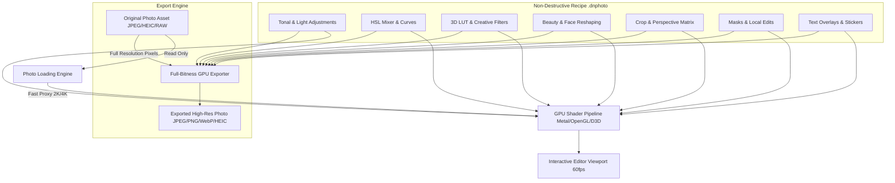

# Danaview 1.3.0: Non-Destructive Photo & Image Editor

> **Release:** Danaview 1.3.0 (app version `1.3.0+N`). **Date:** 2026-10-12. **Status:** Proposal & Architectural Draft.
> **Baseline:** `docs/v1.1/video-editor/ARCHITECTURE.md` (D-01 to D-44), `docs/v1.2/ai-studio/AI_STUDIO_PLAN.md` (D-45 to D-70), `docs/v1.2/editor-desktop/DESKTOP_EDITOR_PLAN.md` (D-71 to D-85), `docs/v1.3/home-photo-video-view/HOME_PHOTO_VIDEO_PLAN.md` (D-86 to D-98), and `docs/v1.3/camera-photo-video/NATIVE_CAMERA_PLAN.md` (D-99 to D-115).
> **Scope:** A professional, non-destructive photo and image editing engine. Reuses Danaview's existing GPU shader pipeline, 3D LUT engine, and typography engine. Features pro tonal adjustments, RGB curves, HSL color mixer, portrait beauty retouching, selective masking, crop/perspective transforms, text overlays, batch processing, and direct integration with the native camera and video editor.
> **Decisions:** Proposes decisions **D-116 to D-130**. Decisions marked **[OWNER]** require confirmation from the product owner.

---

## 0. Contents

1. Executive Summary & Goals
2. Decisions Log (D-116 to D-130)
3. Architecture & Non-Destructive Pipeline
   - 3.1 Non-Destructive Project Model (`.dnphoto`)
   - 3.2 GPU Shader Pipeline Reuse (Color, LUT, Blur, Grain)
   - 3.3 High-Resolution Full-Bitness Render Engine
4. Core Image Editing Capabilities
   - 4.1 Pro Tone & Light Adjustments (Exposure, Contrast, Highlights, Shadows, Whites, Blacks)
   - 4.2 Color Mastery (HSL Mixer, Temperature/Tint, Vibrance, 3D LUTs)
   - 4.3 Curves & Tonal Range (Master RGB, Red, Green, Blue Channels)
   - 4.4 Portrait Beauty & Face Reshaping Integration
   - 4.5 Crop, Straighten & Perspective Keystone Correction
   - 4.6 Selective Masks (Linear, Radial, Brush, Luminance)
   - 4.7 Text Overlays, Stickers, Borders & Typography
   - 4.8 Batch Editing & Preset System
5. Bridge to Camera & Video Editor
6. Platform Matrix & Graceful Degradation
7. Implementation Ticket Breakdown (PHT-01 to PHT-20)

---

## 1. Executive Summary & Goals

### 1.1 Executive Summary

Danaview 1.3.0 establishes complete visual media symmetry by adding a dedicated, non-destructive **Photo Editor**. While v1.1.0 and v1.2.0 delivered a desktop and mobile multi-track video editor, photographers and creators also require precision still-image post-processing.

Rather than building an isolated application, the Photo Editor leverages the architectural foundation already validated in `danaview_editor_core` and `danaview_editor_engine_api`: GPU color grading shaders (D-08), 3D LUT evaluation (D-07 `.vlut`), and rich text rendering (D-05, D-06 `TextLayoutEngine`). Edits are non-destructive, stored in lightweight `.dnphoto` sidecars, and photos can instantly transition into animated clips in the video editor.

### 1.2 Goals

| #        | Goal                                                                                                                                                      | Where Guaranteed       |
| -------- | --------------------------------------------------------------------------------------------------------------------------------------------------------- | ---------------------- |
| **G-P1** | **Strict Non-Destructive Editing**: The original image is never modified, overwritten, or compressed. Edits exist as an undoable command tree and recipe. | ARCH G2, D-116; PHT-01 |
| **G-P2** | **Full-Bitness Pipeline**: 10-bit HDR and 16-bit half-float processing prevents banding across extreme shadow/highlight recovery.                         | D-118; PHT-03          |
| **G-P3** | **Shared Engine Architecture**: 100% code reuse for color math, LUTs, and typography between Photo Editor and Video Editor.                               | D-117; PHT-02          |
| **G-P4** | **Instant Real-Time Feedback**: 60 fps rendering during adjustments on high-resolution 48 MP images via tiled GPU viewport scaling.                       | D-119; PHT-04          |
| **G-P5** | **Batch Productivity**: Copy adjustments from one photo and paste across dozens of photos with background batch export.                                   | D-125; PHT-12          |
| **G-P6** | **Owner Standing UI Compliance**: Figtree typography, custom Danaview controls, computed contrast, zero raw Material widgets.                             | ARCH §1.3; PHT-15      |

---

## 2. Decisions Log (D-116 to D-130)

| ID        | Decision (Summary)                                                                                                    | Owner?      |
| --------- | --------------------------------------------------------------------------------------------------------------------- | ----------- |
| **D-116** | Non-destructive `.dnphoto` project format (single JSON recipe alongside thumbnail cache).                             | –           |
| **D-117** | Engine reuse: Photo Editor executes `danaview_editor_core` visual layer shaders directly on still textures.           | –           |
| **D-118** | Color pipeline: Rec.709 / Display P3 color space with 16-bit float internal precision.                                | –           |
| **D-119** | Viewport rendering: preview operates on screen-resolution GPU mipmaps; export re-evaluates full resolution.           | –           |
| **D-120** | Tone adjustments: Exposure, Contrast, Highlights, Shadows, Whites, Blacks, Clarity, Dehaze, Vignette, Grain.          | –           |
| **D-121** | HSL Color Mixer: 8 independent color bands (Red, Orange, Yellow, Green, Aqua, Blue, Purple, Magenta).                 | –           |
| **D-122** | Tone Curves: Spline-interpolated master RGB, Red, Green, and Blue curves with interactive anchor points.              | –           |
| **D-123** | Portrait retouching: inherits camera's beauty algorithms (face slimming, nose/eye reshaping, skin smoothing).         | **[OWNER]** |
| **D-124** | Crop & Transform: free crop, aspect ratios, horizon leveler, 90° rotation, horizontal/vertical keystone.              | –           |
| **D-125** | Batch processing: copy/paste recipe, batch export to JPEG, PNG, WebP, HEIC with configurable quality.                 | **[OWNER]** |
| **D-126** | Selective masks: Linear gradient, Radial gradient, and Brush masks with independent tone adjustments.                 | –           |
| **D-127** | Typography & overlays: multi-layer text utilizing `FontCatalog` and `TextLayoutEngine`, vector stickers, borders.     | –           |
| **D-128** | Video Editor bridge: "Add to Video Project" turns photo into timeline still with optional Ken Burns pan/zoom.         | –           |
| **D-129** | EXIF & Metadata: preservation of camera metadata (EXIF/IPTC) with optional "Strip Metadata on Export" privacy toggle. | **[OWNER]** |
| **D-130** | Platform capability detection: low-memory devices clamp viewport resolution; unsupported tools hidden.                | –           |

---

## 3. Architecture & Non-Destructive Pipeline



### 3.1 Non-Destructive Project Model (`.dnphoto`)

The `.dnphoto` file format follows the clean architecture established in `ARCHITECTURE.md §8`:

```json
{
  "schema": 1,
  "minReader": 1,
  "source": {
    "uri": "file:///var/mobile/Media/DCIM/100APPLE/IMG_4210.HEIC",
    "fingerprint": "a3f5b9...",
    "width": 4032,
    "height": 3024
  },
  "adjustments": {
    "exposure": 0.35,
    "contrast": 1.1,
    "highlights": -0.2,
    "shadows": 0.15,
    "whites": 0.05,
    "blacks": -0.05,
    "temperature": 5600,
    "tint": 4.0,
    "vibrance": 1.15,
    "saturation": 1.02,
    "clarity": 0.1,
    "dehaze": 0.05,
    "vignette": -0.15,
    "grain": 0.08
  },
  "hsl": {
    "orange": { "hue": -2, "saturation": 5, "luminance": 8 }
  },
  "crop": {
    "rect": [0.05, 0.05, 0.9, 0.9],
    "rotationDegrees": 0.0,
    "flipH": false,
    "flipV": false
  },
  "lutId": "teal_and_orange_cinematic",
  "beauty": {
    "smooth": 0.4,
    "slimming": 0.25,
    "eyeEnlarge": 0.15
  }
}
```

---

## 4. Core Image Editing Capabilities

### 4.1 Pro Tone & Light Adjustments

- **Exposure**: $\pm 5.0$ EV stops in 0.01 EV increments.
- **Contrast**: Symmetric S-curve contrast slider (0.50 to 2.00).
- **Highlights & Shadows**: Targeted smart recovery algorithms preventing highlight clipping and lifting shadow detail without washing out midtones.
- **Whites & Blacks**: Precise clipping-point anchors with visual clipping warnings (blue for crushed blacks, red for blown highlights).
- **Clarity & Texture**: Midtone local contrast enhancement without halos.
- **Dehaze**: Atmospheric scattering subtraction algorithm.

### 4.2 Color Mastery & HSL Mixer

- **White Balance**: Kelvin temperature slider ($2,000\text{ K} - 12,000\text{ K}$) and tint slider (green to magenta).
- **Vibrance**: Non-linear saturation protecting skin tones from over-saturation.
- **8-Channel HSL Mixer**:
  - Independent **Hue** ($\pm 100^\circ$), **Saturation** ($-100$ to $+100$), and **Luminance** ($-100$ to $+100$) for:
    - Red, Orange, Yellow, Green, Aqua, Blue, Purple, Magenta.
  - Interactive Target Adjustment Tool (TAT): drag directly on any pixel in the photo to adjust the hue/saturation of that specific color family.

```
+-------------------------------------------------------------------------------+
|  COLOR MIXER (HSL)                                                [ Done ]    |
+-------------------------------------------------------------------------------+
|  Selected: [🟠 Orange]  (Targeting Skin Tones)                                |
|  Colors:   [🔴] [🟠] [🟡] [🟢] [🔵] [🟣] [🟤] [⚪]                            |
|                                                                               |
|  Hue:         [ - ]=======o===========[ + ]  -4°                              |
|  Saturation:  [ - ]=========o=========[ + ]  +8%                              |
|  Luminance:   [ - ]===========o=======[ + ]  +15%                             |
+-------------------------------------------------------------------------------+
```

### 4.3 Curves & Tonal Range

- Interactive curve graph with histogram underlay.
- Spline interpolation through up to 8 user-placed anchor points.
- Modes: **Combined RGB**, **Red Channel**, **Green Channel**, **Blue Channel**.

### 4.4 Comprehensive Portrait Retouching, Makeup & Body Suite

The Photo Editor embeds the identical high-fidelity beauty, retouching, makeup, and body reshaping engine developed for the Native Camera (`CAM-04`, `CAM-05`, `CAM-06`). While the camera executes these at 60 fps on live video streams, the Photo Editor evaluates them on still photo textures at full sensor bitness (16-bit half-float Display P3 / Rec.709) with sub-pixel deformation precision.

#### 1. Face Shape & Slimming
- **Face Slimming / Narrow Face**: Symmetrical radial contraction narrowing full facial width while keeping ear and neck contours natural.
- **V-Shaped Face**: Contours the lower jaw angle progressively toward the chin apex.
- **Jawline Sharpening**: Localized edge-contrast enhancement and contour lifting along the mandible.
- **Chin Slimming & Shortening**: Independent dual-axis chin adjustments—narrow width, shorten/lengthen height, and sharpen apex.
- **Forehead Width & Height Adjustment**: Hairline repositioning and temporal curve narrowing to balance classical facial proportions.
- **Lower-Face Slimming**: Targeted volume reduction around the lower cheeks, jowls, and corners of the mouth.
- **Cheekbone Enhancement**: Softens overly angular zygomatic arches or adds chiseled high-cheekbone definition.
- **Face Symmetry Correction**: Real-time landmark mirror balancing correcting natural tilt or asymmetric expression planes.
- **Overall Face Reshape**: Master proportional scaling aligning upper, middle, and lower facial thirds to Golden Ratio aesthetics.

#### 2. Eyes & Eyebrows
- **Eye Enlargement**: Iris-centered radial magnification preserving natural eyelid curvature without fisheye distortion.
- **Eye Shape & Angle Adjustment**: Inner/outer canthus angle control (fox-eye lift, rounded doe-eye, subtle almond contouring).
- **Eye Spacing & Positioning**: Inter-ocular distance expansion/contraction and vertical orbital elevation.
- **Eye Brightening**: Sclera luminance lifting with specular highlight boost creating vivid, glistening catchlights.
- **Dark-Circle & Eye-Bag Removal**: Non-destructive micro-contrast smoothing and blue/purple chroma neutralization under the lower lid.
- **Eyebrow Thickness, Shape & Positioning**: Arch height, tail angle, brow thickness, and vertical brow-to-eye spacing.
- **Eyelash Enhancement**: Procedural lash volume thickening, length extension, and curl rendering along upper and lower lashlines.

#### 3. Nose & Lips
- **Nose Slimming & Narrowing**: Lateral nasal bridge compression and alar flare reduction.
- **Nose Length & Bridge Adjustment**: Nasal bridge height sculpting, dorsal hump smoothing, and vertical nose length tuning.
- **Nose-Tip Reshaping**: Precision spherical scaling (refine bulbous tips, lift drooping tips, sharpen columella).
- **Lip Enlargement & Resizing**: Volumetric upper/lower lip plumping with independent vermilion border definition.
- **Lip Shape & Thickness Adjustment**: Cupid's bow contouring, lip corner elevation, and upper-to-lower fullness ratio tuning.
- **Smile Adjustment**: Bilateral oral commissure lift creating a natural, pleasant smile with subtle cheek lift.

#### 4. Skin Retouching
- **Skin Smoothing**: Multi-frequency domain-transform filtering eliminating pores, roughness, and blemishes while preserving authentic skin texture, eyebrows, and hair.
- **Acne & Blemish Removal**: Precision patch inpainting brush and automated neural spot removal.
- **Dark-Spot Removal**: Melanin-selective desaturation fading freckles, sunspots, and hyperpigmentation.
- **Skin Tone & Brightness Adjustment**: Tone shifting across porcelain, warm honey, bronze, olive, and deep rich palettes.
- **Oiliness Reduction (Anti-Shine)**: Specular highlight attenuation on the T-zone, forehead, and nose tip yielding a velvety matte complexion.
- **Wrinkle Softening**: Micro-contrast attenuation fading forehead furrows, laugh lines, and periorbital crow's feet.
- **Natural Glow**: Diffuse subsurface-scattering simulation introducing soft, youthful vitality and dewy skin luster.
- **Teeth Whitening**: Selective dental enamel brightening with blue-tinted chroma desaturation targeting the mouth opening.

#### 5. Makeup & Appearance
- **Foundation & Concealer**: Flawless skin tint matching with customizable coverage opacity and satin/matte finish.
- **Lipstick**: Matte, gloss, velvet, and ombré finishes across hundreds of curated shades with feathering controls.
- **Blush & Contour**: Anatomical blush placement on cheek apples paired with 3D shadow contouring along the jaw and nose bridge.
- **Eyeliner & Eyeshadow**: Winged, tightline, and smokey liner styles paired with multi-gradient eyeshadow blends.
- **Virtual Colored Contact Lenses**: Procedural iris overlays with realistic pupil apertures and light reflections.
- **Hair Color & Hairstyle Effects**: Intelligent hair strand segmentation with vibrant or natural color tinting.
- **Freckles & Beauty Marks**: Authentic aesthetic freckle scattering and placement of customizable beauty marks.

#### 6. Body Slimming & Proportions
- **Body Reshaping**: Full-body silhouette mesh deformation with smart background-preservation pinning.
- **Waist Slimming**: Bilateral torso contraction accentuating a balanced, natural waistline.
- **Arm & Leg Slimming**: Targeted cylindrical deformation reducing upper arm girth, thigh fullness, and calf width.
- **Hip & Shoulder Adjustments**: Shoulder broadening/softening and hip curve contouring.
- **Leg-Length Adjustment**: Lower-body elongation anchored to floor plane for statuesque proportions.
- **Height & Body-Proportion Correction**: Head-to-body proportion tuning and posture realignment.

#### 7. Filters, Masks & Effects
- **Real-Time Beauty Filters**: Natural, Soft, Glam, Vintage 35mm, Pastel, and Cinematic portrait color profiles.
- **Background Blur & Portrait Bokeh**: Realistic synthetic depth-of-field bokeh ($f/1.4$ to $f/16$) with customizable aperture blades.
- **AR Masks & Stickers**: 3D face-anchored vector stickers, glasses, headbands, and decorative frames.
- **Photo & Video Retouching Cohesion**: Shared `.dnphoto` and `.dnproj` beauty shader contracts guarantee identical output across still photos and video clips.
- **Before-and-After Comparison**: Split-screen slider and instant press-to-hold unretouched toggle.
- **Adjustable Intensity**: Universal master intensity (0–100%) and independent parameter sliders.
- **Undo, Redo & Reset**: Full history stack for all facial and body modifications.

#### 8. Advanced Intelligence & Automation
- **AI Face Detection & Facial Landmarks**: High-precision 468-point 3D mesh detection with multi-face detection (select and beautify individual subjects).
- **Automatic Face Enhancement**: One-tap smart beautification analyzing skin tone and facial balance for instant, natural results.
- **Manual Precision Sliders**: High-precision numeric inputs for meticulous creator control.
- **Full Sensor HD Export**: Full-resolution export preserving native 48 MP / 100 MP detail without downsampling.
- **Preset Styles & User Recipes**: Curated style presets ("Natural Glow", "Editorial Chic", "Sunset Warmth", "Clean Beauty") and custom recipe saving.

```
+---------------------------------------------------------------------------------------------------+
|  PHOTO EDITOR BEAUTY & RETOUCHING SUITE                                          [ Before / After ]|
+---------------------------------------------------------------------------------------------------+
|  [ Face Shape ]  [ Eyes/Brows ]  [ Nose/Lips ]  [ Skin ]  [ Makeup ]  [ Body ]  [ Filters ]  [ Presets ]
+---------------------------------------------------------------------------------------------------+
|  Active Subject: Face 1 of 2 [Next Subject >]                        Master Intensity: [===o==] 70%|
|                                                                                                   |
|  Face Slimming:    [ - ]======o===========[ + ] 50%    Skin Smoothing:    [ - ]=======o========[ + ] 60%  |
|  V-Line Jaw:       [ - ]====o=============[ + ] 40%    Blemish Removal:   [ - ]=========o======[ + ] 80%  |
|  Chin Length/Slim: [ - ]===o==============[ + ] 30%    Teeth Whitening:   [ - ]========o=======[ + ] 75%  |
|  Eye Enlarge:      [ - ]===o==============[ + ] 35%    Lipstick (Gloss):  [ - ]=====o==========[ + ] 50%  |
|  Eye Brighten:     [ - ]=====o============[ + ] 55%    Waist Slimming:    [ - ]====o===========[ + ] 40%  |
|  Nose Slimming:    [ - ]====o=============[ + ] 45%    Leg Length:        [ - ]===o============[ + ] 25%  |
+---------------------------------------------------------------------------------------------------+
|  [ 🔄 Reset Section ]                         [ 💾 Save Preset ]                     [ ✨ Auto Enhance ]|
+---------------------------------------------------------------------------------------------------+
```

### 4.5 Crop, Straighten & Perspective Keystone

- **Aspect Ratios**: Original, Freeform, 1:1, 4:5 (Instagram), 9:16 (Stories), 16:9, 3:2, 4:3, 2.39:1 Cinema.
- **Auto-Straighten**: Detects horizon tilt using embedded gyro sensor metadata or line detection.
- **Perspective Keystone**: Horizontal and vertical keystone correction for architecture and flat-lay photography.

### 4.6 Selective Masks & Local Adjustments

- **Mask Types**:
  - **Linear Gradient**: Graduated density filter for skies and landscapes.
  - **Radial Gradient**: Vignettes, spotlights, and subject highlighting.
  - **Brush Mask**: Freehand painting with soft edge feathering.
  - **Luminance Mask**: Isolates specific brightness ranges.
- **Local Overrides**: Masks allow localized adjustments to Exposure, Contrast, Warmth, Saturation, and Sharpness.

### 4.7 Text Overlays, Typography & Stickers

- Uses `TextLayoutEngine` from `danaview_editor_engine_api`:
  - Access to full bundled `FontCatalog` (Figtree, Outfit, Roboto, plus user-imported `.ttf`/`.otf` fonts).
  - Multi-line text with letter spacing, line height, drop shadows, outlines, and color fills.
  - Vector stickers, location tags, date stamps, and decorative film frames.

### 4.8 Batch Editing & Presets

- **Presets**: Save any combination of adjustments, curves, HSL, and LUT into reusable presets stored in local JSON storage (`D-62`).
- **Copy & Paste Edits**: Copy adjustments from one image and paste across hundreds of selected photos in the Home Screen grid.
- **Batch Export**: Configurable dimensions, format (JPEG, PNG, WebP, HEIC), quality compression slider, and optional EXIF privacy stripping.

---

## 5. Bridge to Camera & Video Editor

1. **Camera Handoff**: Photos captured in the Native Camera feature an immediate "Edit" button that transitions into the Photo Editor with zero file copy overhead.
2. **Video Editor Timeline Integration**:
   - Tapping **"Add to Video Project"** exports the edited photo directly onto a video track in the active `.dnproj`.
   - Automatically assigns a 3.0-second clip duration with optional Ken Burns pan-and-zoom animation preset.

---

## 6. Platform Matrix & Graceful Degradation

| Feature                 | iOS / iPadOS     | Android             | macOS            | Windows       | Linux               |
| ----------------------- | ---------------- | ------------------- | ---------------- | ------------- | ------------------- |
| **Tone & Color Engine** | Metal (Instant)  | OpenGL ES / Vulkan  | Metal (Instant)  | Direct3D 11   | OpenGL / CPU        |
| **Face Reshaping**      | Vision + Metal   | MediaPipe + GL      | Vision + Metal   | DirectML / GL | CPU / GL            |
| **RAW File Decoding**   | Apple RAW engine | DNG / Media3        | Apple RAW engine | Windows WIC   | LibRaw / FFmpeg     |
| **Blemish Healing**     | GPU Poisson      | GPU Poisson         | GPU Poisson      | GPU Direct3D  | CPU fallback        |
| **Batch Export**        | Hardware ImageIO | MediaCodec / Bitmap | Hardware ImageIO | WIC HW encode | libjpeg-turbo / PNG |

---

## 7. Implementation Ticket Breakdown (PHT-01 to PHT-20)

| Ticket     | Scope & Summary                                                                                 | Depends On          |
| ---------- | ----------------------------------------------------------------------------------------------- | ------------------- |
| **PHT-01** | Create `.dnphoto` project domain model, JSON codec, and migration handler.                      | Core                |
| **PHT-02** | Adapt `danaview_editor_engine_api` GPU shader graph for still-image texture processing.         | v1.1 Engine         |
| **PHT-03** | Implement 16-bit float high-bitness rendering pipeline with Display P3 support.                 | PHT-02              |
| **PHT-04** | Develop interactive viewport renderer with smooth pan and pinch-to-zoom at 60 fps.              | PHT-02              |
| **PHT-05** | Build Pro Tone adjustment sliders (Exposure, Contrast, Highlights, Shadows, Whites, Blacks).    | PHT-02              |
| **PHT-06** | Implement 8-channel HSL Color Mixer with on-image Target Adjustment Tool (TAT).                 | PHT-05              |
| **PHT-07** | Build Spline RGB and individual color channel curves widget and shader evaluator.               | PHT-05              |
| **PHT-08** | Integrate portrait beauty retouching algorithms (face slimming, nose/eye reshaping, smoothing). | CAM-05, PHT-02      |
| **PHT-09** | Build blemish removal healing brush with Poisson blend interpolation.                           | PHT-08              |
| **PHT-10** | Implement Crop, Horizon Leveler, Rotation, and Keystone perspective correction matrix.          | PHT-04              |
| **PHT-11** | Develop Selective Masking engine (Linear Gradient, Radial Gradient, Brush Mask).                | PHT-05              |
| **PHT-12** | Implement Text Overlay and typography editor using `FontCatalog` and `TextLayoutEngine`.        | AIS-22, PHT-04      |
| **PHT-13** | Build Preset management system (saving, applying, exporting preset recipes).                    | PHT-05              |
| **PHT-14** | Implement Copy/Paste adjustments and batch photo exporter.                                      | PHT-13, HOM-08      |
| **PHT-15** | Design and build Photo Editor UI compliant with Owner standing UI rules.                        | ARCH §1.3           |
| **PHT-16** | Build "Add to Video Project" bridge with automated Ken Burns animation.                         | PHT-01, v1.1 Editor |
| **PHT-17** | Implement EXIF metadata viewer and export privacy stripping toggle.                             | PHT-01              |
| **PHT-18** | High-resolution export engine (JPEG, PNG, WebP, HEIC with quality sliders).                     | PHT-03              |
| **PHT-19** | Memory stress test on 48 MP and 100 MP camera images across low-RAM devices.                    | PHT-04              |
| **PHT-20** | Golden image parity test suite comparing desktop vs mobile photo exports.                       | PHT-18              |
