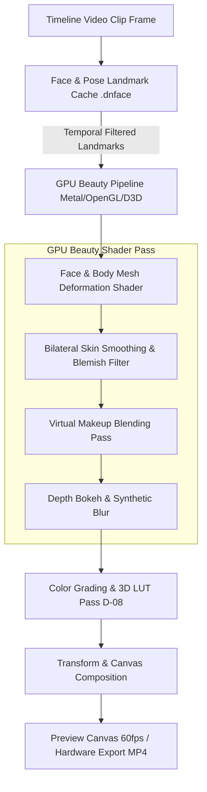

# Danaview 1.3.0: Video Editor Updates (Beauty, Face Reshaping, Makeup, Body Slimming & Retouching)

> **Release:** Danaview 1.3.0 (app version `1.3.0+N`). **Date:** 2026-10-12. **Status:** Proposal & Architectural Draft.
> **Baseline:** `docs/v1.1/video-editor/ARCHITECTURE.md` (decisions D-01 to D-44), `docs/v1.2/editor-desktop/DESKTOP_EDITOR_PLAN.md` (decisions D-71 to D-85), `docs/v1.3/camera-photo-video/NATIVE_CAMERA_PLAN.md` (D-99 to D-115), and `docs/v1.3/photo-editor/PHOTO_EDITOR_PLAN.md` (D-116 to D-130).
> **Scope:** Extends the Danaview Multi-Track Video Editor to integrate the complete 8-category Beauty, Face Reshaping, Virtual Makeup, Body Slimming, and AI Retouching Suite directly into the timeline editing and export pipeline across mobile and desktop.
> **Decisions:** Proposes decisions **D-131 to D-145**. Decisions marked **[OWNER]** require confirmation from the product owner.

---

## 0. Contents

1. Executive Summary & Goals
2. Decisions Log (D-131 to D-145)
3. Architecture & RenderPlan Pipeline Integration
   - 3.1 Timeline Clip Effect Lowering (`BeautyEffectSpec` & Layer Shader Order)
   - 3.2 Real-Time Face Mesh Tracking on Moving Video (Temporal Smoothing)
   - 3.3 Keyframing & Automation of Beauty Parameters
4. Comprehensive 8-Category Video Retouching Suite
   - 4.1 Face Shape & Slimming
   - 4.2 Eyes & Eyebrows
   - 4.3 Nose & Lips
   - 4.4 Skin Retouching
   - 4.5 Virtual Makeup & Appearance
   - 4.6 Body Slimming & Proportions
   - 4.7 Video Filters & Cinematic Portrait Bokeh
   - 4.8 Advanced Tracking, Multi-Subject Support & Automation
5. Video Editor UX & Inspector Integration
6. Platform Capability Matrix & Performance Optimization
7. Implementation Ticket Breakdown (VED-01 to VED-18)

---

## 1. Executive Summary & Goals

### 1.1 Executive Summary
In Danaview 1.1.0 and 1.2.0, the Video Editor established multi-track timeline editing, color grading, 3D LUTs (`.vlut`), text overlays, and AI subtitles. Danaview 1.3.0 elevates the video editor by bringing the **complete 8-category Beauty, Face Reshaping, Virtual Makeup, Body Slimming, and AI Retouching Suite** directly to video timeline clips.

Creators can now apply facial slimming, skin smoothing, blemish healing, eye enlargement, makeup styling, and body proportion corrections not just to live camera recordings and photos, but to **any video clip on the timeline**, complete with temporal landmark tracking, multi-subject detection, and keyframe automation.

### 1.2 Goals

| # | Goal | Where Guaranteed |
|---|---|---|
| **G-V1** | **Temporal Consistency**: Zero flickering or mesh jitter on moving subjects across frame boundaries via Kalman/One-Euro landmark filtering. | D-132; VED-03 |
| **G-V2** | **Multi-Subject Tracking**: Detect, isolate, and independently beautify up to 4 individual faces within the same video clip. | D-133; VED-05 |
| **G-V3** | **Keyframe Automation**: Animate any beauty parameter over time (e.g., transition from natural to glam) using linear/bezier keyframe curves. | D-134; VED-06 |
| **G-V4** | **Hardware Accelerated Export**: Retouching pipeline evaluates in real time during timeline scrub and exports at full 4K 60fps via native GPU encoders. | D-131, D-135; VED-14 |
| **G-V5** | **Strict Non-Destructive Invariance**: Original source video files are never modified; beauty effects exist as parametric metadata in `.dnproj`. | ARCH G2, D-136; VED-01 |

---

## 2. Decisions Log (D-131 to D-145)

| ID | Decision (Summary) | Owner? |
|---|---|---|
| **D-131** | Beauty effect placement in D-08 effect order: crop → chroma key → **beauty/mesh deformation** → grade → LUT → blur → place. | – |
| **D-132** | Temporal landmark stabilization: One-Euro filter smoothing 468 3D facial landmarks to eliminate inter-frame mesh jitter. | – |
| **D-133** | Multi-face track management: persistent Face IDs assigned per clip; independent beauty parameter sets per subject. | **[OWNER]** |
| **D-134** | Keyframable beauty channels: all numeric beauty sliders support timeline keyframes with interpolation. | – |
| **D-135** | Background landmark pre-caching: background isolate pre-tracks video landmarks, storing compact vector caches (`.dnface`). | – |
| **D-136** | Project schema update: `.dnproj` schema 3 introduces `BeautyEffectSpec` within visual clip effect lists. | – |
| **D-137** | Full 8-category beauty parity with Camera and Photo Editor across all supported desktop and mobile platforms. | – |
| **D-138** | Body slimming mesh segmentation: pose estimation with background-preservation constraint preventing background warping. | **[OWNER]** |
| **D-139** | Inspector UI integration: dedicated "Beauty & Retouching" tab in clip inspector alongside Transform, Color, and Audio. | – |
| **D-140** | Split-screen Before/After preview on video timeline canvas with draggable comparison divider. | – |
| **D-141** | Presets & copy/paste attributes: copy beauty recipe from one clip and paste onto multiple timeline clips. | – |
| **D-142** | Real-time proxy playback: low-tier devices execute beauty shaders on half-resolution proxies during interactive playback. | – |
| **D-143** | Offline & privacy guarantee: 100% on-device neural landmark models; zero external API or cloud calls. | AIS G-S1 |
| **D-144** | Selective bypass toggle: per-category and master beauty bypass switches for instant A/B performance testing. | – |
| **D-145** | Standing UI compliance: custom Danaview controls, Figtree typography, dark UI, computed contrast $\ge 4.5:1$. | ARCH §1.3 |

---

## 3. Architecture & RenderPlan Pipeline Integration



### 3.1 RenderPlan Layer Lowering & Effect Order
In Danaview's lowered RenderPlan architecture (D-01, D-08), beauty operations are inserted directly before color grading and 3D LUT evaluation:
$$\text{Source Frame} \longrightarrow \text{Crop} \longrightarrow \text{Chroma Key} \longrightarrow \mathbf{Beauty\ \&\ Deformation} \longrightarrow \text{Grade} \longrightarrow \text{LUT} \longrightarrow \text{Blur} \longrightarrow \text{Transform}$$
By executing mesh deformation and skin smoothing before color grading and LUT application, virtual makeup and skin smoothing integrate seamlessly with the project's overall color palette.

### 3.2 Temporal Landmark Stabilization
Real-time tracking on video clips must account for rapid head movement, camera shake, and lighting shifts:
- **One-Euro Filter**: Adapts cutoff frequency dynamically based on velocity, eliminating jitter during static dialogue while reacting instantaneously to rapid head turns.
- **Occlusion Recovery**: When a hand or object briefly occludes a face, the beauty mesh smoothly fades out over 3 frames rather than snapping or glitching.

---

## 4. Comprehensive 8-Category Video Retouching Suite

The video editor provides full parity with the camera and photo editor across all 8 beauty categories:

### 4.1 Face Shape & Slimming
- **Face Slimming / Narrow Face**: Symmetrical radial contraction narrowing facial width on moving subjects.
- **V-Shaped Face**: Lower-jaw contouring tapering progressively toward the chin apex.
- **Jawline Sharpening**: Enhanced edge contrast defining the mandibular border across camera angles.
- **Chin Slimming & Shortening**: Independent dual-axis chin adjustments (width, vertical height, apex sharpness).
- **Forehead Width & Height Adjustment**: Hairline translation and temporal curve scaling.
- **Lower-Face Slimming**: Targeted volume reduction around lower cheeks and mouth corners.
- **Cheekbone Enhancement**: Soften prominent zygomatic arches or sculpt chiseled cheek definition.
- **Face Symmetry Correction**: Dynamic balancing correcting natural facial tilt or asymmetric expressions.
- **Overall Face Reshape**: Master Golden Ratio proportion scaling.

### 4.2 Eyes & Eyebrows
- **Eye Enlargement**: Iris-centered radial magnification preserving natural eyelid movement and blinks.
- **Eye Shape & Angle Adjustment**: Canthus angle control (cat-eye lift, doe-eye tilt, aperture rounding).
- **Eye Spacing & Positioning**: Interpupillary distance tuning and vertical orbital elevation.
- **Eye Brightening**: Sclera brightening and specular reflection boost tracking eye movement.
- **Dark-Circle & Eye-Bag Removal**: Non-destructive micro-contrast smoothing under the lower lid.
- **Eyebrow Thickness, Shape & Positioning**: Arch height, tail angle, thickness, and vertical placement.
- **Eyelash Enhancement**: Procedural lash volume thickening and curl rendering.

### 4.3 Nose & Lips
- **Nose Slimming & Narrowing**: Lateral nasal bridge compression and alar flare reduction.
- **Nose Length & Bridge Adjustment**: Nasal bridge height sculpting and vertical nose length tuning.
- **Nose-Tip Reshaping**: Precision spherical scaling (refine bulbous tips, lift drooping tips).
- **Lip Enlargement & Resizing**: Volumetric upper/lower lip plumping tracking speech movement.
- **Lip Shape & Thickness Adjustment**: Cupid's bow contouring, corner elevation, and fullness ratio tuning.
- **Smile Adjustment**: Bilateral oral commissure lift creating a natural, joyful smile during dialogue.

### 4.4 Skin Retouching
- **Skin Smoothing**: Multi-frequency domain-transform filtering eliminating pores while preserving hair and eyes.
- **Acne & Blemish Removal**: Precision patch inpainting tracking moving skin surfaces.
- **Dark-Spot Removal**: Melanin-selective desaturation fading freckles and hyperpigmentation.
- **Skin Tone & Brightness Adjustment**: Tone shifting across porcelain, warm honey, bronze, and deep rich palettes.
- **Oiliness Reduction (Anti-Shine)**: Specular highlight attenuation on the T-zone and forehead.
- **Wrinkle Softening**: Micro-contrast attenuation fading forehead lines and crow's feet.
- **Natural Glow**: Diffuse subsurface-scattering simulation introducing soft, youthful vitality.
- **Teeth Whitening**: Dental enamel brightening with blue-tinted chroma desaturation during speech.

### 4.5 Virtual Makeup & Appearance
- **Foundation & Concealer**: Flawless skin tint matching with customizable coverage opacity.
- **Lipstick**: Matte, gloss, velvet, and ombré finishes tracking lip contours during video speech.
- **Blush & Contour**: Anatomical blush placement on cheek apples paired with 3D jaw/nose shadow contouring.
- **Eyeliner & Eyeshadow**: Winged and smokey liner styles paired with multi-gradient eyeshadow blends.
- **Virtual Colored Contact Lenses**: Procedural iris overlays with natural pupil dilation.
- **Hair Color & Hairstyle Effects**: Intelligent hair strand segmentation with natural or vibrant color tinting.
- **Freckles & Beauty Marks**: Authentic aesthetic freckle scattering and customizable beauty marks.

### 4.6 Body Slimming & Proportions
- **Body Reshaping**: Full-body skeletal tracking adjusting silhouette contours across video movement.
- **Waist Slimming**: Bilateral torso contraction accentuating a natural waistline with background-anchoring protection.
- **Arm & Leg Slimming**: Targeted cylindrical deformation reducing upper arm girth and leg fullness.
- **Hip & Shoulder Adjustments**: Shoulder broadening/softening and hip curve contouring.
- **Leg-Length Adjustment**: Lower-extremity vertical stretching anchored to ground plane.
- **Height & Body-Proportion Correction**: Head-to-body proportion tuning and posture alignment.

### 4.7 Video Filters & Cinematic Portrait Bokeh
- **Real-Time Video Beauty Filters**: Natural, Soft, Glam, Vintage 35mm, Pastel, and Cinematic portrait profiles.
- **Dynamic Background Blur (Portrait Bokeh)**: Synthetic depth-of-field blur ($f/1.4$ to $f/16$) with edge feathering.
- **AR Masks & Stickers**: 3D face-anchored vector stickers and aesthetic video overlays.
- **Before-and-After Comparison**: Interactive split-screen slider on timeline preview canvas.
- **Adjustable Intensity**: Universal master intensity (0–100%) plus granular per-feature micro-sliders.
- **Undo, Redo & Reset**: Full history integration with timeline undo stack (`Cmd/Ctrl+Z`).

### 4.8 Advanced Tracking, Multi-Subject Support & Automation
- **AI Face Detection & Facial Landmarks**: High-precision 468-point 3D tracking under extreme angles ($\pm 60^\circ$).
- **Multi-Subject Selection**: Tag and configure beauty parameters independently for up to 4 subjects in a frame.
- **Automatic Video Face Enhancement**: One-tap smart beautification analyzing lighting and facial structure.
- **Timeline Keyframing**: Animate any beauty parameter over time with linear and bezier easing curves.
- **Full 4K Video Export**: Hardware-accelerated GPU export pipeline maintaining pristine master quality.
- **Save Custom Presets**: Save and reuse video beauty recipes across different project timelines.

---

## 5. Video Editor UX & Inspector Integration

```
+---------------------------------------------------------------------------------------------------+
|  CLIP INSPECTOR: Video Clip 1 (00:02:14 - 00:08:30)                              [ Compare Split ]|
+---------------------------------------------------------------------------------------------------+
|  [ Transform ]   [ Color & LUT ]   [ 💄 Beauty & Retouch ]   [ Audio ]   [ Speed ]   [ Keyframes ]    |
+---------------------------------------------------------------------------------------------------+
|  Master Beauty: [ ON ]                                               Intensity: [====o===] 75%    |
|  Active Subject: Face 1 (Main Actor) [ + Track Face 2 ]              Temporal Smoothing: [ High v]|
|                                                                                                   |
|  [ Face Shape ]  [ Eyes/Brows ]  [ Nose/Lips ]  [ Skin ]  [ Makeup ]  [ Body ]  [ Filters ]  [ Presets ]
|                                                                                                   |
|  Face Slimming:    [ - ]======o===========[ + ] 55%  [◇]  Skin Smoothing:   [ - ]=======o========[ + ] 65% [◇]
|  V-Shape Jaw:      [ - ]====o=============[ + ] 40%  [◇]  Blemish Healing:  [ - ]=========o======[ + ] 85% [◇]
|  Chin Slim/Length: [ - ]====o=============[ + ] 35%  [◇]  Dark Circles:     [ - ]=======o========[ + ] 60% [◇]
|  Eye Enlarge:      [ - ]===o==============[ + ] 30%  [◇]  Teeth Whitening:  [ - ]========o=======[ + ] 75% [◇]
|  Nose Slimming:    [ - ]====o=============[ + ] 42%  [◇]  Lipstick (Matte): [ - ]=====o==========[ + ] 45% [◇]
|  Waist Slimming:   [ - ]====o=============[ + ] 38%  [◇]  Leg Length:       [ - ]===o============[ + ] 25% [◇]
+---------------------------------------------------------------------------------------------------+
|  [ 🔄 Reset Beauty ]             [ 📋 Copy Attributes ]             [ 💾 Save Beauty Preset ]     |
+---------------------------------------------------------------------------------------------------+
```

---

## 6. Platform Capability Matrix & Performance Optimization

| Feature | iOS / iPadOS | Android | macOS | Windows | Linux |
|---|---|---|---|---|---|
| **Video Beauty Shader** | Metal Pipeline | OpenGL ES 3.2 / Vulkan | Metal Pipeline | Direct3D 11 HLSL | OpenGL / Vulkan |
| **Landmark Tracking** | Apple Vision | MediaPipe FaceMesh | Apple Vision | DirectML / ONNX | ONNX Runtime |
| **Temporal Smoothing** | One-Euro Filter | One-Euro Filter | One-Euro Filter | One-Euro Filter | One-Euro Filter |
| **Multi-Face Video** | Up to 4 faces | Up to 4 faces | Up to 4 faces | Up to 4 faces | Up to 4 faces |
| **4K 60fps Video Export**| VideoToolbox HW | MediaCodec HW | VideoToolbox HW | MFT (NVENC/QSV/AMF)| VA-API / NVENC |

---

## 7. Implementation Ticket Breakdown (VED-01 to VED-18)

| Ticket | Scope & Summary | Depends On |
|---|---|---|
| **VED-01** | Create `BeautyEffectSpec` in `danaview_editor_core` and update `.dnproj` schema to version 3. | CORE-03, PHT-01 |
| **VED-02** | Implement D-131 effect order: insert GPU beauty deformation passes prior to color grading. | API-04, CAM-05 |
| **VED-03** | Develop temporal One-Euro landmark stabilization filter to eliminate inter-frame mesh jitter. | CAM-04 |
| **VED-04** | Build background video landmark pre-tracker isolate and `.dnface` caching service. | VED-03 |
| **VED-05** | Implement multi-subject face detection and independent Face ID parameter management. | VED-03 |
| **VED-06** | Wire timeline keyframe animation system for all numeric beauty parameters. | VED-01, CORE-19 |
| **VED-07** | Implement real-time facial slimming, V-line jaw, and chin deformation shaders for video clips. | VED-02 |
| **VED-08** | Implement video eye enlargement, canthus tilt, and eye brightening shaders. | VED-02 |
| **VED-09** | Implement video nose slimming, bridge elevation, and lip plumping shaders. | VED-02 |
| **VED-10** | Implement video skin smoothing, blemish healing, and teeth whitening shaders. | VED-02 |
| **VED-11** | Build virtual makeup shader passes (foundation, lipstick, blush, contour, eyeliner). | VED-02 |
| **VED-12** | Implement video body reshaping, waist slimming, and leg length adjustment shaders. | VED-02 |
| **VED-13** | Design and build "Beauty & Retouching" inspector panel in `danaview_editor` UI kit. | ARCH §1.3, VED-01 |
| **VED-14** | Implement split-screen Before/After preview divider on video canvas. | VED-13 |
| **VED-15** | Build beauty preset management and copy/paste attributes for timeline video clips. | VED-01 |
| **VED-16** | Hardware export verification: validate real-time 4K 60fps rendering with full beauty passes. | VED-02, DSK-06 |
| **VED-17** | Memory and performance benchmarking on low-RAM mobile and desktop devices. | VED-16 |
| **VED-18** | Automated parity test suite: verify identical beauty rendering between video editor and camera. | VED-16 |
